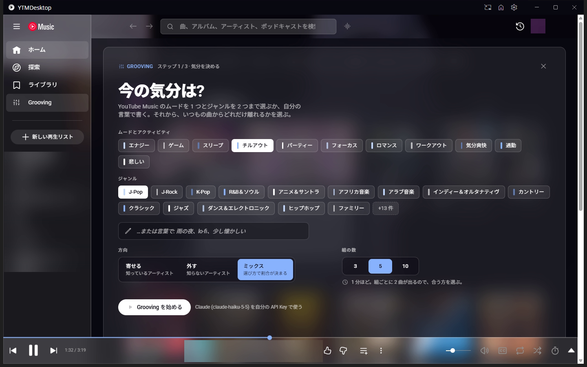
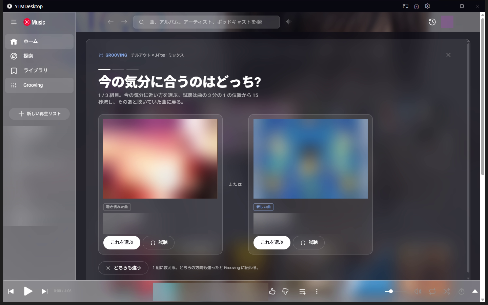
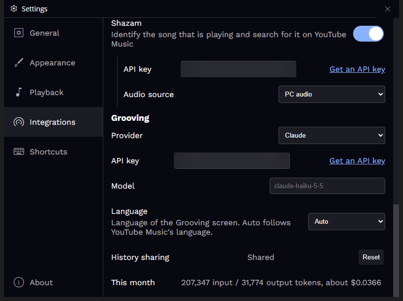
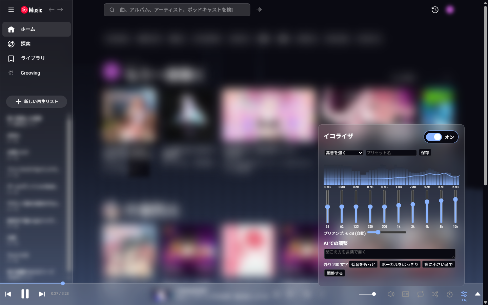
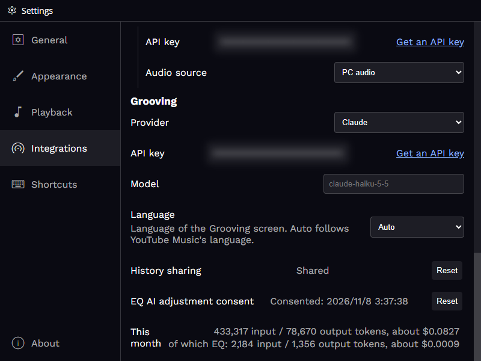

# YouTube Music Desktop App (reeschan fork)

[日本語](#日本語) | [English](#english)


---

## 日本語

このリポジトリは [ytmdesktop/ytmdesktop](https://github.com/ytmdesktop/ytmdesktop) の個人用の fork です。
アプリの機能・ダウンロード・開発環境の作り方・ビルドの手順は、本家の README を参照してください。

- 本家の README: <https://github.com/ytmdesktop/ytmdesktop#readme>
- 本家のリリース: <https://github.com/ytmdesktop/ytmdesktop/releases>

この fork は、本家の v2.0.12 をもとに、本家のコードを改変しています (2026-11-08 更新、reeschan)。改変したのは下の 6 つの機能と「そのほかの変更」、それに伴う設定・ビルドの変更です。いつ何を変えたかは「[変更履歴](#変更履歴)」に、ファイルごとの変更はコミットの履歴にあります。ライセンスは本家と同じ [GPL-3.0](LICENSE) です。本家とは関係のない非公式の fork です。YouTube と YouTube Music は Google LLC の商標です。Shazam は Apple Inc. の商標です。Gemini は Google LLC の、Claude は Anthropic PBC の、OpenAI は OpenAI の商標です。

この fork では、次の 6 つの機能を足しています。

### 1. テーマ

設定の **Appearance → Theme** で、アプリ全体の配色を選べます。アプリの画面 (タイトルバー・設定・ミニプレイヤーなど) と YouTube Music の画面の両方に、同じ色が当たります。切り替えは再起動なしで、すぐ反映されます。

- 同梱のテーマ: **Default** (元の見た目)、**Midnight** (紺)、**Forest** (深緑)、**Glass** (すりガラス、既定)、**Jacket** (再生中の曲のジャケットの色)
- **Glass** は、ナビバー・サイドバー・プレイヤーバー・メニューの後ろをぼかし、背景動画が面の後ろにうっすら透けます
- **Jacket** は、再生中の曲のジャケットから色を作ります。曲が変わると、色が 0.6 秒かけて移ります (OS で動きを減らす設定にしているときは、移さずに切り替えます)。ジャケットの画像は YouTube の画像のサーバーから読みます
- **Theme file** を選ぶと、自分で書いたテーマファイル (CSS) を使えます

| Midnight | Forest |
|---|---|
|  |  |


テーマファイルには、6 つの色項目を CSS 変数で書きます。

```css
:root {
  --ytmd-color-background: #0b1020; /* 背景 */
  --ytmd-color-surface: #161d33;    /* 面 (カード・メニュー・プレイヤーバー) */
  --ytmd-color-text: #e6e9f2;       /* 文字 */
  --ytmd-color-text-muted: #9aa3bd; /* 控えめな文字 */
  --ytmd-color-accent: oklch(0.72 0.12 260); /* アクセント (スイッチ・スライダー・シークバー) */
  --ytmd-color-border: #263052;     /* 枠線 */
}
```

- 色は、16 進・`rgb()`・`hsl()`・`oklch()` などの関数・名前付きの色で書けます (Tailwind v4 の `oklch` の色もそのまま使えます)。
- 面のぼかしは `--ytmd-surface-blur: 20px;` のように書けます (0〜40px、書かなければ 0 でぼかさない)。
- 書いていない項目や読めない値には、Default の色を使います。どの項目が読めなかったかは、設定画面に出ます。
- ファイルを保存し直すと、すぐ反映されます。
- カスタム CSS は、テーマの後に当たります。テーマの一部を上書きできます。
- 危険・エラー・成功を表す色は、テーマに関わらず固定です。
- アプリの画面は Tailwind v4 (prefix `tw:`) で、`tw:bg-ytmd-surface` のようにテーマの色を使っています。

### 2. 背景動画

設定の **Appearance → Background video** で、メインウィンドウの背景全体に映像を流せます (既定でオン)。**Source** で、何を流すかを選びます。

- **Playing video** (既定): YouTube Music で今再生している曲の映像 (MV など) を、背景に大きく描きます。映像の無い曲では、その曲のジャケットで埋めます。一時停止の間は最後の場面で止まります。サインインの画面などでは出しません。
- **Video file**: 手元の動画ファイル (mp4 / webm) を、無音でループ再生します。
- **Spectrum**: 今鳴っている音のスペクトルを、テーマのアクセント色で背景全体に描きます (「6. イコライザ」を参照)。OS で動きを減らす設定にしているときは描きません。


- **Mask opacity** (0〜100%): 動画の上に重ねる層の濃さ。層の色はテーマの背景色です。
- **Blur** (0〜20px): 動画のぼかし。
- 最小化・トレイに隠す・全画面表示の間は、動画を止めます。Video file の動画は、曲の一時停止とは連動しません。
- OS の「アニメーションを減らす」がオンのときは、動かさずに 1 枚の絵だけを出します (Playing video では曲が変わったときと一時停止したときに描き直す)。
- 動画ファイルが見つからないときは、動画なしで表示し、設定画面で知らせます。パスは残るので、ファイルを戻せば再び流れます。

### 3. Discord の表示テンプレート

設定の **Integrations → Discord rich presence** で、Discord に出す内容を変えられます。


- **First line**・**Second line**・**Album art tooltip** の 3 つの欄に、`{title}`・`{artist}`・`{album}` を差し込めます。例えば First line を `{title} / {artist}` にすると、曲名とアーティストを 1 行で出せます。
- 空になった欄は出しません。1 行目だけは、空のとき曲名で埋めます。
- 「Play on YTMDesktop」ボタンを出すかどうかと、Discord のメンバー一覧に何を出すか (アプリ名・1 行目・2 行目) を選べます。
- 設定画面で、再生中の曲を使ったプレビューを見ながら書けます。
- Discord を後から起動しても、つながり直して今の曲を送り直します。Linux では Discord の IPC の場所をすべて試します。

### 4. 曲の聞き取り (Shazam)

設定の **Integrations → Shazam** で有効にし、[RapidAPI の Shazam](https://rapidapi.com/apidojo/api/shazam) で取った API Key を入れます。キーは暗号化して保存されます。

- 音の元は、PC の音 (Windows のみ)、システムの既定のマイク、入力デバイスから選びます。macOS と Linux の既定はシステムの既定のマイクで、Linux で PC の音を録るときは Monitor のデバイスを選びます。
- 検索欄の右のアイコンを押すと 5 秒録って曲を探し、見つかれば `曲名 アーティスト` で検索します。音の元が PC の音でアプリが再生中なら、録音の間だけ再生を止めます。
- 本家とは関係のない非公式の連携です。Shazam (Apple) とも関係はありません。

### 5. Grooving (気分から作るプレイリスト)

YouTube Music の左のサイドバーの **Grooving** から開きます。今の気分を選び、2 曲ずつ出る組から合う方を何回か選ぶと、LLM が 25 曲の **Grooving のリスト** を作ります。キューがそのリストに置き換わって再生が始まり、「プレイリストとして保存」で YouTube Music のプレイリストに残せます。



1. **気分を決める**: YouTube Music のムードを 1 つとジャンルを 2 つまで選ぶか (「チルアウト × J-Pop」のように掛け合わせる)、自分の言葉で書きます (「雨の夜、lo-fi、少し懐かしい」など)。
2. **方向と組の数**: いつもの曲からどれだけ離れるか (**寄せる** は知っているアーティスト、**外す** は知らないアーティスト、**ミックス** は選び方で割合が決まる) と、組の数 (3・5・10) を選びます。
3. **2 曲から選ぶ**: 組ごとに 2 曲が出るので、合う方を選びます。**試聴** は曲の 3 分の 1 の位置から 15 秒流し、そのあと聴いていた曲に戻ります。どちらも合わなければ **どちらも違う** を選べます。



- **曲から始める**: 気分を選ぶ画面の「曲から」のタブで、再生中の曲か、直近に聞き取った曲を種にして始められます。画面からその場で聞き取ることもできます (聞き取りには Shazam の API Key が要ります)。種の曲そのものは、リストと続きに入りません。
- **続けて流す**: できあがりの画面の「続けて流す」をオンにすると、残りが 5 曲になったところで、聴き方 (最後まで聴いた・スキップ・高評価・低評価) をもとに続きのリスト (25 曲) を作り、キューの最後に足します。1 回の Grooving で 3 回までです。保存したプレイリストには、保存のボタンの「足した曲もプレイリストに足す」で足せます。
- **ほかのページに移っても続く**: Grooving の途中で YouTube Music のほかのページに移っても、回は終わらずに画面だけが隠れます。隠れているあいだは、サイドバーの Grooving に進み具合 (用意中・`1 / 3`・できあがり・エラー) が出て、押すと同じ画面に戻ります。ページを読み込み直しても、回は残ります。
- ミックスでは、2 択で選ばなかった曲と、「どちらも違う」と答えた組の 2 曲を、リストに入れません。
- 候補の曲は、YouTube Music の履歴・高評価・関連曲・ムードとジャンルのプレイリスト・検索から、ページの中で集めます。YouTube Music への問い合わせは、人が操作する程度の間隔に抑えています。
- LLM は、設定の **Integrations → Grooving** で選びます。**Gemini**・**Claude**・**OpenAI** のどれかを、自分の API Key で使います (キーは暗号化して保存)。**Model** が空欄なら各社の軽いモデル (`gemini-3.5-flash-lite`・`claude-haiku-5-5`・`gpt-6-luna`) を使い、書き換えることもできます。
- 初めて使うときに、履歴と高評価の曲名・アーティストを LLM に送るかを聞きます。送らないことも選べ、そのときは方向が「外す」だけになり、LLM に送るのは気分のプレイリストの曲だけになります。答えは設定の **History sharing** の **Reset** で取り消せます。
- できあがりの画面に、その回に使ったトークン数と費用の目安が出ます (例: `claude-haiku-5-5` で 3 組の回が約 $0.005)。設定画面の **This month** で今月の合計を見られます。料金表に無いモデルは、費用を「不明」と出します。
- 画面の言語は **Language** で選べます (Auto は YouTube Music の表示言語に合わせる。English と Japanese)。
- リストの中で、1 人のアーティストの曲は 3 曲までです。LLM の呼び出しは、どの 10 分をとっても 120 回までにしています (ページの偽の操作で Key を使い込まれないように)。
- API の料金は、選んだサービスの利用者の負担です。本家とは関係のない非公式の機能で、Google・Anthropic・OpenAI とも関係はありません。



### 6. イコライザ

YouTube Music の画面下のプレイヤーバーの右端にある **EQ** のボタンを押すと、イコライザのパネルが開きます。パネルの外を押すか Esc で閉じます。イコライザがオンのあいだは、ボタンがアクセント色になります。



- **オン・オフ**: パネルの右上のトグルで切り替えます。オフのときは元の音のままです。イコライザを一度もオンにせず、スペクトルも出していないうちは、アプリは YouTube Music の音に触れません。
- **バンドとプリアンプ**: 31 Hz〜16 kHz の 10 本のつまみを、±12 dB の範囲で 0.5 dB ずつ動かせます。ダブルクリックで 0 に戻ります。プリアンプは、上げたバンドに合わせて自動で下がります。手で動かしたときは「自動に戻す」で戻せます。
- **プリセット**: 同梱の 7 つ (フラット・低音を強く・高音を強く・ボーカル・ロック・エレクトロニック・夜) から選べます。今の値に名前を付けて保存でき (50 個まで、名前は 30 文字まで)、上書き・名前の変更・削除もパネルの中でできます。
- **スペクトル**: パネルを開いているあいだ、今鳴っている音のスペクトルに、イコライザのカーブを重ねて描きます。背景動画の元を **Spectrum** にすると、背景全体にも描けます。色はテーマのアクセント色です。
- **AI での調整**: 「低音をもっと」「ボーカルをはっきり」のように、聞こえ方を言葉 (200 文字まで) で書くと、LLM がバンドとプリアンプの値を決めて、短い説明を添えます。「元に戻す」で前の値に戻せます。LLM は Grooving と同じ設定 (**Integrations → Grooving** の Provider・API Key・Model) を使います。
- 初めて AI での調整を使うときに、曲名と書いた言葉を LLM に送るかを聞きます。答えは、設定の **EQ AI adjustment consent** の **Reset** で取り消せます。AI での調整は、10 分に 10 回までです。
- 使ったトークン数と費用の目安は、設定の **This month** に Grooving と合わせて出て、EQ の分を内訳で示します。
- パネルの文は、YouTube Music の表示の言語に合わせて、日本語か英語になります。値とプリセットは設定に残り、次に起動したときもそのまま使えます。
- API の料金は、選んだサービスの利用者の負担です。本家とは関係のない非公式の機能で、Google・Anthropic・OpenAI とも関係はありません。



### そのほかの変更

- **既定の見た目**: 新しく入れたときの既定を、Glass のテーマと、再生中の動画の背景にしました。
- **ミニプレイヤーの動画**: MV のある曲を再生している間は、ミニプレイヤーにその動画を出します。
- **トレイのツールチップ**: トレイのアイコンに、再生中の曲名とアーティストを出します。
- **キーボード**: Ctrl+W でウィンドウを閉じ、F11 でメインウィンドウの全画面を切り替えます。
- **前回の続き**: **Continue where you left off** がオンなら、前回止めた位置から再生を続けます。
- **更新**: 設定画面とタイトルバーから、更新を確かめて入れられます。
- **ウィンドウの位置**: 外したディスプレイの上にあったウィンドウは、つながっているディスプレイに戻して開きます。
- **不具合の直し**: 起動が止まる、キューの曲の情報が欠けると落ちる、ログファイルに URL が残る、設定画面のドロップダウンの選択肢が読めない、などの多数の不具合を直しました。細かい内容はコミットの履歴にあります。
- **本家の修正の取り込み**: 本家の修正のうち、Electron 45.2.2、preload の置き場所、時間つきの歌詞の送り方、戻る・進むのボタンの位置、タスクバーのサムバーのボタン、Custom CSS の入れ方、Companion サーバーのソケットの扱いを、この fork に合わせて書き直して取り込みました。

### 変更履歴

本家 (v2.0.12、2026-09-08) から改変した内容を、日付とともに残します。版ごとの詳しい内容は [Releases](https://github.com/reeschan/ytmdesktop/releases) にあります。

- **v2.6.0 (2026-11-08)**: イコライザ (10 バンドとプリアンプ・プリセット・スペクトル・AI での調整) を足しました。背景動画の元に Spectrum を足し、Grooving の LLM の設定と通信を、イコライザと共通の部品に切り出しました。設定画面のドロップダウンの選択肢が読めない不具合を直しました。
- **v2.5.0 (2026-11-07)**: Jacket テーマを足しました。Grooving に「続けて流す」と「曲から始める」を足し、ミックスで選ばなかった曲をリストに入れないようにしました。本家の修正 (上の「本家の修正の取り込み」) を取り込みました。
- **v2.4.0 (2026-11-05)**: Grooving の途中でほかのページに移っても、ページを読み込み直しても、回が続くようにしました。隠れているあいだは、サイドバーに進み具合を出します。
- **v2.3.0 (2026-11-04)**: Grooving と曲の聞き取り (Shazam) を足しました。既定の見た目・ミニプレイヤーの動画・トレイのツールチップ・キーボード・前回の続き・更新・ウィンドウの位置を変え、多数の不具合を直しました。Electron 45.2.1 と TypeScript 7 に上げました。
- **v2.2.0 (2026-11-02)**: この fork の最初のリリースです。テーマ・背景動画・Discord の表示テンプレートを足しました。

### 構成

<picture>
  <source media="(prefers-color-scheme: dark)" srcset="docs/architecture/architecture-dark.svg">
  
</picture>

図のソースは [docs/architecture/architecture.d2](docs/architecture/architecture.d2) です。構成を変えたら、arch-diagram スキルの `render.py` で描き直します。

### 開発 (この fork で変わったところ)

```sh
pnpm install
pnpm start   # 開発版を起動
pnpm test    # Vitest (テーマの読み込み・背景動画の状態の決定・Discord の表示の組み立て・曲の聞き取り・Grooving・イコライザ)
```

設計の文書は [docs/specs/](docs/specs/) (テーマ・背景動画・Discord・曲の聞き取り・Grooving・Jacket テーマ・イコライザ)、[docs/adr/](docs/adr/)、[GLOSSARY.md](GLOSSARY.md) にあります。

PR と `development` への push では、GitHub Actions がテスト・型チェック・lint を回します (`.github/workflows/build.yml`)。

### リリース

Windows x64 のインストーラー (exe) を、タグから GitHub Release に上げます (`.github/workflows/publish.yml`)。

1. `package.json` の `version` を上げて、`development` にマージする
2. 同じ版のタグを付けて push する (例えば `git tag v2.2.0` と `git push origin v2.2.0`)。タグと `package.json` の版が違うと、ワークフローは止まる
3. Actions が exe を作り、この fork の **下書き** の Release に付ける。中身を確かめて公開する

アプリの自動更新は、この fork の公開済みの Release を見ます (リポジトリ変数 `YTMD_UPDATE_FEED_OWNER` と `YTMD_UPDATE_FEED_REPOSITORY`)。

---

ライセンス: [GPL-3.0](LICENSE)。本家と同じです。

---

## English

This repository is a personal fork of [ytmdesktop/ytmdesktop](https://github.com/ytmdesktop/ytmdesktop).
For the app's features, downloads, development setup and build steps, see the upstream README.

- Upstream README: <https://github.com/ytmdesktop/ytmdesktop#readme>
- Upstream releases: <https://github.com/ytmdesktop/ytmdesktop/releases>

This fork modifies the upstream code, starting from upstream v2.0.12 (updated 2026-11-08, reeschan). The changes are the six features below, the "Other changes", and the settings and build changes they need. The [Change history](#change-history) says what changed when, and the commit history lists the changes file by file. It is licensed under [GPL-3.0](LICENSE), the same as upstream. It is an unofficial fork, not affiliated with upstream. YouTube and YouTube Music are trademarks of Google LLC. Shazam is a trademark of Apple Inc. Gemini is a trademark of Google LLC, Claude of Anthropic PBC, and OpenAI of OpenAI.

This fork adds the following six features.

### 1. Themes

Pick a color theme in **Appearance → Theme**. The same colors apply to the app screens (title bar, settings, miniplayer and so on) and to YouTube Music itself, right away and without a restart.

- Bundled themes: **Default** (the original look), **Midnight** (navy), **Forest** (dark green), **Glass** (frosted, the default) and **Jacket** (the colors of the playing song's jacket)
- **Glass** blurs what is behind the nav bar, the side bar, the player bar and the menus, so the background video shows faintly through them
- **Jacket** makes the colors from the jacket of the playing song. When the song changes, the colors move over 0.6 seconds (with reduced motion set in the OS, they switch without moving). The jacket images are read from YouTube's image servers
- **Theme file** lets you use your own theme file (CSS)

| Midnight | Forest |
|---|---|
|  |  |


A theme file declares the six color items as CSS variables.

```css
:root {
  --ytmd-color-background: #0b1020; /* background */
  --ytmd-color-surface: #161d33;    /* surface (cards, menus, player bar) */
  --ytmd-color-text: #e6e9f2;       /* text */
  --ytmd-color-text-muted: #9aa3bd; /* muted text */
  --ytmd-color-accent: oklch(0.72 0.12 260); /* accent (switches, sliders, seek bar) */
  --ytmd-color-border: #263052;     /* border */
}
```

- Colors can be hex, `rgb()`, `hsl()`, `oklch()` and the other color functions, or named colors (Tailwind v4 `oklch` colors work as they are).
- Write the surface blur as `--ytmd-surface-blur: 20px;` (0–40px; leave it out for 0, no blur).
- Missing or unreadable items fall back to the Default values, and the settings screen lists them.
- Saving the file again applies it right away.
- Custom CSS is applied after the theme, so it can override parts of it.
- Colors that mean something (danger, error, success) stay the same in every theme.
- The app screens use Tailwind v4 with the `tw:` prefix, for example `tw:bg-ytmd-surface`.

### 2. Background video

In **Appearance → Background video**, play a picture across the whole background of the main window (on by default). **Source** chooses what to play.

- **Playing video** (default): the video of the song YouTube Music is playing now (a music video and so on), drawn large behind the page. Songs without a video track fill it with their artwork. It holds the last frame while the song is paused, and it is not shown on pages such as the sign-in screen.
- **Video file**: a local video file (mp4 / webm), looped without sound.
- **Spectrum**: the spectrum of what is playing, drawn across the whole background in the theme's accent color (see "6. Equalizer"). It is not drawn when the OS asks for reduced motion.


- **Mask opacity** (0–100%): how strongly the layer over the video covers it. The layer uses the theme's background color.
- **Blur** (0–20px): blur applied to the video.
- The video stops while the window is minimized, hidden to the tray or in fullscreen. A video file does not follow the song's pause.
- When the OS asks for reduced motion, a single still picture is shown instead (with Playing video, it is redrawn when the song changes or is paused).
- When the video file is missing, the window shows no video and the settings screen says so. The path is kept, so the video comes back once the file does.

### 3. Discord display templates

In **Integrations → Discord rich presence**, change what Discord shows.


- **First line**, **Second line** and **Album art tooltip** take `{title}`, `{artist}` and `{album}`. For example, `{title} / {artist}` on the first line shows the title and the artist on one line.
- Empty lines are left out, except the first line, which falls back to the title.
- Choose whether to show the "Play on YTMDesktop" button, and what the Discord member list shows (app name, first line or second line).
- A preview built from the playing song shows the result while you type.
- When Discord starts after the app, the app connects again and sends the current track again. On Linux it tries every Discord IPC location.

### 4. Song recognition (Shazam)

Turn it on in **Integrations → Shazam** and enter an API Key from [Shazam on RapidAPI](https://rapidapi.com/apidojo/api/shazam). The key is stored encrypted.

- Choose the audio source from the PC's sound (Windows only), the system's default microphone, or an input device. On macOS and Linux the default is the system's default microphone; on Linux, choose a Monitor device to record the PC's sound.
- Press the icon at the right of the search box to record 5 seconds and look the song up. If it is found, the app searches for `title artist`. When the audio source is the PC's sound and the app is playing, playback is paused only while recording.
- This is an unofficial integration, not affiliated with upstream, and not affiliated with Shazam (Apple) either.

### 5. Grooving (playlists from your mood)

Open it from **Grooving** in the YouTube Music side bar. Pick your mood, then pick the better of two songs a few times, and an LLM builds a 25-song **Grooving list**. The list replaces the queue and starts playing, and **Save as playlist** keeps it as a YouTube Music playlist.


1. **Pick the mood**: choose one YouTube Music mood and up to two genres (combined, as in "Chill × J-Pop"), or describe it in your own words (for example "rainy night, lo-fi, a little nostalgic").
2. **Direction and pairs**: how far to go from your usual songs (**Stay familiar**: artists you know, **Discover**: artists you don't know, **Mix**: your choices set the ratio) and the number of pairs (3, 5 or 10).
3. **Pick one of two**: each pair shows two songs; pick the one that fits. **Preview** plays 15 seconds from a third of the song, then goes back to what you were listening to. **Neither** says that both missed.


- **Start from a song**: the "From a song" tab on the mood screen starts from the playing song or the song you recognized last. You can also recognize one right there (recognition needs a Shazam API key). The seed song itself is not put in the list or the continuation.
- **Keep it going**: turn on "Keep it going" on the finished screen, and when 5 tracks are left, a continuation list (25 tracks) is made from how you listened (played to the end, skipped, liked, disliked) and added to the end of the queue. Up to 3 times per Grooving run. For a saved playlist, the save button "Add new tracks to the playlist" adds them.
- **The run goes on when you visit other pages**: moving to another YouTube Music page during Grooving does not end the run; only the screen is hidden. While hidden, the Grooving entry in the side bar shows how far the run has got (Preparing, `1 / 3`, Ready, Error), and clicking it shows the same screen again. Reloading the page keeps the run.
- In a mix, the track you did not pick in each pair, and both tracks of a pair you answered "Neither" to, do not go into the list.
- The candidate songs are collected inside the page from your YouTube Music history, likes, related songs, mood and genre playlists, and search. Requests to YouTube Music are spaced out like a person using it.
- Choose the LLM in **Integrations → Grooving**: **Gemini**, **Claude** or **OpenAI**, with your own API key (stored encrypted). An empty **Model** uses each provider's light model (`gemini-3.5-flash-lite`, `claude-haiku-5-5`, `gpt-6-luna`); you can enter another one.
- On first use, Grooving asks whether to send the titles and artists of your history and likes to the LLM. You can say no: then the only direction is "Discover", and only the songs of the mood playlists are sent. **Reset** next to **History sharing** in the settings takes the answer back.
- The done screen shows the tokens and the estimated cost of the run (for example about $0.005 for 3 pairs with `claude-haiku-5-5`), and **This month** in the settings shows the month's total. Models missing from the price table show the cost as unknown.
- **Language** sets the screen's language (Auto follows YouTube Music's language; English and Japanese).
- A list has at most 3 songs by one artist. LLM calls are capped at 120 in any 10 minutes, so forged page events cannot spend your key without end.
- You pay the API costs of the provider you choose. This is an unofficial feature, not affiliated with upstream, nor with Google, Anthropic or OpenAI.


### 6. Equalizer

Press the **EQ** button at the right end of the player bar at the bottom of YouTube Music to open the equalizer panel. Click outside the panel or press Esc to close it. While the equalizer is on, the button shows the accent color.


- **On / off**: switch it with the toggle at the top right of the panel. When it is off, you hear the original sound. Until you turn the equalizer on or show the spectrum for the first time, the app does not touch YouTube Music's audio at all.
- **Bands and preamp**: 10 sliders from 31 Hz to 16 kHz move within ±12 dB in 0.5 dB steps; a double click puts one back to 0. The preamp goes down on its own to match the raised bands. After you move it by hand, "Return to auto" puts it back.
- **Presets**: pick one of the 7 bundled presets (Flat, Bass boost, Treble boost, Vocal, Rock, Electronic, Night). Save the current values under a name (up to 50 presets, names up to 30 characters), and overwrite, rename or delete them inside the panel.
- **Spectrum**: while the panel is open, it draws the spectrum of what is playing, with the equalizer curve on top. Set the background video source to **Spectrum** to draw it across the whole background too. It uses the theme's accent color.
- **Adjust with AI**: describe how it should sound in your own words (up to 200 characters), such as "more bass" or "clearer vocals", and an LLM chooses the band and preamp values with a short explanation. "Undo" brings back the previous values. The LLM uses the same settings as Grooving (Provider, API key and Model in **Integrations → Grooving**).
- On first use of Adjust with AI, the app asks whether to send the song title and your words to the LLM. **Reset** next to **EQ AI adjustment consent** in the settings takes the answer back. Adjust with AI is capped at 10 calls in 10 minutes.
- **This month** in the settings shows the tokens and the estimated cost together with Grooving, with the EQ part as a breakdown.
- The panel follows YouTube Music's language (English or Japanese). The values and presets are kept in the settings and used again at the next start.
- You pay the API costs of the provider you choose. This is an unofficial feature, not affiliated with upstream, nor with Google, Anthropic or OpenAI.


### Other changes

- **Default look**: a new install now starts with the Glass theme and the playing-video background.
- **Video in the miniplayer**: while a song with a music video plays, the miniplayer shows the video.
- **Tray tooltip**: the tray icon shows the playing song's title and artist.
- **Keyboard**: Ctrl+W closes the window, and F11 toggles full screen for the main window.
- **Continue where you left off**: when it is on, playback resumes from where you stopped last time.
- **Updates**: check for and install updates from the settings and the title bar.
- **Window position**: a window last placed on a display that is gone opens again on a connected display.
- **Bug fixes**: many fixes, such as the startup getting stuck, a crash on queue items with missing data, URLs left in the log file, and unreadable options in the settings drop-down lists. The commit history has the details.
- **Upstream fixes**: these upstream fixes were rewritten for this fork and taken in: Electron 45.2.2, the preload scripts' location, the scrolling of timed lyrics, the place of the back and forward buttons, the taskbar thumbar buttons, how Custom CSS is injected, and the companion server's socket file.

### Change history

The changes made to upstream (v2.0.12, 2026-09-08), with their dates. Each version's details are on the [Releases](https://github.com/reeschan/ytmdesktop/releases) page.

- **v2.6.0 (2026-11-08)**: added the equalizer (10 bands and a preamp, presets, the spectrum and Adjust with AI). Added Spectrum as a background video source, and moved Grooving's LLM settings and calls into parts shared with the equalizer. Fixed the unreadable options in the settings drop-down lists.
- **v2.5.0 (2026-11-07)**: added the Jacket theme. Added "Keep it going" and "Start from a song" to Grooving, and a mix no longer puts the tracks you did not pick into the list. Took in the upstream fixes (see "Upstream fixes" above).
- **v2.4.0 (2026-11-05)**: a Grooving run now goes on when you move to another page or reload the page, and the side bar shows its progress while it is hidden.
- **v2.3.0 (2026-11-04)**: added Grooving and song recognition (Shazam). Changed the default look, the miniplayer video, the tray tooltip, the keyboard shortcuts, continuing where you left off, updates and the window position, and fixed many bugs. Moved to Electron 45.2.1 and TypeScript 7.
- **v2.2.0 (2026-11-02)**: the first release of this fork, with themes, the background video and the Discord display templates.

### Architecture

<picture>
  <source media="(prefers-color-scheme: dark)" srcset="docs/architecture/architecture-dark.svg">
  
</picture>

The diagram source is [docs/architecture/architecture.d2](docs/architecture/architecture.d2). Redraw it with the arch-diagram skill's `render.py` when the structure changes.

### Development (what changed in this fork)

```sh
pnpm install
pnpm start   # run the dev build
pnpm test    # Vitest (theme resolution, background video decision, Discord activity builder, song recognition, Grooving, equalizer)
```

Design documents: [docs/specs/](docs/specs/) (themes, background video, Discord, song recognition, Grooving, the Jacket theme, the equalizer), [docs/adr/](docs/adr/) and [GLOSSARY.md](GLOSSARY.md).

On pull requests and pushes to `development`, GitHub Actions runs the tests, the type check and lint (`.github/workflows/build.yml`).

### Releases

A tag builds the Windows x64 installer (exe) and attaches it to a GitHub Release (`.github/workflows/publish.yml`).

1. Bump `version` in `package.json` and merge it into `development`
2. Push a tag for the same version (for example `git tag v2.2.0` and `git push origin v2.2.0`). The workflow stops when the tag and `package.json` disagree
3. Actions builds the exe and attaches it to a **draft** Release of this fork. Check it and publish it

The app's auto updater follows the published Releases of this fork (repository variables `YTMD_UPDATE_FEED_OWNER` and `YTMD_UPDATE_FEED_REPOSITORY`).

---

License: [GPL-3.0](LICENSE), the same as upstream.
