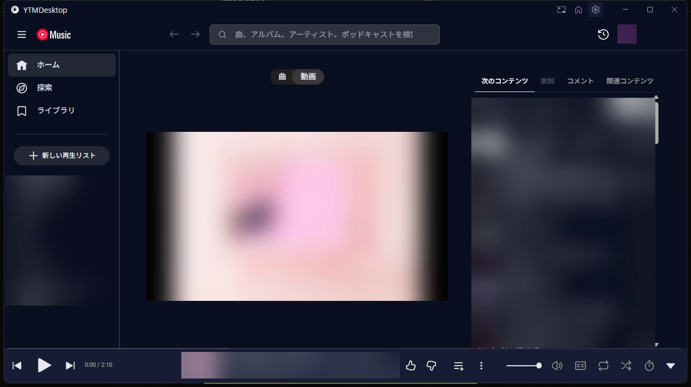
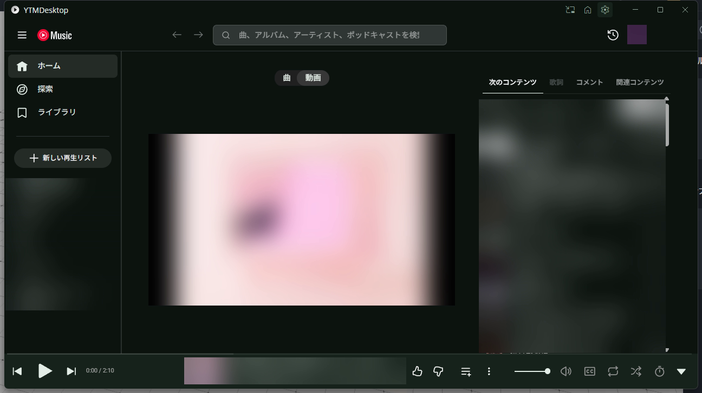
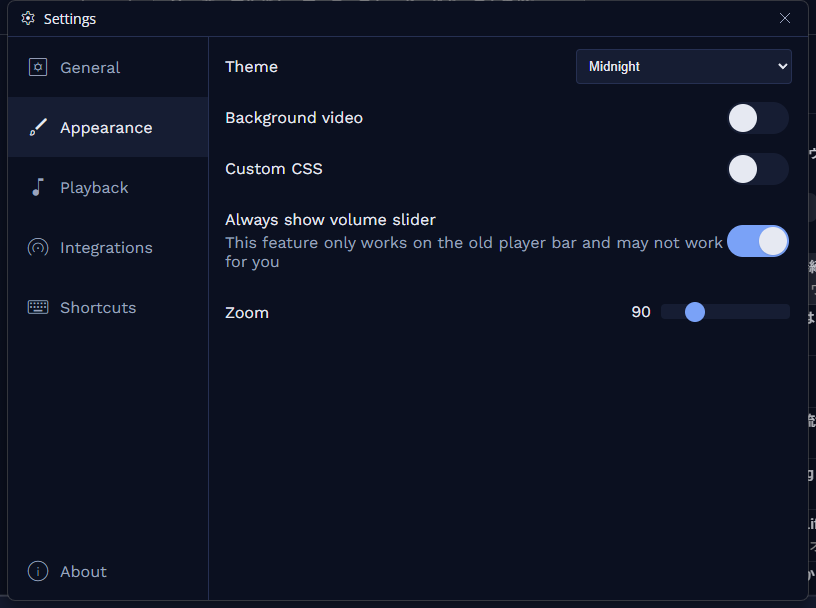
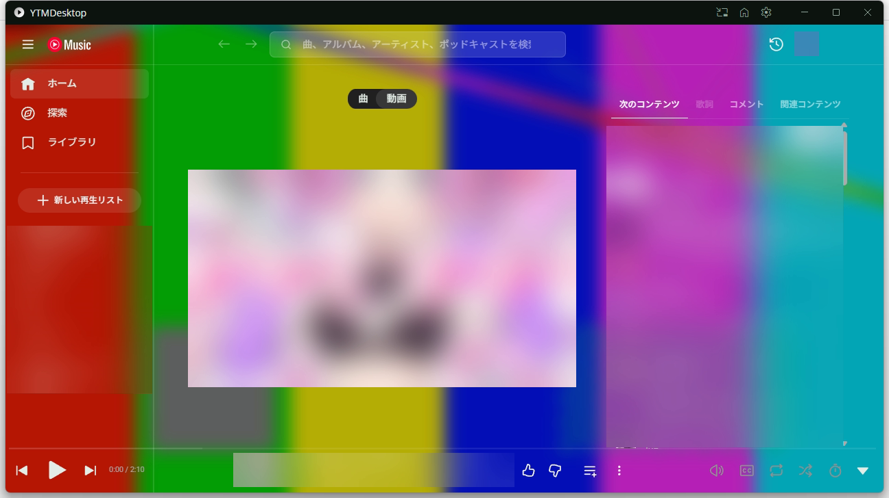
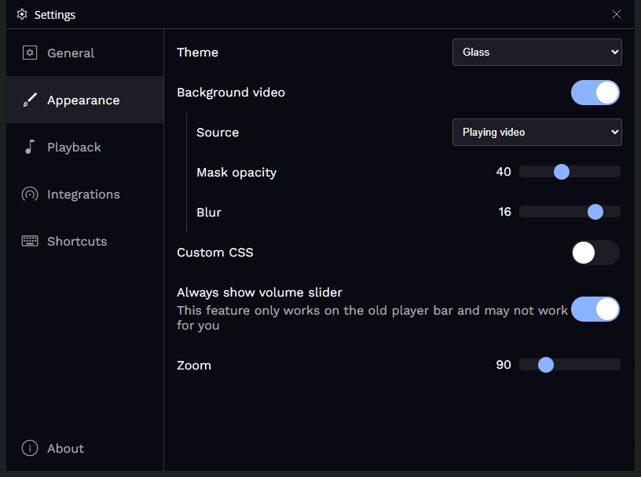
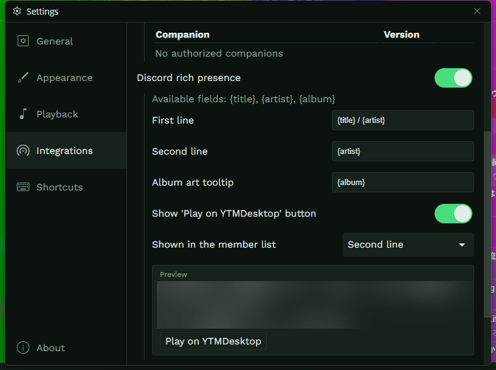
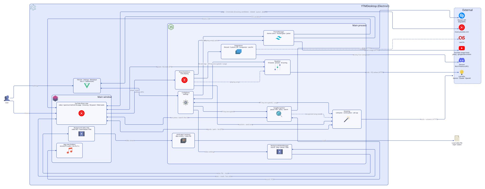

# YouTube Music Desktop App (reeschan fork)

[日本語](#日本語) | [English](#english)



---

## 日本語

このリポジトリは [ytmdesktop/ytmdesktop](https://github.com/ytmdesktop/ytmdesktop) の個人用の fork です。
アプリの機能・ダウンロード・開発環境の作り方・ビルドの手順は、本家の README を参照してください。

- 本家の README: <https://github.com/ytmdesktop/ytmdesktop#readme>
- 本家のリリース: <https://github.com/ytmdesktop/ytmdesktop/releases>

この fork では、次の 3 つの機能を足しています。

### 1. テーマ

設定の **Appearance → Theme** で、アプリ全体の配色を選べます。アプリの画面 (タイトルバー・設定・ミニプレイヤーなど) と YouTube Music の画面の両方に、同じ色が当たります。切り替えは再起動なしで、すぐ反映されます。

- 同梱のテーマ: **Default** (元の見た目)、**Midnight** (紺)、**Forest** (深緑)
- **Theme file** を選ぶと、自分で書いたテーマファイル (CSS) を使えます

| Midnight | Forest |
|---|---|
|  |  |



テーマファイルには、6 つの色項目を CSS 変数で書きます。

```css
:root {
  --ytmd-color-background: #0b1020; /* 背景 */
  --ytmd-color-surface: #161d33;    /* 面 (カード・メニュー・プレイヤーバー) */
  --ytmd-color-text: #e6e9f2;       /* 文字 */
  --ytmd-color-text-muted: #9aa3bd; /* 控えめな文字 */
  --ytmd-color-accent: oklch(0.72 0.12 260); /* アクセント (スイッチ・スライダー・シークバー) */
  --ytmd-color-border: #263052;     /* 枠線 */
}
```

- 色は、16 進・`rgb()`・`hsl()`・`oklch()` などの関数・名前付きの色で書けます (Tailwind v4 の `oklch` の色もそのまま使えます)。
- 書いていない項目や読めない値には、Default の色を使います。どの項目が読めなかったかは、設定画面に出ます。
- ファイルを保存し直すと、すぐ反映されます。
- カスタム CSS は、テーマの後に当たります。テーマの一部を上書きできます。
- 危険・エラー・成功を表す色は、テーマに関わらず固定です。
- アプリの画面は Tailwind v4 (prefix `tw:`) で、`tw:bg-ytmd-surface` のようにテーマの色を使っています。

### 2. 背景動画

設定の **Appearance → Background video** で、手元の動画ファイル (mp4 / webm) をメインウィンドウの背景全体に流せます。動画は無音でループ再生します。





- **Mask opacity** (0〜100%): 動画の上に重ねる層の濃さ。層の色はテーマの背景色です。
- **Blur** (0〜20px): 動画のぼかし。
- 最小化・トレイに隠す・全画面表示の間は、動画を止めます。曲の一時停止とは連動しません。
- 動画ファイルが見つからないときは、動画なしで表示し、設定画面で知らせます。パスは残るので、ファイルを戻せば再び流れます。

### 3. Discord の表示テンプレート

設定の **Integrations → Discord rich presence** で、Discord に出す内容を変えられます。



- **First line**・**Second line**・**Album art tooltip** の 3 つの欄に、`{title}`・`{artist}`・`{album}` を差し込めます。例えば First line を `{title} / {artist}` にすると、曲名とアーティストを 1 行で出せます。
- 空になった欄は出しません。1 行目だけは、空のとき曲名で埋めます。
- 「Play on YTMDesktop」ボタンを出すかどうかと、Discord のメンバー一覧に何を出すか (アプリ名・1 行目・2 行目) を選べます。
- 設定画面で、再生中の曲を使ったプレビューを見ながら書けます。

### 構成

<picture>
  <source media="(prefers-color-scheme: dark)" srcset="docs/architecture/architecture-dark.svg">
  
</picture>

図のソースは [docs/architecture/architecture.d2](docs/architecture/architecture.d2) です。構成を変えたら、arch-diagram スキルの `render.py` で描き直します。

### 開発 (この fork で変わったところ)

```sh
pnpm install
pnpm start   # 開発版を起動
pnpm test    # Vitest (テーマの読み込み・背景動画の状態の決定・Discord の表示の組み立て)
```

設計の文書は [docs/specs/theme-bgvideo-discord.md](docs/specs/theme-bgvideo-discord.md)、[docs/adr/](docs/adr/)、[GLOSSARY.md](GLOSSARY.md) にあります。

---

## English

This repository is a personal fork of [ytmdesktop/ytmdesktop](https://github.com/ytmdesktop/ytmdesktop).
For the app's features, downloads, development setup and build steps, see the upstream README.

- Upstream README: <https://github.com/ytmdesktop/ytmdesktop#readme>
- Upstream releases: <https://github.com/ytmdesktop/ytmdesktop/releases>

This fork adds the following three features.

### 1. Themes

Pick a color theme in **Appearance → Theme**. The same colors apply to the app screens (title bar, settings, miniplayer and so on) and to YouTube Music itself, right away and without a restart.

- Bundled themes: **Default** (the original look), **Midnight** (navy) and **Forest** (dark green)
- **Theme file** lets you use your own theme file (CSS)

| Midnight | Forest |
|---|---|
|  |  |


A theme file declares the six color items as CSS variables.

```css
:root {
  --ytmd-color-background: #0b1020; /* background */
  --ytmd-color-surface: #161d33;    /* surface (cards, menus, player bar) */
  --ytmd-color-text: #e6e9f2;       /* text */
  --ytmd-color-text-muted: #9aa3bd; /* muted text */
  --ytmd-color-accent: oklch(0.72 0.12 260); /* accent (switches, sliders, seek bar) */
  --ytmd-color-border: #263052;     /* border */
}
```

- Colors can be hex, `rgb()`, `hsl()`, `oklch()` and the other color functions, or named colors (Tailwind v4 `oklch` colors work as they are).
- Missing or unreadable items fall back to the Default colors, and the settings screen lists them.
- Saving the file again applies it right away.
- Custom CSS is applied after the theme, so it can override parts of it.
- Colors that mean something (danger, error, success) stay the same in every theme.
- The app screens use Tailwind v4 with the `tw:` prefix, for example `tw:bg-ytmd-surface`.

### 2. Background video

In **Appearance → Background video**, choose a local video file (mp4 / webm) to play across the whole background of the main window. It loops without sound.


- **Mask opacity** (0–100%): how strongly the layer over the video covers it. The layer uses the theme's background color.
- **Blur** (0–20px): blur applied to the video.
- The video stops while the window is minimized, hidden to the tray or in fullscreen. It does not follow the song's pause.
- When the video file is missing, the window shows no video and the settings screen says so. The path is kept, so the video comes back once the file does.

### 3. Discord display templates

In **Integrations → Discord rich presence**, change what Discord shows.


- **First line**, **Second line** and **Album art tooltip** take `{title}`, `{artist}` and `{album}`. For example, `{title} / {artist}` on the first line shows the title and the artist on one line.
- Empty lines are left out, except the first line, which falls back to the title.
- Choose whether to show the "Play on YTMDesktop" button, and what the Discord member list shows (app name, first line or second line).
- A preview built from the playing song shows the result while you type.

### Architecture

<picture>
  <source media="(prefers-color-scheme: dark)" srcset="docs/architecture/architecture-dark.svg">
  
</picture>

The diagram source is [docs/architecture/architecture.d2](docs/architecture/architecture.d2). Redraw it with the arch-diagram skill's `render.py` when the structure changes.

### Development (what changed in this fork)

```sh
pnpm install
pnpm start   # run the dev build
pnpm test    # Vitest (theme resolution, background video decision, Discord activity builder)
```

Design documents: [docs/specs/theme-bgvideo-discord.md](docs/specs/theme-bgvideo-discord.md), [docs/adr/](docs/adr/) and [GLOSSARY.md](GLOSSARY.md).

---

License: [GPL-3.0](LICENSE), the same as upstream.
