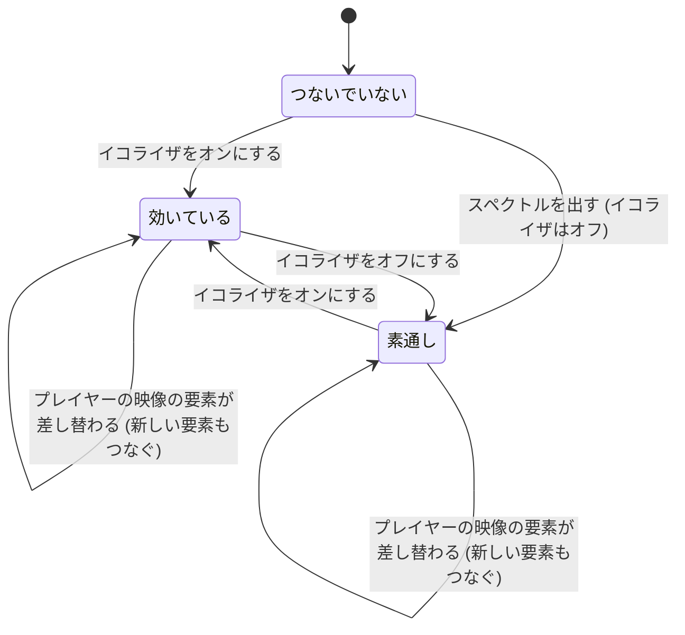
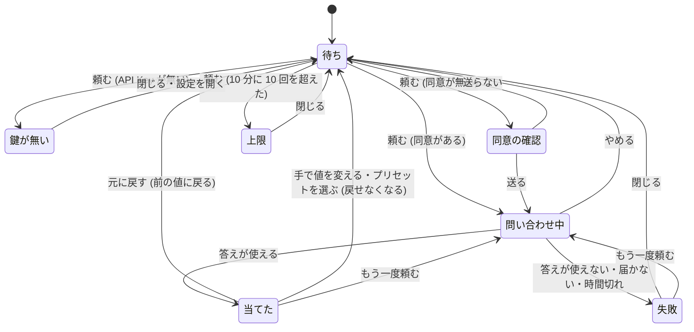

# イコライザ・スペクトル・AI での調整

用語は [GLOSSARY.md](../../GLOSSARY.md) に従う (イコライザ・バンド・プリアンプ・プリセット・同梱プリセット・保存したプリセット・AI での調整・スペクトル・背景動画の元・AI のサービス)。音の経路の置き場所は [ADR 0005](../adr/0005-equalizer-audio-route-in-ytm-view.md)、AI の鍵の置き場所は [ADR 0004](../adr/0004-grooving-screen-inside-ytm-view.md) と同じ考え方に従う。

## Problem Statement

YouTube Music の音は、ヘッドホンやスピーカー、聴く時間帯によって聞こえ方が変わる。それなのに、今のアプリには音の聞こえ方を変える手段が無い。低音が足りない、ボーカルが埋もれる、夜に小さい音で聴くと細くなる、と感じても直せない。OS やドライバのイコライザはほかのアプリの音にも効くので、YouTube Music の音だけを整えることもできない。

また、イコライザの値をどう動かせば「こう聞こえてほしい」に近づくかは、慣れていない人には分かりにくい。今鳴っている音が高さごとにどう出ているかも見えないので、動かした結果を目で確かめることもできない。

## Solution

YTM 画面のプレイヤーバーに **イコライザ** のボタンを足す。押すと、曲の画面を覆わない小さなパネルが開く。パネルでは次のことができる。

- イコライザのオン・オフ、10 のバンド (31Hz〜16kHz、±12dB) とプリアンプを動かす。
- 同梱プリセット (7 つ) と保存したプリセットから選び、今の値を名前を付けて保存する。
- 書いた言葉 (例えば「ボーカルをはっきり」) から、AI での調整でバンドとプリアンプの値を決めさせる。結果はすぐ当たり、気に入らなければ元に戻せる。
- 今鳴っている音の **スペクトル** を、イコライザのカーブの後ろに見る。

スペクトルは、背景動画の元の 3 つ目の選択肢「スペクトル」として、背景全体にも描ける。色は今のテーマのアクセント色に従うので、Jacket テーマなら曲ごとに色が変わる。

イコライザを初めてオンにするか、スペクトルを初めて出すまでは、アプリは YouTube Music の音に一切触れない。

## User Stories

### パネル

1. 利用者として、プレイヤーバーのボタンからイコライザのパネルを開きたい。それは、曲を聴きながらすぐ調整したいからだ。
2. 利用者として、パネルは曲の画面やキューを覆わない大きさで開いてほしい。それは、今の曲を見ながら調整したいからだ。
3. 利用者として、パネルの外を押すか Esc を押したら、パネルが閉じてほしい。それは、ほかの操作にすぐ戻りたいからだ。
4. 利用者として、YouTube Music がプレイヤーバーを描き直しても、ボタンが消えないでほしい。それは、いつでも開けてほしいからだ。
5. 利用者として、パネルの文は、YouTube Music の表示の言語 (日本語か英語) に合わせてほしい。それは、Grooving と同じように読みたいからだ。

### イコライザ

6. 利用者として、パネルのスイッチでイコライザのオン・オフを切り替えたい。それは、効かせた音と元の音を聴き比べたいからだ。
7. 利用者として、オフにしたら、元の音とまったく同じに戻ってほしい。それは、オフで音が変わると信用できないからだ。
8. 利用者として、10 のバンドのつまみを、それぞれ ±12dB の範囲で動かしたい。それは、聞こえ方を自分で整えたいからだ。
9. 利用者として、つまみを動かしたら、その場で音が変わってほしい。それは、耳で確かめながら動かしたいからだ。
10. 利用者として、つまみの値 (dB) と周波数が読めてほしい。それは、どこをどれだけ動かしたか分かりたいからだ。
11. 利用者として、つまみをダブルクリックしたら 0dB に戻ってほしい。それは、1 本だけやり直したいからだ。
12. 利用者として、バンドを上げても音が割れないように、プリアンプが自動で下がってほしい。それは、割れた音を聴きたくないからだ。
13. 利用者として、プリアンプを自分で動かしたら、その値を使ってほしい。それは、音量の感じを自分で決めたいからだ。
14. 利用者として、プリアンプを自動に戻す操作がほしい。それは、手で動かしたあとに自動の値へ戻したいからだ。
15. 利用者として、イコライザのオン・オフと今の値は、アプリを閉じても次に起動したときにそのまま戻ってほしい。それは、毎回作り直したくないからだ。
16. 利用者として、YouTube Music の音量の操作と、音量の比率の設定は、今までどおり効いてほしい。それは、イコライザのために音量の操作が変わると困るからだ。
17. 利用者として、YTM 画面が読み込み直されても、イコライザが効いたままであってほしい。それは、知らないうちに元の音に戻ると気づけないからだ。

### プリセット

18. 利用者として、同梱プリセットの「フラット」「低音を強く」「高音を強く」「ボーカル」「ロック」「エレクトロニック」「夜」から選びたい。それは、すぐ使える形から始めたいからだ。
19. 利用者として、プリセットを選んだら、バンドとプリアンプがその値になってほしい。それは、選んだ音にすぐなってほしいからだ。
20. 利用者として、今の値に名前を付けて、保存したプリセットにしたい。それは、気に入った音をあとで呼び出したいからだ。
21. 利用者として、保存したプリセットを今の値で上書きしたい。それは、少し直した音を同じ名前で残したいからだ。
22. 利用者として、保存したプリセットの名前を変えたい。それは、あとで分かりやすい名前にしたいからだ。
23. 利用者として、保存したプリセットを消したい。消す前には確認してほしい。それは、うっかり消したくないからだ。
24. 利用者として、同じ名前で保存しようとしたら、上書きしてよいか聞いてほしい。それは、知らないうちに上書きされたくないからだ。
25. 利用者として、同梱プリセットは変えられず、同じ名前でも保存できないようにしてほしい。それは、元の形をいつでも選べてほしいからだ。
26. 利用者として、選んだプリセットから値を変えたら、パネルに「(プリセット名)・変更あり」と出てほしい。それは、今の音がプリセットそのものか分かりたいからだ。
27. 利用者として、保存したプリセットが 50 個に達したら、それ以上は保存できないと知らせてほしい。それは、保存に失敗した理由を知りたいからだ。

### AI での調整

28. 利用者として、パネルの欄に言葉を書いて、AI にバンドとプリアンプを決めてほしい。それは、どのつまみをどう動かせばよいか分からなくても、聞こえ方を言葉で伝えたいからだ。
29. 利用者として、欄の下の例 (「低音をもっと」「ボーカルをはっきり」「夜に小さい音で」) を押して、そのまま使いたい。それは、何を書けばよいかの手がかりがほしいからだ。
30. 利用者として、AI には今の値と今の曲名・アーティストも渡してほしい。それは、今の音と曲に合わせた調整にしてほしいからだ。
31. 利用者として、AI が決めた値はすぐ当たってほしい。それは、すぐ聴いて確かめたいからだ。
32. 利用者として、AI がなぜその値にしたかを、パネルに 1〜2 文で出してほしい。それは、何が変わったか分かりたいからだ。
33. 利用者として、AI の結果が気に入らなければ「元に戻す」で前の値に戻したい。それは、試すのをためらいたくないからだ。
34. 利用者として、AI の結果をそのままプリセットとして保存したい。それは、気に入った結果を残したいからだ。
35. 利用者として、問い合わせ中は欄が押せなくなり、「やめる」で止められてほしい。それは、二重に頼んだり、待たされ続けたりしたくないからだ。
36. 利用者として、「やめる」を押したら、遅れて返ってきた結果は当たらないでほしい。それは、止めたのに音が変わると困るからだ。
37. 利用者として、失敗したときは、イコライザを変えずに、理由を一文で出してほしい。それは、何が起きたか分かりたいからだ。
38. 利用者として、初めて AI での調整を使うときに一度だけ、「曲名と書いた言葉を (AI のサービス) に送ります」と確認してほしい。それは、何がどこに送られるかを知ってから使いたいからだ。
39. 利用者として、確認で「送らない」を選んだら、何も送らないでほしい。それは、送ることを断れてほしいからだ。
40. 利用者として、API Key をまだ入れていなくても AI での調整の欄は見えていて、押したら設定画面へ案内してほしい。それは、その機能があることと使い方を知りたいからだ。
41. 利用者として、AI での調整は Grooving と同じ AI のサービス・API Key・モデルで動いてほしい。それは、鍵を 2 回入れたくないからだ。
42. 利用者として、AI での調整にかかった料金も、設定画面の使用量に合算して、EQ の分の内訳も見たい。それは、何にいくら使ったか分かりたいからだ。
43. 利用者として、設定画面で、AI での調整の送信の同意を取り消したい。それは、あとで考えが変わったときに止めたいからだ。
44. 利用者として、言葉は 200 文字までにしてほしい。それは、長すぎて料金がかさむのを避けたいからだ。

### スペクトル

45. 利用者として、パネルの中で、イコライザのカーブの後ろに今の音のスペクトルを見たい。それは、動かした結果を目でも確かめたいからだ。
46. 利用者として、背景動画の元で「スペクトル」を選んで、背景全体にスペクトルを描きたい。それは、曲に合わせて動く背景を楽しみたいからだ。
47. 利用者として、スペクトルの色はテーマのアクセント色で、上に行くほど薄くなってほしい。それは、テーマの見た目になじんでほしいからだ。
48. 利用者として、Jacket テーマでは、スペクトルの色も曲ごとに変わってほしい。それは、曲の雰囲気をそろえたいからだ。
49. 利用者として、背景のスペクトルにも、マスクの濃さとぼかしが効いてほしい。それは、YTM 画面を読みやすく保ちたいからだ。
50. 利用者として、一時停止したら、棒が下がりきって止まってほしい。それは、音が止まったことが見て分かってほしいからだ。
51. 利用者として、OS で動きを減らす設定にしているときは、背景のスペクトルを描かないでほしい。パネルの中のスペクトルは、ゆっくりの更新で出てほしい。それは、動きを減らす設定を尊重しつつ、確かめる手段は残してほしいからだ。
52. 利用者として、スペクトルは、イコライザがオフでも出てほしい。それは、元の音の様子も見たいからだ。

### 音に触れないこと

53. 利用者として、イコライザを一度もオンにせず、スペクトルも出していないうちは、アプリに YouTube Music の音に触れないでほしい。それは、使わない機能のせいで音が変わる心配をしたくないからだ。
54. 利用者として、イコライザを初めてオンにしたときに音が一瞬途切れることがあると、知っておきたい。それは、故障と取り違えたくないからだ。

## Implementation Decisions

- **イコライザの共有モジュール (新規、純粋な関数と型)**: main・preload・YTM 画面のスクリプトの 3 か所から使う。次のものを持つ。
  - バンドの周波数 (31・62・125・250・500・1k・2k・4k・8k・16k Hz)、バンドの範囲 (±12dB)、プリアンプの範囲 (-12〜+12dB)、刻み (0.5dB)。
  - 同梱プリセット 7 つの id と値。名前は表示の言語ごと (日本語・英語) に持つ。値の目安は次のとおりで、実装後に耳で調整してよい。
    - フラット: すべて 0
    - 低音を強く: 6, 5, 4, 2, 0, 0, 0, 0, 0, 0
    - 高音を強く: 0, 0, 0, 0, 0, 1, 2, 4, 5, 6
    - ボーカル: -2, -2, -1, 0, 2, 4, 4, 2, 0, -1
    - ロック: 4, 3, 2, 0, -1, -1, 1, 3, 4, 4
    - エレクトロニック: 5, 4, 2, 0, -1, 0, 1, 2, 4, 5
    - 夜: 4, 3, 1, 0, 0, 0, 0, 1, 3, 4
  - イコライザの値の型: 10 のバンドの dB、プリアンプの dB、プリアンプを手で決めたか。
  - 自動のプリアンプ: いちばん上げたバンドの dB だけ下げる (どのバンドも 0 以下なら 0)。手で決めたときは手の値を使う。
  - プリセットの参照の型: 同梱プリセット (id) か、保存したプリセット (名前)。
  - 保存したプリセットの操作 (保存・上書き・名前を変える・消す): 一覧と操作を受け、新しい一覧か、断る理由を返す。断る理由は、名前が空・長すぎる (30 文字まで)・同梱プリセットの名前 (どちらの言語でも) と同じ・同じ名前がある (上書きの確認が要る)・50 個に達した。名前は前後の空白を落として比べる。
  - 「変更あり」の判定: 今の値と、選んでいるプリセットの値が違うか。
  - AI の答えを正す処理: 長さが 10 でない・数でないものは使えないとし、範囲の外の値は範囲に収め、0.5dB に丸める。説明は 120 文字で切る。
  - スペクトルの棒の作り方: 周波数ごとの大きさの並び (AnalyserNode の値) とサンプルレートから、30Hz〜16kHz を対数の軸で 48 本に分けた棒の高さ (0〜1) を返す。
  - main と YTM 画面のあいだの合図と状態の型、検証の関数 (Grooving の検証と同じ書き方)。
- **設定 (config) の型と既定値**: 一番上に `equalizer` を足す。
  - オン・オフ (既定はオフ)、今の値 (既定はフラット・プリアンプ自動)、選んでいるプリセットの参照 (既定はフラット)、保存したプリセットの一覧 (既定は空)、AI での調整の送信の同意 (同意した日時か、無し)。
  - 既定値は configstore の defaults に足す。conf は起動時に defaults を一番上のキーの単位で浅くマージするので、新しい `equalizer` には migration が要らない。後から `equalizer` の中に項目を足すときは migration が要る。
  - 背景動画の元に `spectrum` を足す。既定値は今のまま。
- **使用量の内訳**: Grooving の使用量の型に、AI での調整の分の内訳 (入力・出力のトークン、料金の見積もり、料金の分からないトークン) を任意の項目として足す。合計の項目は今までどおり両方を合わせた値にする。内訳の無い古いデータは、すべて Grooving の分として扱う。月が変わったら内訳も 0 から数える。
- **イコライザの係 (main、新規サービス)**: イコライザの状態の持ち主。
  - 設定を読み、YTM 画面に状態 (オン・オフ、値、選んでいるプリセット、プリセットの一覧、変更ありか、AI での調整の進み具合) を送る。
  - YTM 画面からの合図 (オン・オフ、バンド・プリアンプの変更、プリアンプを自動に戻す、プリセットを選ぶ・保存・上書き・名前を変える・消す、AI での調整を頼む・やめる・元に戻す、同意の答え、設定を開く) を検証してから受け、状態を更新する。
  - つまみのドラッグ中は合図が続くので、設定への書き込みは 300ms まとめてから行う。YTM 画面への状態はすぐ返す。
  - 状態の移り変わりは、合図と今の状態から「次の状態と、起こすこと (設定に書く・状態を送る・AI に問い合わせる・設定画面を開く)」を返す純粋な関数に閉じ込め、サービスはその結果を実行するだけにする (Grooving の effects と同じ分け方)。
  - YTM 画面が作り直されたら (view-recreated)、今の状態を送り直す。
- **AI での調整の問い合わせ (main)**: Grooving の LLM の部品を使う。
  - AI のサービス・API Key・モデルの読み出しと、プロバイダごとのモデルの作り方を、Grooving の中から main の共通の場所に切り出し、Grooving と AI での調整の両方から使う。
  - 送るもの: 利用者の言葉 (200 文字で切る)、今のバンドとプリアンプの値、バンドの周波数と範囲、今の曲名とアーティスト (曲が無ければ送らない)。説明の文は、Grooving の言語の設定に合わせた言語で書かせる。
  - 返させるもの (構造化出力): 10 のバンドの dB、プリアンプの dB、説明。共有モジュールの処理で正してから当てる。
  - 呼び出しの上限: 10 分に 10 回まで (YTM 画面の偽の合図で呼ばせ続けられないように)。問い合わせの時間切れは Grooving と同じ値にする。
  - 失敗の理由は Grooving の失敗の理由をそのまま使い、同じ文で出す。API Key が無いときは問い合わせず、「鍵が無い」の状態にする。
  - 当てる前の値を 1 つ覚えておき、「元に戻す」で戻す。手で値を変えるか、プリセットを選ぶか、もう一度 AI での調整をしたら、覚えた値は捨てる (戻せるのは直前の 1 回だけ)。
  - 当てたときは、選んでいるプリセットはそのまま残し、「変更あり」にする。
  - 「やめる」は問い合わせを止め、遅れて返った結果は捨てる。
  - API Key と問い合わせの中身は YTM 画面に渡さない。YTM 画面に送るのは、進み具合・説明・失敗の理由・値だけ。
- **YTM 画面のスクリプト (新規)**:
  - **ボタンとパネル**: プレイヤーバーの右の操作の並びにボタンを足す。プレイヤーバーが描き直されたら足し直す (Grooving の入口と同じく、DOM の変化を見て整える作り)。パネルはボタンの上に開き、外を押すか Esc で閉じる。パネルの文は Grooving と同じく、YouTube Music の表示の言語で日本語か英語を選ぶ。外から来た文 (プリセットの名前・AI の説明) は textContent でだけ入れる。色はテーマの CSS 変数からだけ取る。
  - **音の経路**: プレイヤーの `<video>` を Web Audio に通す。経路は「元の音 → プリアンプ → 10 のフィルタ (いちばん低いバンドは lowshelf、いちばん高いバンドは highshelf、そのあいだは peaking、Q は約 1.41) → スペクトルの測り役 (AnalyserNode) → 出力」。
    - つなぐのは、イコライザがオンの状態を初めて受けたとき、またはスペクトルを初めて描くときだけにする。一度つないだらつないだままにし、オフのときはプリアンプとすべてのフィルタを 0dB (素通し) にする。
    - `<video>` が別の要素に差し替わったら、新しい要素もつなぐ (つなぐ条件をもう満たしていれば)。
    - 値の変更は、ぷつっという音が出ないように、短い時間 (約 30ms) かけて移す。
    - `<video>` の音量 (YouTube Music の音量・音量の比率の設定) は経路の手前で効くので、そのままにする。
  - **スペクトルの描画**: パネルを開いているあいだだけ、パネルの canvas に描く。背景動画の元がスペクトルのときは、背景動画と同じ層 (マスクの下の canvas) に描く。描くのは画面に見えているあいだだけにし、音が止まって棒がすべて下がりきったら、描くのを休む。動きを減らす設定のときは、背景には描かず、パネルの中は 1 秒に 4 回の更新にする。
- **背景動画の元「スペクトル」**: 背景動画の決め方の純粋な関数に、スペクトルの元を足す。スペクトルのときは、YTM 画面の中の層を使い (再生中の動画と同じ置き場所)、動きを減らす設定のときは出さない。マスクの濃さ・ぼかしは今のまま効かせる。設定画面の背景動画の元の選択肢に「スペクトル」を足す。
- **設定画面**: Grooving の欄の、Grooving の同意を取り消す操作の並びに、「EQ の AI での調整の送信の同意」の状態 (同意した日付) と取り消す操作を足す。使用量の表示に、EQ の分の内訳の行を足す。イコライザ自体の操作は設定画面に置かない。
- **同意の確認**: AI での調整を初めて頼んだときに、パネルの中で「曲名と書いた言葉を (AI のサービス) に送ります」と出し、「送る」「送らない」を選ばせる。「送る」で日時を保存し、そのまま問い合わせる。「送らない」では何も保存せず、何も送らない (次に頼んだときにまた聞く)。

## Testing Decisions

- よいテストは、外から見える振る舞いだけを確かめる。入力を与えて出力 (次の状態・起こすこと・返る値) を見て、中の作りには触れない。テストは Vitest で、`src/shared/grooving/` と `src/shared/background-video/` の今のテストと同じく、表で並べた例で書く。
- **合意済みの seam** (この 3 つでテストを先に書く):
  1. **イコライザの共有モジュール**: 次のことを確かめる。
     - 自動のプリアンプが、いちばん上げたバンドの dB だけ下がり、上げたバンドが無ければ 0 になること。手で決めたときは手の値になること。
     - 保存したプリセットの操作が、空の名前・31 文字の名前・同梱プリセットの名前 (日本語・英語)・同じ名前・51 個目を、それぞれの理由で断ること。前後の空白を落として比べること。上書き・名前を変える・消すの結果の一覧。
     - 「変更あり」が、同じ値なら偽、1 本でも違えば真になること。
     - AI の答えを正す処理が、範囲の外を収め、0.5dB に丸め、長さ違い・数でない値を使えないとし、長い説明を切ること。
     - スペクトルの棒が 48 本で、0〜1 に収まり、無音で全部 0 になり、ある周波数だけ鳴らした入力でその周波数の棒がいちばん高くなること。
     - 合図と状態の検証が、正しい形を通し、欠けた形・余計な型・範囲の外の数を落とすこと。
  2. **イコライザの状態の移り変わり (main の純粋な関数)**: 合図と今の状態から、次の状態と起こすことが決まること。
     - オン・オフ、バンドの変更 (自動のプリアンプが追う)、プリセットを選ぶ・保存 (同じ名前で上書きの確認)・消す。
     - AI での調整: 同意が無ければ確認を出し、問い合わせない。「送らない」で何も保存せず送らない。鍵が無ければ案内を出し、問い合わせない。問い合わせ中の 2 回目の依頼は無視する。成功で値が当たり、元に戻せる。失敗で値が変わらない。「やめる」のあとに届いた結果は捨てる。手で値を変えたら、元に戻せなくなる。上限を超えた依頼は問い合わせない。
  3. **AI での調整の問い合わせ (main)**: 偽のモデル (Grooving の LLM のテストと同じやり方) で、正しい答え・形の違う答え・範囲の外の答え・失敗が、それぞれ正しい結果になること。送る文に API Key が入らず、言葉が 200 文字で切られ、曲が無ければ曲名が入らないこと。
- 背景動画の決め方のテストに、スペクトルの元の例 (オン・オフ・動きを減らす設定) を足す。
- 使用量の足し算のテストに、内訳の例 (内訳の無い古いデータ・月が変わったとき) を足す。
- テストしないものは、開発版で確かめる: 音が実際に変わること、オフで元の音と同じになること、ぷつっという音が出ないこと、プレイヤーバーが描き直されてもボタンが残ること、パネルの見た目、スペクトルの見た目と Jacket の色、YTM 画面の読み込み直しのあとも効いていること、初めてつないだときの途切れの長さ。

## Out of Scope

- 曲ごとに自動でプリセットを切り替えること。
- プリセットの書き出し・読み込み (ファイル)。
- ミニプレイヤーでのスペクトル。
- パラメトリック EQ (周波数や幅を動かすこと)。
- イコライザの操作を設定画面・ショートカットキー・Companion サーバーの API から行うこと。
- 曲の聞き取りで録る音から、イコライザの効果を除くこと (PC の音を録るので、効かせた音が録られる)。
- AI での調整で、聴いた履歴を送ること。

## Further Notes

- 音の経路をつなぐと元に戻せないため、使うまではつながない ([ADR 0005](../adr/0005-equalizer-audio-route-in-ytm-view.md))。
- YTM のページのメインワールドのスクリプトは、イコライザの合図を偽造できる。AI での調整の同意を保存させることもできる。Grooving と同じく既知の制約として受け入れる。YouTube Music はもともと曲名を知っているので、偽の合図でできるのは、鍵の持ち主の LLM に曲名と言葉を送ることまでになる。その回数も main の上限で抑える。
- YTM の映像は MediaSource (blob の URL) で流れるので、Web Audio に通しても、別の origin のせいで音が消えることはない想定。開発版で最初に確かめる。

## 状態の図

pstack の `/statechart` の検査 (TLC と Java のダウンロードが要る) は、利用者の許可を取っていないため行っていない。図と利用者の合意で Ready とする。

### 音の経路

アプリを起動したときにイコライザがオンなら、YTM 画面の準備ができたところで「効いている」になる。

### AI での調整

