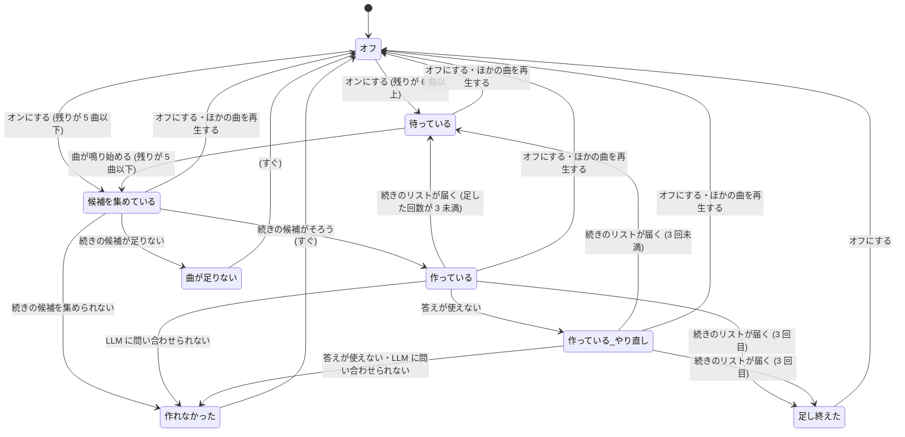

# Grooving: 続けて流す

用語は [GLOSSARY.md](../../GLOSSARY.md) に従う (Grooving・Grooving のリスト・方向・聴き慣れた曲・新しい曲・組・続けて流す・続きのリスト・反応・スキップ・続きの印・隠す)。Grooving の仕組みは [Grooving](grooving.md) の上に足し、この仕様に書いていないことは grooving.md のとおりにする。

## Problem Statement

Grooving のリストは 25 曲 (およそ 1 時間半) で終わる。気分に合ったリストを聴き終えると、キューは YouTube Music の自動再生に移り、気分と関係の無い曲が流れ始める。続きを聴くには、もう一度 Grooving を開いて気分を選び、組に答え直す必要がある。

また、リストを聴いている間の振る舞い (すぐに飛ばした曲、高評価を付けた曲) は、どこにも生かされない。「この曲は違った」と行動で示しても、次のリストには伝わらない。

## Solution

Grooving のできあがりの画面に、**続けて流す** のトグルを出す。オンにした回では、Grooving のリストの残りが 5 曲になると、LLM が **続きのリスト** (25 曲) を作り、キューの後ろに足す。これを 1 回オンにするごとに最大 3 回 (合わせて 100 曲) まで繰り返す。

続きのリストは、その回の気分・方向・組の答えに加え、リストの曲ごとの **反応** (最後まで聴いた・スキップ・高評価・低評価) を手がかりにして作る。スキップや低評価の曲のアーティストは控え、高評価の曲の関連曲を候補に足す。

トグルのオン・オフは設定に覚え、次の回は前回の選択から始める。

## User Stories

### オンにする・止まる

1. 利用者として、Grooving のできあがりの画面に「続けて流す」のトグルがほしい。それは、リストを聴き終えても同じ気分の曲を聴き続けたいからだ。
2. 利用者として、初めて使うときは「続けて流す」がオフであってほしい。それは、頼んでいないのに LLM の料金がかかると困るからだ。
3. 利用者として、トグルのオン・オフを覚えておき、次の回のできあがりの画面では前回の選択から始めてほしい。それは、毎回押し直したくないからだ。
4. 利用者として、トグルの近くに、1 回につき最大何曲まで足すか (100 曲) と、LLM の料金がかかることが分かる短い説明がほしい。それは、オンにしたときに何が起きるかを知りたいからだ。
5. 利用者として、オンにした回では、Grooving のリストの残りが 5 曲になったら、続きのリストが作られてキューの後ろに足されてほしい。それは、リストが途切れずに流れ続けてほしいからだ。
6. 利用者として、続きのリストを足すのは 1 回の Grooving につき 3 回まで (合わせて 100 曲まで) であってほしい。それは、消し忘れで夜通し LLM を呼び続けてほしくないからだ。
7. 利用者として、上限まで足し終えたら、できあがりの画面に「続きを足し終えた」と出てほしい。それは、そこから先は YouTube Music の自動再生になると知りたいからだ。
8. 利用者として、続きのリストを作っている間も、今の曲はそのまま流れ続けてほしい。それは、待たされずに聴き続けたいからだ。
9. 利用者として、× で閉じる・「もう一度」・同意の取り消し・アプリを閉じる、のどれかで、続けて流すが止まってほしい。それは、その回を終わらせたのに続きが足され続けると困るからだ。
10. 利用者として、Grooving のリストにも続きのリストにも無い曲を自分で再生したら、続けて流すが止まってほしい。それは、別の曲を聴き始めたのに Grooving の曲が足され続けると困るからだ。
11. 利用者として、試聴で曲を流しても、続けて流すは止まらないでほしい。それは、試聴は Grooving の操作の一部だからだ。
12. 利用者として、ほかのページに移って Grooving を隠しても、続けて流すは止まらないでほしい。それは、ほかのページを見ながら聴き続けたいからだ。
13. 利用者として、トグルを途中でオフにしたら、それ以上は足されないでほしい。すでに足した曲はキューに残ってよい。それは、もう十分だと思ったときに止めたいからだ。
14. 利用者として、止まったあとにトグルをもう一度オンにしたら、残りが 5 曲以下ならすぐ続きを作ってほしい。それは、オンにし直した意味がすぐ出てほしいからだ。

### 反応

15. 利用者として、リストの曲を最後まで聴いたことが、続きのリストの手がかりになってほしい。それは、気に入って聴いた曲に近い曲が続いてほしいからだ。
16. 利用者として、曲の早いうちに次へ進めたら (スキップ)、その曲のアーティストが続きのリストで控えられてほしい。それは、合わないと示した曲に近い曲を聴きたくないからだ。
17. 利用者として、高評価を付けた曲の関連曲が、続きのリストの候補に入ってほしい。それは、とくに気に入った曲の方向に広げたいからだ。
18. 利用者として、低評価を付けた曲のアーティストが、続きのリストで控えられてほしい。それは、はっきり嫌だと示した曲に近い曲を聴きたくないからだ。
19. 利用者として、続きのリストにも反応が記録され、次の続きのリストの手がかりになってほしい。それは、聴くほど気分に近づいてほしいからだ。
20. 利用者として、反応は Grooving の回の中だけで使い、保存しないでほしい。それは、聴き方の記録がアプリに残り続けるのは気持ちが悪いからだ。

### 続きのリストの中身

21. 利用者として、続きのリストには、それまでに Grooving のリストや続きのリストに入った曲が入らないでほしい。それは、同じ曲が繰り返し流れると飽きるからだ。
22. 利用者として、続きのリストも、最初に選んだ方向 (寄せる・外す・ミックス) のとおりであってほしい。それは、方向を選んだ意味が続きでも保たれてほしいからだ。
23. 利用者として、ミックスの続きのリストは、組の答えで決まった割合 (聴き慣れた曲と新しい曲) を引き継いでほしい。それは、割合が急に変わると戸惑うからだ。
24. 利用者として、続きのリストでも、1 人のアーティストの曲は 3 曲までであってほしい。それは、同じアーティストが続くと単調になるからだ。
25. 利用者として、続きのリストの候補は、その回に集めた候補のうちまだ流していない曲と、高評価した曲 (無ければ最後まで聴いた最後の曲) の関連曲から作られてほしい。それは、気分から外れずに、反応に沿って広げてほしいからだ。
26. 利用者として、履歴を送らない設定のときも、続けて流すを使いたい。そのときも、LLM に送るのは曲名・アーティスト・気分・自分の選択と反応だけであってほしい。それは、履歴を外に出さずに続きを聴きたいからだ。

### 表示

27. 利用者として、できあがりの画面の一覧に、足した続きのリストの曲も後ろに並んでほしい。それは、何が流れるかを確かめたいからだ。
28. 利用者として、続きのリストを作っている間は、できあがりの画面に「続きを作っている」と出てほしい。それは、動いているのかを知りたいからだ。
29. 利用者として、何回足したか (例えば「2 / 3」) が分かってほしい。それは、あとどれだけ続くかを知りたいからだ。
30. 利用者として、続きのリストに使ったトークン数と費用の目安も、その回の使用量に足されてほしい。それは、続けて流すでいくらかかったかを知りたいからだ。
31. 利用者として、隠しているあいだに続きのリストを作っているときは、続きの印が「用意中」になってほしい。それは、裏で動いていることに気づきたいからだ。

### 失敗

32. 利用者として、続きのリストの LLM の答えがおかしかったときは、1 回だけ自動でやり直してほしい。それは、たまの失敗で止まってほしくないからだ。
33. 利用者として、それでも駄目なときは、できあがりの画面と続きの印に「続きを作れなかった」と出て、トグルがオフに戻ってほしい。それは、失敗したまま LLM を呼び続けてほしくないからだ。
34. 利用者として、失敗のあと、トグルをもう一度オンにすればすぐ作り直してほしい。それは、時間をおいて自分でやり直したいからだ。
35. 利用者として、続きのリストを作れなかったときも、キューはそのまま流れ、尽きたら YouTube Music の自動再生に任せてほしい。それは、失敗で再生が止まると困るからだ。
36. 利用者として、候補が足りずに続きのリストを作れないときは、「続きの曲が足りない」と出てほしい。それは、LLM の失敗と区別したいからだ。

### 保存

37. 利用者として、「プレイリストとして保存」は、押した時点で並んでいる曲 (続きのリストを含む) すべてを保存してほしい。それは、聴いた並びのまま残したいからだ。
38. 利用者として、保存したあとに続きのリストが足されたら、ボタンが「足した曲もプレイリストに足す」に変わってほしい。それは、保存したプレイリストを最新の並びにしたいからだ。
39. 利用者として、「足した曲もプレイリストに足す」を押したら、同じプレイリストの末尾に、まだ入れていない曲だけが足されてほしい。それは、同じプレイリストが 2 つできると困るからだ。

### YouTube Music への呼び方

40. 利用者として、続けて流すが YouTube Music を呼ぶ回数と速さも、今の Grooving と同じ上限 (60 秒に 20 回まで、間を空ける) に収まってほしい。それは、機械的なアクセスとみなされたくないからだ。

## Implementation Decisions

### 設定 (integrations)
- `groovingContinue: boolean`: 続けて流すのトグルの最後の選択。既定 false。ストアに無いキーは、読む側が既定値で補う (`??`。今の Grooving の設定と同じ)。トグルを押すたびに書く。

### 反応の決定 (共有モジュール、新規、純粋な関数)
- 前の曲の最後の様子 (videoId・最後の再生位置 (秒)・曲の長さ (秒)・高評価の状態) を受け、反応を返す。
- 低評価なら「低評価」、高評価なら「高評価」、最後の再生位置が `min(30 秒, 曲の長さの 3 分の 1)` より前なら「スキップ」、それ以外は「最後まで聴いた」。上から先に当てはまったものにする。曲の長さが分からない (0) ときは、30 秒で決める。

### 続きの候補 (共有モジュール、新規、純粋な関数)
- その回の候補・関連曲 (高評価の曲、無ければ最後まで聴いた最後の曲の関連曲。無ければ空)・それまでにリストに入れた曲・反応・方向・知っているアーティストを受け、続きの候補を返す。
  - 関連曲に、知っているアーティストかどうかで聴き慣れた曲 / 新しい曲の印を付け、方向で絞る (今の候補の組み立てと同じ決まり)。
  - それまでにリストに入れた曲 (Grooving のリストと続きのリストのすべて) を除く。
  - スキップと低評価の曲の 1 人目のアーティストを、**控えるアーティスト** として、その人の曲を除く。
  - 重複を除き、80 曲までにする。
- 候補が足りるかは、今の「候補が足りるか」と同じ決まり (25 曲以上、ミックスなら聴き慣れた曲と新しい曲がそれぞれ割合に足りる数) で決める。ただし組を作らないので、選ばなかった曲を外すための余り (2 × 回数) は要らない。

### Grooving の進行の決定 (共有モジュール)
- できあがり・保存している・保存済みの状態に、**続けて流す** の部分を足す。持つもの: オンか・足した回数 (0〜3)・段階 (待っている / 候補を集めている / 作っている / 作っている (やり直し) / 作れなかった / 曲が足りない / 足し終えた)・リストに入れた曲のすべて (Grooving のリスト + 続きのリスト)・曲ごとの反応・保存したプレイリストの ID と、そこに入れた曲。
- 出来事を足す: トグルを切り替える・曲が鳴り始めた (videoId)・反応が決まった (videoId と反応)・続きの候補がそろった / 足りない / 集められない・続きのリストが届いた / 使えない / 問い合わせられない・プレイリストに足せた / 足せなかった。
- すること (effect) を足す: 続きの候補を集める (関連曲の元の曲の videoId か null)・続きのリストを頼む・キューの後ろに足す (videoIds)・プレイリストに足す (playlistId, videoIds)。
- 決まり:
  - 曲が鳴り始めて、その曲がリストに入れた曲の最後から 6 曲以内 (残りが 5 曲以下) で、オンで、足した回数が 3 未満で、段階が「待っている」なら、続きの候補を集める。
  - 鳴り始めた曲が、リストに入れた曲にも試聴の曲にも無いなら、オフにする (ほかの曲を再生した)。
  - 続きのリストが届いたら、リストに入れた曲に足し、回数を 1 増やし、キューの後ろに足す。回数が 3 になったら段階を「足し終えた」にする。
  - 答えが使えないときは 1 回だけやり直す。2 回目も駄目、または問い合わせられないときは「作れなかった」にしてオフにする。候補が足りないときは「曲が足りない」にしてオフにする。
  - トグルをオンにしたとき、段階が「作れなかった」「曲が足りない」なら「待っている」に戻し、今の曲が残り 5 曲以内ならすぐ続きの候補を集める。オフにしたときは段階を「待っている」に戻し、進んでいる問い合わせの答えは捨てる (届いても足さない)。
  - 閉じる・「もう一度」・同意の取り消し・アプリを閉じるで、その回ごと終わる (今までどおり)。
  - 保存は、押した時点のリストに入れた曲すべてを保存し、保存した曲を覚える。保存済みで、まだ保存していない曲があるときは、画面のボタンを「足した曲もプレイリストに足す」にし、押すと「プレイリストに足す」をする (保存している状態を通る)。
- 画面に出すもの (view state) に足す: トグルの状態・足した回数と上限・段階・リストに入れた曲の並び (続きのリストを含む)・保存ボタンの種類 (保存 / 足した曲も足す / 保存済み)。続きの印は、続きを集めている・作っているあいだは「用意中」、作れなかったときは「エラー」。
- 間引きを止める (`groovingStopsThrottling`) のは、今の条件に加え、続きの候補を集めている・作っているあいだ。

### Grooving の受け持ち (メインプロセス)
- PlayerStateStore を見張り、曲が変わったら (videoId が変わる)、前の曲の反応を反応の決定に通して進行の決定に「反応が決まった」を送り、続けて「曲が鳴り始めた」を送る。見張るのは、進行ができあがり・保存している・保存済みのあいだだけ。前の曲の再生位置は、曲が変わる直前に見えた値を使う。
- 続きの候補を集める: その回の候補 (main が覚えているもの) を使い、関連曲だけをページに頼む (新しいページの呼び出し、関連曲 1 曲分。`next` と `browse` の 2 回)。履歴と高評価は読み直さない (知っているアーティストは、その回に決めたものを覚えて使う)。
- 続きのリストを頼む: 今のリストの頼み (LLM) に、反応の行 (`videoId | 曲名 | アーティスト | 反応`) と、控えるアーティストと、「リストに入れた曲は選ばない」ことを足す。聴き慣れた曲の曲数は、組の答えから今の決まりで出した数を使う。答えの確かめは今の `checkGroovingList` を続きの候補で使う。トークン数は、その回と今月の使用量に足す。
- 履歴を送らない設定のとき、反応の行に載せるのは Grooving のリストと続きのリストの曲 (気分のプレイリストか検索から来た曲) だけなので、履歴は送られない。

### YTM 画面
- **キューの後ろに足す** (新しいページの呼び出し): videoIds を、今の「残り 24 曲を裏で足す」と同じ足し方 (キューの末尾に 1 曲ずつ、裏の優先度) で足す。新しいキューの置き換えが始まったら止める。キューの先頭の曲の確かめはしない (続きはリストの後ろに付くため)。
- **プレイリストに足す** (新しいページの呼び出し): `browse/edit_playlist` に `ACTION_ADD_VIDEO` の操作を並べて、保存したプレイリストに曲を足す。上限と間隔は今の YTM への呼び方に従う。実装の最初に開発版で、要求の形が通ることを確かめる。
- **できあがりの画面**: リストの下に続けて流すのトグルと短い説明 (「残り 5 曲で続きを足す (最大 100 曲)。LLM の料金がかかる」の意味)、段階の 1 行 (「続きを作っている」「続き 2 / 3」「続きを足し終えた」「続きを作れなかった」「続きの曲が足りない」)。一覧には続きのリストの曲も後ろに並べる。保存ボタンの文言は view state の種類に従う。文言は表示の言語 (英語・日本語) に従い、Grooving の文言の置き場に足す。

## Testing Decisions

- よいテストは、共有モジュールの関数に入力を与え、出力だけを確かめる。テストは Vitest で、`src/shared/grooving/` の今のテストと同じ書き方にする。
- **合意済みの seam** (この 3 つでテストを先に書く):
  1. **反応の決定**: 低評価・高評価・スキップ (30 秒の手前・3 分の 1 の手前・長さ 0)・最後まで聴いた、と、高評価でスキップしたときに高評価になること。
  2. **続きの候補**: リストに入れた曲を除く・控えるアーティストを除く・方向ごとの絞り込み・関連曲の印付け・80 曲の上限・候補が足りるかの判定 (ミックスの割合の数を含む)。
  3. **Grooving の進行の決定** (今の seam に足す): 残り 5 曲で候補を集めること・6 曲以上残っていると集めないこと・オフでは集めないこと・3 回で足し終えること・ほかの曲でオフになること・試聴の曲ではオフにならないこと・やり直しは 1 回だけ・失敗と曲が足りないでオフになること・オンにし直したときにすぐ集めること・オフにしたあとに届いた答えを捨てること・保存のあとに足した曲だけをプレイリストに足すこと・view state の段階と保存ボタンの種類と続きの印・間引きを止めるかどうか。
- LLM への実際の問い合わせ、キューの後ろに足すこと、プレイリストに足すこと、反応の見張り (曲の切り替わり) は、開発版で確かめる。

## Out of Scope

- 続けて流すの上限 (3 回) を利用者が変える設定。
- 反応を回をまたいで保存し、次の Grooving に生かすこと。
- 続きのリストの途中で、気分や方向を変えること。
- 反応で、ミックスの割合を変えること。
- 続きのリストを足すときに、すでにキューに入っている曲 (Grooving のリスト以外) を並べ替えること。

## 状態の図

続けて流すは、できあがり・保存している・保存済みの中で並んで動く部分。pstack の `/statechart` の検査は、利用者の許可を取っていないため行っていない (TLC と Java のダウンロードが要る)。図と利用者の合意で Ready とする。

「曲が足りない」「作れなかった」は、画面にその 1 行を出したままオフになる (段階の表示は、次にオンにするまで残す)。その回が終わる出来事 (閉じる・もう一度・同意の取り消し・アプリを閉じる) では、どの状態からもその回ごと終わる。足した回数は、その回の中で数え、オンにし直しても 0 に戻さない (1 回の Grooving につき 3 回まで)。

## Further Notes

- grooving.md の「YTM への呼び方」には「呼ぶのは利用者の操作のときだけ。裏で定期的に呼ばない」とある。続けて流すは、利用者がトグルをオンにする操作を起点とし、1 回のオンにつき 3 回までに限る。この例外は 2026-11-06 に利用者が決めた (design-flow の Q6・Q7)。
