# Grooving

用語は [GLOSSARY.md](../../GLOSSARY.md) に従う (Grooving・気分・方向・聴き慣れた曲・新しい曲・組・試聴・Grooving のリスト)。画面と LLM の置き場所は [ADR 0004](../adr/0004-grooving-screen-inside-ytm-view.md) に従う。続けて流すは [grooving-continue.md](grooving-continue.md)、曲から始める (種の曲) は [grooving-seed-song.md](grooving-seed-song.md) に書く (2026-11-06 追加)。

## Problem Statement

「今の気分に合う曲を流したい」と思っても、YouTube Music で叶える手は限られる。ホームのおすすめやラジオは、そのときの気分を細かく伝えられない。「気分とジャンル」のプレイリストは誰にでも同じ並びで、自分の好みも、「今日は知らない曲を聴きたい」「いつもの曲がいい」といった気分も反映されない。自分でプレイリストを作るのは手間がかかり、その場の気分に追いつかない。

## Solution

YTM 画面のサイドバーの「ライブラリ」の下に **Grooving** の項目を足す。押すと、YTM の中央の領域を覆って Grooving の画面が出る。

1. **気分** を選ぶ。YTM の「ムードとアクティビティ」「ジャンル」から 1 つ選ぶか、言葉で書く。
2. **方向** を選ぶ。「寄せる」(聴き慣れた曲から)・「外す」(新しい曲から)・「ミックス」(両方を混ぜる)。
3. 回数を選ぶ (3 回 / 5 回 / 10 回)。
4. LLM が候補から 2 曲の **組** を作り、利用者は好きな方を選ぶ (「どちらも違う」も選べる)。組の曲は **試聴** で 15 秒聴ける。これを選んだ回数だけ繰り返す。
5. LLM が選択の結果から今の気分を読み取り、25 曲の **Grooving のリスト** を作る。キューがそのリストに置き換わって再生が始まり、気分の説明とリスト、その回に使ったトークン数と費用の目安が画面に出る。「プレイリストとして保存」で YTM のプレイリストに残せる。

Grooving の途中でほかのページに移っても、その回は終わらない。画面を **隠す** だけで、サイドバーの Grooving の項目に **続きの印** が出て、押すと隠したときの画面のまま戻れる。その回が終わるのは、× で閉じる・「もう一度」・同意の取り消し・アプリを閉じる、のどれかのときだけ (2026-11-04 追加)。

初めて使うときに、履歴と高評価の曲名・アーティストを LLM に送るかを聞く。送らないことも選べ、そのときは方向が「外す」だけになり、LLM に送るのは気分のプレイリストの曲だけになる。

LLM は、利用者が設定画面で選んだプロバイダ (Gemini / Claude / ChatGPT) を、利用者自身の API Key で使う。LLM には曲を考えさせず、YTM から集めた候補の中から選ばせるだけにする。

## User Stories

### 設定

1. 利用者として、設定画面で、Grooving に使う LLM のプロバイダを Gemini・Claude・ChatGPT から選びたい。それは、自分が Key を持っているサービスを使いたいからだ。
2. 利用者として、プロバイダごとに API Key を入れておきたい。それは、プロバイダを切り替えるたびに Key を入れ直したくないからだ。
3. 利用者として、API Key の入力欄の横に、そのプロバイダの Key を取るページへのリンクがほしい。それは、どこで Key を取るのか迷いたくないからだ。
4. 利用者として、API Key の入力欄は、入れた文字が隠れてほしい。それは、画面を人に見せることがあるからだ。
5. 利用者として、API Key は暗号化して保存されてほしい。それは、使った分だけ課金される Key を、設定ファイルにそのまま残したくないからだ。
6. 利用者として、OS の暗号化 (safeStorage) が使えない環境では、Grooving を使えないこととその理由を、設定画面で知りたい。それは、なぜ使えないのか分からないと困るからだ。
7. 利用者として、モデルは何も入れなければ、そのプロバイダの軽いモデルが使われてほしい。それは、モデルの名前を調べずに使い始めたいからだ。
8. 利用者として、モデル名を書き換えられる欄がほしい。それは、新しいモデルが出たときや、別のモデルを試したいときに、アプリの更新を待ちたくないからだ。
9. 利用者として、設定画面で、LLM に履歴を送ることへの同意を取り消したい。それは、気が変わったときに止めたいからだ。
9a. 利用者として、設定画面で、今月の Grooving で使ったトークン数と費用の目安を見たい。それは、API 代がどれくらいかかっているかを知りたいからだ。

### 入口と同意

10. 利用者として、YTM 画面のサイドバーの「ライブラリ」の下に「Grooving」の項目がほしい。それは、ホームや探索と同じ感覚で開きたいからだ。
11. 利用者として、窓が狭くてサイドバーが細くなったときも、同じ位置に Grooving のアイコンがほしい。それは、窓の幅で入口が消えると困るからだ。
12. 利用者として、YTM がサイドバーを描き直しても、Grooving の項目が消えないでほしい。それは、いつの間にか入口が無くなると困るからだ。
13. 利用者として、API Key が入っていないのに Grooving を押したら、「設定で LLM を選び、API Key を入れてください」と出て、設定画面を開くボタンがほしい。それは、何をすれば使えるかをすぐ知りたいからだ。
14. 利用者として、初めて Grooving を使うとき、何を (履歴と高評価の曲名・アーティスト、気分、自分の選択) どこに (選んだ LLM のサービス) 送るのかを具体的に知らされ、同意してから始めたい。それは、自分の聴いている曲が外に送られることを知らずに使いたくないからだ。
14a. 利用者として、履歴と高評価を送らずに使う選択肢がほしい。そのときは「外す」だけになり、送るのは気分のプレイリストの曲名・アーティストと自分の選択だけであってほしい。それは、履歴は外に出したくないが、知らない曲は探したいからだ。
14b. 利用者として、履歴を送らないときも、知っているアーティストの曲は候補から外れてほしい。それは、履歴を送らなくても「新しい曲」であってほしいからだ (履歴はアプリの中で使うだけで、外には送らない)。
15. 利用者として、同意しなかったら、何も送られずに Grooving の画面が閉じてほしい。それは、断ったのに送られては困るからだ。
16. 利用者として、一度答えたら (送る・送らない のどちらでも)、次からは聞かれずに始めたい。それは、毎回同じ確認を押したくないからだ。

### 気分・方向・回数

17. 利用者として、YTM の「ムードとアクティビティ」と「ジャンル」の項目が、YTM と同じ 2 段の分け方で並んでほしい。それは、YTM で見慣れた選び方で選びたいからだ。
18. 利用者として、YTM 側で項目が増えたり変わったりしたら、Grooving の選択肢もそれに合ってほしい。それは、YTM に無い項目を選んでも曲が見つからないからだ。
19. 利用者として、一覧に無い気分 (「雨の夜」など) を言葉で書きたい。それは、決まった項目では今の気分を言い表せないことがあるからだ。
20. 利用者として、気分は 1 つだけ選ぶか、言葉で書くかのどちらかにしたい。それは、選ぶことが多いと始めるまでが面倒だからだ。
21. 利用者として、方向を「寄せる」「外す」「ミックス」から選びたい。それは、今日はいつもの曲がいいのか、知らない曲を聴きたいのかが日によって違うからだ。
22. 利用者として、回数を「3 回」「5 回」「10 回」から選びたい。それは、すぐ聴きたい日と、じっくり選びたい日があるからだ。
22a. 利用者として、履歴を送らない設定のときは、「寄せる」と「ミックス」が選べないことと、その理由が分かってほしい。それは、なぜ選べないのか迷いたくないからだ。

### 候補

23. 利用者として、「寄せる」では、自分の履歴・高評価に出てくるアーティストの曲から選ばれてほしい。それは、いつもの好みに合う曲を聴きたいからだ。
24. 利用者として、「寄せる」でも、選んだ気分に合う曲が選ばれてほしい。それは、聴き慣れた曲でも、今の気分に合わない曲は聴きたくないからだ。
25. 利用者として、「外す」では、履歴にも高評価にも出てこないアーティストの曲だけが選ばれてほしい。それは、「知らない曲が来た」とはっきり分かりたいからだ。
26. 利用者として、「ミックス」では、組がいつも「聴き慣れた曲」と「新しい曲」の 1 曲ずつであってほしい。それは、どれくらい冒険したいかを、選ぶことで伝えたいからだ。
27. 利用者として、履歴が少なくて「寄せる」の候補が足りないときは、気分のプレイリストの曲で補ってほしい。それは、履歴が少ないだけで使えないのは困るからだ。
28. 利用者として、候補を補ったときは、「履歴が少ないので、気分のプレイリストで補いました」と知らせてほしい。それは、聴き慣れない曲が混ざった理由を知りたいからだ。
29. 利用者として、気分を言葉で書いたときも、実在する曲だけが出てほしい。それは、存在しない曲を見せられても選べないからだ。

### 組を選ぶ

30. 利用者として、組の 2 曲が、ジャケット・曲名・アーティストで大きく並んでほしい。それは、見ただけでどちらの気分かを感じ取りたいからだ。
31. 利用者として、今が何回目か、あと何回か分かってほしい。それは、終わりが見えないと続けにくいからだ。
32. 利用者として、組の 2 曲は、方向の違う 2 曲であってほしい。それは、似た 2 曲では選ぶ意味が薄いからだ。
33. 利用者として、一度見せた曲は、次の組で繰り返し出てほしくない。それは、同じ曲を何度も比べたくないからだ。
34. 利用者として、2 回目からの組は、それまでの選択を踏まえて作られてほしい。それは、選ぶほど自分の気分に近づいてほしいからだ。
35. 利用者として、どちらも違うと思ったら「どちらも違う」を選びたい。それは、無理に選ぶと気分と違うリストになるからだ。
36. 利用者として、「どちらも違う」も 1 回として数えてほしい。それは、それも気分を伝える答えだからだ。
37. 利用者として、選んだらすぐに次の組が出てほしい。それは、選ぶたびに待たされるとテンポが崩れるからだ。
38. 利用者として、次の組を待つ間は、待っていることが分かってほしい。それは、止まったのか動いているのかを見分けたいからだ。

### 試聴

39. 利用者として、組の曲ごとに「試聴」のボタンがほしい。それは、曲名だけでは分からない曲があるからだ。
40. 利用者として、試聴は曲の 3 分の 1 の位置から 15 秒流れてほしい。それは、イントロではなく曲の雰囲気が分かるところを聴きたいからだ。
41. 利用者として、試聴を途中で止めるボタンがほしい。それは、すぐに分かったら先に進みたいからだ。
42. 利用者として、試聴中にもう一方の曲の試聴を押したら、そちらに切り替わってほしい。それは、2 曲を聴き比べたいからだ。
43. 利用者として、試聴が終わったら、聴いていた曲の聴いていた位置に戻ってほしい。それは、試聴のせいで聴いていた曲を見失いたくないからだ。
44. 利用者として、試聴でキューが変わらないでほしい。それは、Grooving をやめたときに、元のキューのまま聴き続けたいからだ。
45. 利用者として、何も再生していなかったときは、試聴が終わったら止まったままであってほしい。それは、勝手に曲が流れ出すと驚くからだ。
46. 利用者として、試聴中に組から選んだら、試聴が終わって元の曲に戻ってほしい。それは、選んだあとも試聴が流れ続けると困るからだ。

### Grooving のリスト

47. 利用者として、選び終えたら、25 曲の Grooving のリストが作られてほしい。それは、しばらく聴き続けられる長さがほしいからだ。
48. 利用者として、リストができたら、キューがそのリストに置き換わり、1 曲目から再生が始まってほしい。それは、すぐ聴き始めたいからだ。
49. 利用者として、置き換える前に確認を出さないでほしい。それは、選び終えた時点で聴くつもりだからだ。
50. 利用者として、LLM が読み取った今の気分の説明 (「雨の夜のローファイ」など) を見たい。それは、自分の選択がどう受け取られたかを知りたいからだ。
51. 利用者として、気分の説明は YTM 画面と同じ言語で書かれてほしい。それは、読める言葉で知りたいからだ。
52. 利用者として、リストの 25 曲を画面で見たい。それは、何が流れるかを確かめたいからだ。
52a. 利用者として、できあがりの画面で、その回に使ったトークン数と費用の目安を見たい。それは、1 回にいくらかかるかを知りたいからだ。
53. 利用者として、「寄せる」のリストは聴き慣れた曲で、「外す」のリストは新しい曲でできていてほしい。それは、最初に選んだ方向のとおりのリストがほしいからだ。
54. 利用者として、「ミックス」のリストは、2 択で聴き慣れた曲と新しい曲のどちらを多く選んだかで、割合が決まってほしい。それは、その日の冒険したい度合いがリストに出てほしいからだ。
55. 利用者として、「ミックス」では、どちらの曲も最低 2 割は入ってほしい。それは、ミックスを選んだのに片方だけになると困るからだ。
55a. 利用者として、「ミックス」のリストには、2 択で選ばなかった曲 (選ばなかった方の曲と、「どちらも違う」と答えた組の 2 曲) が入らないでほしい。それは、選ばなかった曲がリストに出てくると、選んだ意味が無いように感じるからだ (2026-11-05 追加、利用者が決めた)。
56. 利用者として、「プレイリストとして保存」でリストを YTM のプレイリストに残したい。それは、気に入ったリストをまた聴きたいからだ。
57. 利用者として、保存したプレイリストの名前は気分の説明になってほしい。それは、あとで見たときにどんなリストか分かりたいからだ。
58. 利用者として、保存したプレイリストは非公開であってほしい。それは、勝手に公開されると困るからだ。
59. 利用者として、「もう一度」で、気分の選択から始め直したい。それは、別の気分でも作ってみたいからだ。

### 途中でやめる・失敗

60. 利用者として、Grooving の途中で閉じる (×) を押したら、そこで終わってほしい。それは、やめたいときにすぐやめたいからだ。(ほかのページに移ったときは隠すだけにする。ストーリー 76。2026-11-04 変更)
61. 利用者として、途中でやめたら、試聴中でも元の曲の元の位置に戻ってほしい。それは、やめたのに試聴の曲が流れ続けると困るからだ。
62. 利用者として、途中でやめたら、キューは元のままであってほしい。それは、リストができる前にキューが変わると困るからだ。
63. 利用者として、LLM の答えがおかしかったとき (形が違う・候補に無い曲がある・足りない) は、1 回だけ自動でやり直してほしい。それは、たまの失敗で止まってほしくないからだ。
64. 利用者として、それでも駄目なときや、LLM に問い合わせられないときは、何が起きたかを知らせてほしい。それは、待ち続けたくないからだ。
65. 利用者として、失敗したら、その回から再開したい。それは、それまでの選択を無駄にしたくないからだ。
66. 利用者として、API Key が違う・回数の上限に達した・残高が無い、といったプロバイダの失敗は、直し方が分かるように知らせてほしい。それは、設定を直すべきか、時間をおくべきかが違うからだ。
67. 利用者として、候補を集められなかったときは (通信できない、YTM の応答が読めないなど)、そのことを知らせてほしい。それは、LLM のせいなのか YTM のせいなのかを知りたいからだ。

### ほかのページに移る・戻る (2026-11-04 追加)

76. 利用者として、Grooving の途中でほかのページに移っても、その回を続けたまま、画面だけを隠してほしい。それは、少しほかのページを見ただけで、答えた組やできあがりのリストを失いたくないからだ。
77. 利用者として、隠しているあいだも、組の用意・リスト作り・保存はそのまま進んでほしい。それは、戻ったときに待たずに続けたいからだ。
78. 利用者として、試聴中にほかのページに移ったら、試聴は終わって元の曲の元の位置に戻ってほしい。それは、画面が見えないのに試聴の曲が流れ続けると困るからだ。
79. 利用者として、サイドバーの Grooving を押したら、隠したときの画面のまま開いてほしい (組の途中なら同じ組、できあがりなら同じリストと「プレイリストとして保存」)。それは、続きからすぐ再開したいからだ。
80. 利用者として、隠しているあいだ、サイドバーの Grooving の項目に続きの印 (「用意中」「3 / 5」「できあがり」「エラー」) を出してほしい。それは、続きがあることと、どこまで進んだかを知りたいからだ。
81. 利用者として、細いサイドバーでも、Grooving のアイコンの点で続きがあると分かってほしい。それは、サイドバーを細くしていても気づきたいからだ。
82. 利用者として、気分を選ぶ画面で選びかけていたもの (ムード・ジャンル・書いた言葉・方向・組の数) は、ほかのページから戻っても残っていてほしい。それは、選び直す手間を省きたいからだ。
83. 利用者として、API Key の案内と、履歴を送るかの確認の画面は、ほかのページに移ったら閉じてほしい。それは、残しておく進行が無いからだ。
84. 利用者として、隠しているあいだにリストができあがったら、すぐにキューが置き換わって再生が始まってほしい。それは、最後の組に答えた時点で、そのリストを聴くと決めているからだ。
85. 利用者として、キューが置き換わったあとも、できあがりの画面と「プレイリストとして保存」が見えたままであってほしい。それは、プレイヤーのページが重なって保存できなくなると困るからだ。
86. 利用者として、ページを読み込み直しても、その回は残っていてほしい。それは、読み込み直しただけで答えた組を失いたくないからだ。
87. 利用者として、読み込み直したときにページの中で途中だった作業 (候補集め・キューの置き換え・保存) は、失敗として知らせ、やり直せるようにしてほしい。それは、黙って止まったままになると困るからだ。
88. 利用者として、その回が終わるのは、× で閉じる・「もう一度」・同意の取り消し・アプリを閉じる、のどれかのときだけであってほしい。それは、やめるつもりがないのに終わってほしくないからだ。
89. 利用者として、途中でアプリを閉じたら、次に Grooving を開いたときに、前の回が終わったことを 1 回だけ知らせてほしい。それは、最初の画面に戻っている理由を知りたいからだ。
90. 利用者として、その知らせは、× を押す・新しい回を始める・Grooving を閉じる、のどれかで消え、二度と出ないでほしい。それは、分かったあとまで出続けると邪魔だからだ。
91. 利用者として、隠しているあいだに何も待っていないときは、アプリがふだんどおり裏で休んでほしい。それは、できあがりの画面を隠したまま置いていても、電池や CPU を使い続けてほしくないからだ。

### 見た目

68. 利用者として、Grooving の画面は、テーマの色項目に従った色であってほしい。それは、ほかの YTM 画面の部分と見た目をそろえたいからだ。
69. 利用者として、面のぼかしがあるテーマでは、Grooving の画面もすりガラスになってほしい。それは、そのテーマを選んだ見た目のまま使いたいからだ。
70. 利用者として、Grooving の画面を開いている間も、サイドバーとプレイヤーバーは使えてほしい。それは、音量を変えたり、ほかのページに移ったりしたいからだ。

### 安全

71. 利用者として、API Key と LLM への問い合わせの中身は、YouTube Music のページ (YTM 画面) に渡らないでほしい。それは、Google のページのスクリプトに、課金される Key を読まれたくないからだ。
72. 利用者として、LLM に送られるのは、曲名・アーティスト・気分・自分の選択だけであってほしい。それは、必要以上の情報を外に送ってほしくないからだ。
73. 利用者として、Grooving が YouTube Music を呼ぶ回数と速さは、自分が画面で操作するのと同じ程度であってほしい。それは、機械的なアクセスとみなされてアカウントに差し障りが出るのを避けたいからだ。
74. 利用者として、気分とジャンルを掛け合わせて選びたい (例: チルアウト × J-POP、ジャンルは 2 つまで)。それは、1 つの項目だけでは聴きたいものに届かないからだ。
75. 利用者として、Grooving の画面の言葉を日本語にもしたい。それは、英語の見出しやボタンが分かりにくいからだ。

## Implementation Decisions

### 設定 (integrations)
- `groovingProvider`: 使うプロバイダ。定数オブジェクト `GroovingProvider` (Gemini: "gemini" / Anthropic: "anthropic" / OpenAI: "openai")。既定は Gemini。
- `groovingApiKeys`: プロバイダごとの API Key。`{ gemini, anthropic, openai }` のそれぞれが、`safeStorage` で暗号化した値を hex にしたもの (Shazam の Key と同じ形) か null。既定はすべて null。
- `groovingModels`: プロバイダごとのモデル名の上書き。`{ gemini, anthropic, openai }` のそれぞれが文字列か null。null なら既定のモデルを使う。
- `groovingConsent`: 初回の確認への答え。`{ choice, at }` の形か null (null なら未回答)。`choice` は定数オブジェクト `GroovingConsentChoice` (ShareHistory: "share-history" / NoHistory: "no-history")、`at` は答えた日時 (ISO 8601)。
- `groovingUsage`: 今月の使用量。`{ month, inputTokens, outputTokens, estimatedUsd, unpricedTokens }` の形か null。`month` は `YYYY-MM` で、月が変わったら 0 から数え直す。`estimatedUsd` は、料金の分かるモデルの分だけを足したもの。`unpricedTokens` は、料金表に無いモデルの入力と出力のトークンの合計 (2026-11-04 追加。それより前に保存された値には無く、読む側が 0 で補う)。
- ストアに無いキーは、曲の聞き取りと同じく、読む側が既定値で補う (`??`)。版の移行では足さない (2.2.0 の移行は、すでに 2.2.0 で移行したストアでは走らない。2026-11-04 に書き直した)。
- Grooving の on / off のトグルは置かない。入口は常に出す。
- 既定のモデルは、実装するときに各社の軽いモデルの最新版を確かめて決める (Claude は `claude-haiku-5-5`)。

### 設定画面 (Integrations タブの Grooving の欄)
- 項目は英語: `Provider` (Gemini / Claude / ChatGPT の選択)、選んだプロバイダの `API key` (password の入力欄。横に `Get an API key` のリンクで、そのプロバイダの Key の発行ページを外部のブラウザで開く)、`Model` (空欄なら既定のモデルを薄く出す)、`History sharing` (今の答え。`Reset` で未回答に戻し、次に使うときにまた聞く)、`This month` (今月のトークン数と費用の目安)。
- Key の発行ページの URL は実装のときに確かめ、設定画面が外部のブラウザで開ける URL の許可に足す。
- safeStorage が使えないときは、Key の入力欄を押せなくし、理由を出す (Shazam の欄と同じ扱い)。

### LLM の呼び出し (メインプロセス)
- AI SDK (`ai`) と、`@ai-sdk/google`・`@ai-sdk/anthropic`・`@ai-sdk/openai` を使う。答えは zod のスキーマを渡す構造化出力で受け取る。zod は Grooving の LLM まわりだけで使う (Companion の API は typebox のまま)。
- 頼むことは 3 種類:
  1. **検索語**: 気分を言葉で書いたとき、その言葉を YTM の検索に掛ける語 (3 つまで) に変える。
  2. **組**: 気分・方向・候補・それまでの組と答えを渡し、候補から 2 曲の組を 1 つ選ばせる。2 曲がどう違うか (例: テンポ、ジャンル) の短い理由も返させる (画面には出さず、次の組を頼むときに履歴として渡す)。
  3. **リスト**: 気分・方向・候補・すべての組と答え・(寄せるとミックスでは) 聴き慣れた曲と新しい曲の曲数・1 人のアーティストの曲数の上限を渡し、25 曲の並びと、気分の説明 (YTM 画面の表示言語で、プレイリストの名前にも使う長さ) を返させる。
- 候補は `videoId`・曲名・アーティスト・印 (聴き慣れた曲 / 新しい曲) だけを渡す。ジャケットの URL は渡さない。
- ページが返す曲は、メインが受け取るところで、アーティストを 1 曲 5 人まで、曲名とアーティスト名を 200 字までに切る (ページがプロンプトを膨らませられないように。YouTube の曲名は 100 字までなので、ふつうの曲は切れない。2026-11-04 追加、利用者が決めた)。
- 1 回の問い合わせは 30 秒で打ち切る。
- LLM の呼び出しは、回をまたいで、どの 10 分をとっても 120 回まで (ページの偽の合図で Key の呼び出しを際限なく起こされないように。10 組の回は 20〜32 回)。超える呼び出しは送らず、その段を回数の上限 (`RateLimited`) の失敗にする (2026-11-04 追加、利用者が決めた)。
- 答えが zod のスキーマに合わない、または「LLM の答えの確かめ」(共有モジュール) で使えないと分かったら、1 回だけ同じ頼みをやり直す。2 回目も駄目なら失敗にする。検索語も同じで、使えない答え (スキーマに合わない・検索語がすべて空) なら 1 回だけ頼み直し、2 回とも使えなければ候補の失敗 (答えが使えない) にする。
- プロバイダの失敗は、Key が違う (401・403、Gemini の 400 `API_KEY_INVALID`)、モデルが無い (404)、回数の上限 (429)、頼みを断られた (そのほかの 4xx。Anthropic の「credit balance is too low」の 400 など)、そのほか (通信の失敗・打ち切り・5xx) に分けて知らせる。断られたときの画面の文は「プロバイダが頼みを断った (残高が無いなど)。プロバイダのアカウントを確かめる」の意味にする (2026-11-04 追加)。
- **先読み**: 組を見せている間に、「左を選んだ場合」と「右を選んだ場合」の次の組を、両方とも並べて頼んでおく。選ばれた側の答えを使い、もう一方は捨てる。「どちらも違う」を選んだときは先読みせず、そこで頼む。最後の組では先読みしない (次はリストのため)。
- **使用量と費用の目安**: AI SDK が返すトークン数 (入力・出力) を、その回の問い合わせ (先読みで捨てた分も含む) ぶん足す。今月の使用量には、問い合わせが終わるたびに足す (途中でやめた回の分も数える)。費用の目安は、アプリに持たせた料金表 (既定のモデルごとの、100 万トークンあたりのドル) で計算する。料金表に無いモデル (利用者が書き換えたモデル) は、トークン数だけを出し、費用は「不明」と出す。今月の使用量では料金表に無いモデルのトークン数を別に数え (`unpricedTokens`)、設定画面の「今月」は、すべて料金表に無ければ費用を「不明」、混ざっていれば「約 $X + 不明」、料金表にあるものだけなら「約 $X」と出す。料金表は実装するときの各社の公開価格で作り、日付を添える。円には換算しない (為替で古くなるため)。
- **履歴を送らないとき**: 方向は「外す」だけにする。LLM に送るのは、気分 (項目名か書いた言葉)・候補 (気分のプレイリストか検索の曲の、曲名とアーティスト)・自分の選択だけ。履歴と高評価は、知っているアーティストを決めるためにアプリの中で読むだけで、LLM には送らない (新しい曲だけが候補なので、候補に履歴の曲は入らない)。

### Grooving の受け持ち (メインプロセス)
- Grooving の進行の状態はメインが持つ。YTM 画面からの合図 (下の op) を「Grooving の進行の決定」(共有モジュール) に通し、返ってきた「すること」を行う。
- 状態が変わるたびに、YTM 画面に今の状態 (画面に出すもの) を送る。
- API Key を safeStorage で復号するのは、LLM に問い合わせる直前だけにする。
- Grooving の画面を出しているあいだと、隠していても何かを待っているあいだ (候補集め・組やリストの問い合わせ・先読み・保存・キューの置き換え・試聴の最中) は、YTM 画面の `webContents.setBackgroundThrottling(false)` にする。窓が隠れてもページのタイマーが間引かれず、YTM への要求の間隔や試聴の待ちが延びないため (通し確認 2 で、窓が隠れると組まで 36〜72 秒かかった)。閉じたときと、隠していて何も待っていないときは `true` に戻す。止めるかどうかは、「Grooving の進行の決定」の状態から決める (2026-11-04 追加。同じ日に、隠すに合わせて変更)。
- ページの読み込み直し (同じ web contents で新しい文書になる、または YTM 画面が作り直される) では、その回を打ち切らずに「ページを読み込み直した」を進行の決定に通す。ページに頼んでいた作業の答えはもう来ないので、候補集め・検索の途中は候補の失敗、キューの置き換えの途中は置き換えられなかった、保存の途中は保存できなかった (知らせる)、試聴の途中は (戻さずに) 試聴なし、にする。保存が済んでいたのに答えだけが消えた場合、もう一度保存すると同じプレイリストが 2 つできうる (受け入れる)。LLM への問い合わせは、メインで動いているのでそのまま待つ。読み込み直したページには、隠した状態で今の状態を送る (2026-11-04 追加)。
- **前の回の知らせ**: 設定のファイルに 2 つの真偽値を持つ。「今の回が途中」(組の用意からあと、保存済みを除く状態なら真) は、状態が変わって値が変わるたびに書く。「前の回の知らせ待ち」は、起動したときに「今の回が途中」が真なら真にし、そのあと「今の回が途中」を偽にする。気分を選ぶ画面を出すとき、「前の回の知らせ待ち」が真なら、画面の左上に「前の回は、アプリを閉じたため終わりました」(英語は "Your last Grooving ended when the app closed.") を出す。知らせの ×・始める・閉じるのどれかで偽にし、二度と出さない。曲・答え・リストは書かない。状態が変わるたびに書くので、アプリが落ちたときも同じに扱う (2026-11-04 追加)。
- プレイリストの保存の答えは 40 秒まで待つ。ページの保存は、キューの置き換えの後ろに並ぶことがあり、最悪 35 秒かかるため (置き換えの待ち 10 秒 + 要求の順番の待ち 10 秒 + 要求 15 秒。2026-11-04 追加)。

### YTM 画面
- **入口**: サイドバーの最初のまとまり (ホーム・探索・ライブラリが並ぶ `ytmusic-guide-section-renderer` の `div#items`) の最後に、`ytmusic-guide-entry-renderer` と同じ見た目の「Grooving」の項目を足す。細いサイドバー (`div#mini-guide` の `ytmusic-guide-renderer#mini-guide-renderer`。サイドバーを初めて細くしたときに作られる) にも、同じ位置にアイコンを足す。YTM がサイドバーを描き直して項目が消えたら、足し直す。アイコンは Material Symbols から実装で選ぶ。
- **Grooving の画面**: YTM の中央の領域 (ホームや一覧が出る場所) を覆う。サイドバーとプレイヤーバーは覆わない。色はテーマの色項目から取り、面のぼかしが 0 より大きいテーマではすりガラスにする。固定の文言 (見出し・ボタン) は、設定の Language で英語か日本語 (下の「表示の言語」)。気分とジャンルの項目名は YTM から取ったまま出す。
- YTM の遷移 (ほかのページに移る) が起きたら、「ほかのページに移った」をメインに送る。画面の閉じるボタン (×) は「閉じる」を送る。この 2 つは別の出来事にする (下の「隠す・続きの印」。2026-11-04 変更)。プレイヤーのページ (`/watch`) への移動は、今までどおりどちらも送らない。
- **YTM 画面が受け持つ頼みごと** (メインから頼まれて行い、結果を返す):
  - 気分とジャンルの一覧を取る (内部 API の `browse`、`FEmusic_moods_and_genres`)。
  - 候補を集める (下の「候補の集め方」)。
  - 試聴を始める・元に戻す (下の「試聴」)。
  - キューを Grooving のリストに置き換えて 1 曲目から再生する。
  - Grooving のリストをプレイリストとして保存する (YTM の `createPlaylistServiceEndpoint` の形。非公開、名前は気分の説明)。
- 内部 API はページ自身の `ytcfg` の context でページの中から呼ぶ (ログインの情報をそのまま使うため)。応答は「YTM の応答の読み取り」(共有モジュール) で曲の形にしてからメインに送る。
- preload とページのスクリプトのやりとりの名前 (IPC と `postMessage` の op) は、共有モジュールに定数として置き、preload・ページ・メインで同じものを使う (曲の聞き取りと同じ置き方)。

### 隠す・続きの印 (2026-11-04 追加)
- 隠すのは、「気分・方向・回数を選ぶ」から「保存済み」までの状態でほかのページに移ったとき。Key の案内か同意を求めるでほかのページに移ったら、今までどおり閉じる。
- 隠しているあいだ、ページは Grooving の画面 (中央の領域を覆う要素) を見えなくするだけにする。気分を選ぶ画面の選びかけ (ムード・ジャンル・書いた言葉・方向・組の数) はページが覚えておき、ページを読み込み直したら捨てる (始める前の選びかけなので、メインには持たせない)。
- サイドバーの Grooving を押すと、隠したときの画面を出す。今の状態はメインが持っているので、ページは送られてきた状態をそのまま描く。
- 隠しているあいだも、進行は届いた答え (組・リスト・保存の結果) で進む。隠しているあいだにリストが届いたら、今までどおりすぐにキューを置き換えて再生する。
- **続きの印**: 隠しているあいだ、サイドバーの Grooving の項目の右に、短い印を出す。言葉は表示の言語に従う。
  - 候補を集めている・組を待っている・リストを作っている: 「用意中」/ "Preparing"
  - 組を選んでいる: 「n / m」(n 組目、組の数 m)
  - できあがり・保存している・保存済み: 「できあがり」/ "Ready"
  - 失敗 (候補・組・リスト): 「エラー」/ "Error"
  - 気分・方向・回数を選ぶ: 印なし (まだ何も始めていないため)
  細いサイドバーのアイコンには、言葉を出さずに小さな点だけを付ける。画面を出しているあいだは、印を出さない。印の言葉は、メインが画面に出すもの (view state) に含めて送る。
- **できあがりの画面とプレイヤーのページ**: キューを置き換えると、YTM がプレイヤーのページを開き、Grooving の画面に重なる。ページは、置き換えのあとにプレイヤーのページをたたみ、できあがりの画面と「プレイリストとして保存」を見せたままにする。再生はそのまま続ける。たたむのがうまく動かないと開発版で分かったら、できあがり・保存している・保存済みの画面のときだけ、Grooving の画面をプレイヤーのページより上に出す。実装の最初に開発版で確かめ、その結果でここを直す。
- その回が終わる (進行が閉じる、または気分を選ぶに戻る) のは、閉じる (×)・「もう一度」・同意の取り消し (設定の Reset)・アプリを閉じる、のどれかのときだけ。ほかのページに移る・ページを読み込み直す、では終わらない。

### 候補の集め方
- 履歴 (`FEmusic_history`) と高評価 (プレイリスト `VLLM`。`FEmusic_liked_videos` は高評価の曲ではなかった、PBI-401) に出てくるアーティストを「知っているアーティスト」とする。その人の曲が **聴き慣れた曲**、それ以外が **新しい曲**。
- **寄せる**: 履歴・高評価の曲と、履歴の 1 曲目の関連曲 (内部 API の `next`) のうち、聴き慣れた曲。気分に合うかどうかは LLM が判断する。30 曲に満たなければ、気分のプレイリストの曲で補い、補ったことを知らせる。
- **外す**: 気分のプレイリストの曲 (選んだ項目の `FEmusic_moods_and_genres_category` の先のプレイリストの数本) のうち、新しい曲。気分を言葉で書いたときは、検索語で YTM を検索した曲 (曲の絞り込み) のうち、新しい曲。関連曲をたどって補うことはしない (YTM への呼び方を増やさないため。足りなければ「曲が足りない」で止まる、2 回目の最終レビューで利用者が決めた)。
- **ミックス**: 寄せると外すの両方を集め、聴き慣れた曲と新しい曲がおよそ半々になるようにする。
- 履歴を送らない設定のときは「外す」だけで、知っているアーティストの判定には履歴と高評価を使う (アプリの中だけで使う)。
- 候補は重複を除き、80 曲までにする。
- 候補が 25 曲に満たないとき、またはミックスで聴き慣れた曲か新しい曲のどちらかが組の数に満たないとき (ミックスの組はどれも 1 曲ずつ使うため) は、候補が足りない失敗にする (2026-11-04 追加)。
- ミックスでは、リストを頼むときに、2 択で選ばなかった曲 (選ばなかった方の曲と、「どちらも違う」と答えた組の 2 曲) を候補から外す。答えがすべて「どちらも違う」でも 25 曲が残るように、ミックスの候補は 25 + 2 × 回数 曲を要る (足りなければ、始める前に候補が足りない失敗にする。2026-11-05 追加、利用者が決めた)。外すかどうかは方向ごとの決まり (`GROOVING_DIRECTION_RULES` の `dropsUnchosen`) で選ぶ。

### 気分とジャンルの掛け合わせ (2026-11-03 追加、PBI-424〜432 で実装)
- setup の気分の選び方: 「ムードとアクティビティ」から 0〜1 つ、「ジャンル」から 0〜2 つを選ぶ (どちらか 1 つ以上)。言葉で書く気分は今のまま (掛け合わせとは別の選び方)。ジャンルを 2 つまでにするのは、候補集めの要求の数と 25 秒の締め切りのため (3 つだと最大 13 回、約 25 秒で締め切りに届く)。選んだ項目と params が同じ項目は (ムードとジャンルにまたがっても) 押せなくし、ジャンルの上限と同じく薄く出す (メインは params の重なる掛け合わせを受けないため。2026-11-04 追加)。
- 候補の集め方: 選んだジャンルの先のプレイリスト (ジャンルが 1 つなら 2 本、2 つなら 1 本ずつ) に加え、LLM が「気分 × ジャンル」の検索語を作り (最大 3 つ)、YTM を検索した曲 (曲の絞り込み) を足す。気分は LLM が組とリストを選ぶ基準として渡す (気分のプレイリストは取らない)。1 項目だけ選んだとき (気分だけ・ジャンル 1 つだけ) は今の「気分の項目」と同じ (LLM の検索はしない)。
- 要求の数: 履歴・高評価・関連曲 2 に、ジャンルの先 1〜2 とプレイリスト 2、検索 3 で、最大 11 回 (60 秒 20 回の枠に収まる)。
- 画面の表示 (組・できあがり・プレイリストの名前の元) の気分の名前は「チルアウト × J-POP」のように、選んだ項目を × でつなぐ。できあがりの画面には、LLM の気分の説明とあわせて、この気分の名前を出す (プレイリストの名前は今のまま気分の説明)。

### 表示の言語 (2026-11-03 追加、PBI-424〜432 で実装)
- 設定の Grooving の欄に `Language` を足す: `Auto` (YTM のページの表示言語 `ytcfg` の `HL` に合わせる。日本語なら日本語、ほかは英語) / `English` / `日本語`。既定は Auto。
- 切り替えるのは Grooving の画面の固定の文言 (見出し・ボタン・説明・失敗の文)。気分とジャンルの項目名は今どおり YTM から取ったまま。アプリのほかの画面 (設定画面など) は対象外 (アプリ全体の翻訳は別の作業)。
- LLM が作る気分の説明 (プレイリストの名前) と検索語の言語も、決まった言語に合わせる。
- Grooving の画面の文は、語の途中で折り返さない (`word-break: auto-phrase`。効かない環境では今の折り返しのまま。2026-11-04 追加)。

### YTM への呼び方 (人が操作する程度に抑える)
YouTube の利用規約は、ロボットやスクレーパなどの自動化された手段でのアクセスを禁じている。Grooving が YTM の内部 API を呼ぶ回数と速さを、人が画面で操作する程度に抑える (機械らしさを隠すためではなく、量と速さを減らすため。規約に沿うことを保証するものではない)。
- 呼ぶのは利用者の操作 (開く・start・試聴・完成・保存・もう一度) のときだけ。裏で定期的に呼ばない。Grooving を閉じたら、ページで進んでいる取得もやめる。
- 数えるのは Grooving が自分で出す要求だけ。試聴や置き換えで曲を切り替えたときに YTM 自身が出す要求 (`player`・`next` など、試聴 1 回で 6 本ほど) は数えない (利用者が手で曲を切り替えたときと同じ要求で、試聴は利用者が押したときだけ起きる)。
- **1 本ずつ・間を空ける**: Grooving から YTM への要求 (内部 API の fetch と、キューへの追加の要求) は同時に 1 本だけにし、前の要求の開始から 0.8〜2 秒 (毎回ばらつかせる) 空けて次を出す。直前 2 秒より前に要求が無ければ待たない。
- **上限**: Grooving からの要求は、どの 60 秒をとっても 20 回まで。超えそうなら空くまで待つ。利用者が待っている要求 (気分の一覧・候補集め・検索・試聴・保存) を先に出す。裏で足す要求 (下のキューの残り) は、60 秒の枠に 12 回以上の空きがあるときだけ出す (利用者が待っている要求に、候補集めと検索の分を常に残す)。待っていると締め切り (25 秒) に間に合わない要求は、今までどおり時間切れで失敗する。
- **数を減らす**: 関連曲は履歴の 1 曲目の分だけ取る (`next` と `browse` の 2 回)。気分のプレイリストは最初の 2 本だけ取る。候補集めは、気分の項目を選んだとき最大 7 回 (履歴・高評価・気分の先・プレイリスト 2・関連曲 2)。
- **使い回す**: 気分とジャンルの一覧は、YTM のページが読み込まれている間は読み直さない。履歴・高評価・気分の先・プレイリスト・関連曲・検索の応答は 10 分覚えておき、同じものを頼まれたら読み直さない (「もう一度」で読み直さない)。
- **キューの置き換え**: 1 曲目を再生してキューがその 1 曲になったら、そこで完成とする (メインに答えを返す)。残りの 24 曲は、1 曲目を流しながら裏で 1 曲ずつ、前に足した曲の次に足す (上の間隔と上限に従う。1 曲目は数分あるので聞く側は待たない)。残り 24 曲を足し終えるまで 2 分あまりかかる (最初の 10 秒ほどで 9 曲目までは入る。それより先に早送りすると、足し終わる前に YTM の自動再生の曲が流れうる)。足している途中で次のキューの置き換えを頼まれたか、キューの先頭がその 1 曲目でなくなったら (利用者がほかの曲を再生した)、足すのをやめる。試聴では止めない (試聴の差し込みは videoId で探し直して消すので、ぶつからない)。ページを読み込み直すと足すのは止まり、キューは途中までになる。
- **置き換えの失敗**: 1 曲目が落ち着かない・時間切れなどで置き換えに失敗したら、できあがりの画面を「再生中」にせず、キューに入れられなかったことと、もう一度キューに入れるボタンを出す。保存は今までどおり押せる。進行の状態は「できあがり」のまま (状態の図は変えない。できあがり・保存している・保存済みの中の印として持つ。2026-11-04 追加)。

### 試聴
- 次の手順で行い、キューを元のまま保つ。
  1. 今の曲 (キューの位置)・再生位置・再生中かどうかを覚える。
  2. 試聴の曲を、今の曲の次に差し込んで再生し、曲の 3 分の 1 の位置に移る。
  3. 15 秒たつ・止めるボタン・組から選ぶ・ほかのページに移る・もう一方の試聴を押す、のどれかで終える。元の曲の元の位置に戻し、差し込んだ曲をキューから消す。元が止まっていたら止めたままにする。もう一方の試聴を押したときは、戻さずにそのまま差し替える。
- 15 秒は、試聴の曲が鳴り始めてから数える (ページが「鳴り始めた」と答えてから。頼んだ時点からではない。2026-11-04 追加)。
- キューが空のときは、試聴の曲を 1 曲だけキューに入れて鳴らし、終えたら止めてキューを空に戻す (戻す曲は無い。2026-11-04 追加)。キューに曲はあるが選ばれた曲が無いとき (例えば動画版を再生している) は、試聴は失敗にする (戻す位置が分からず、利用者の曲を消しうるため。2 回目の最終レビュー、PBI-446)。
- 既存のリモート操作 (`queueAdd`・`playQueueIndex`・`seekTo`・`queueRemove`) の組み合わせで行う。

### 共有モジュール (Grooving)
純粋な関数だけを置く。テストの境界はここ (Testing Decisions を参照)。
- **Grooving の進行の決定**: 今の状態と出来事を受け、次の状態と、メインがすること (候補を集める・組を頼む・先読みする・試聴を始める・元に戻す・リストを頼む・キューを置き換える・保存する・知らせる) を返す。状態の図 (下) のとおりに動く。
  - 状態には、進行・試聴・キューに加えて、表示 (閉じている / 出している / 隠している) と前の回の知らせ (知らせ待ち / 知らせなし) の部分を持つ。出来事には「ページを読み込み直した」「キューを置き換えた」「知らせを消す」を足し、「ほかのページに移った」と「閉じる」を分ける。画面に出すもの (view state) には、表示と続きの印と前の回の知らせを含める。
  - 状態から、間引きを止めるか (出しているか、何かを待っているか) と、今の回が途中か (前の回の知らせのため) を返す関数も置く (2026-11-04 追加)。
- **候補の組み立て**: 履歴・高評価・関連曲・気分のプレイリスト (または検索) の曲と方向を受け、知っているアーティストを決め、聴き慣れた曲 / 新しい曲の印を付け、方向に合わせて絞り、重複を除いて 80 曲までにした候補と、補ったかどうかを返す。
- **LLM の答えの確かめ**: zod で形を確かめたあとの答えと、候補・方向・それまでに見せた曲を受け、使えるか、やり直しが要るかを返す。
  - 組: 2 曲とも候補にある、2 曲が違う曲、一度見せた曲ではない、ミックスなら片方が聴き慣れた曲でもう片方が新しい曲。
  - リスト: すべて候補にある、重複が無い、25 曲ある、外すならすべて新しい曲、寄せるとミックスなら聴き慣れた曲の決めた曲数を守っている (寄せるで候補を補ったときは新しい曲が混ざる)、1 人のアーティスト (1 人目のアーティスト名を、前後の空白を除き小文字で比べる) が上限の曲数を超えない。
  - **アーティストの上限**: 1 人 3 曲まで。候補が偏っていて作れないときは緩め、上限は 3 以上で、各アーティストをその曲数で打ち切っても、聴き慣れた曲・新しい曲・合わせての決めた曲数が候補から作れる一番小さい数にする。プロンプトで頼み、確かめでも数える (2026-11-04 追加、利用者が決めた)。
  - **候補が足りるか**: 25 曲以上 (選ばなかった曲を外す方向では 25 + 2 × 回数 曲以上) あり、ミックスなら聴き慣れた曲と新しい曲がそれぞれ組の数以上ある。メインが候補を組み立てたあとに使う。
  - **リストの候補**: 選ばなかった曲を外す方向 (ミックス) では、選ばなかった方の曲と「どちらも違う」と答えた組の 2 曲を除いた候補を返す。リストのプロンプト・聴き慣れた曲の曲数・リストの確かめは、この候補を使う (2026-11-05 追加)。
  - **ミックスの割合**: 「どちらも違う」以外の答えのうち、聴き慣れた曲を選んだ割合を出し、0.2〜0.8 に収め、25 曲に掛けて聴き慣れた曲の曲数にする (残りが新しい曲)。答えがすべて「どちらも違う」なら半々。
- **YTM の応答の読み取り**: 内部 API の JSON (気分とジャンル、気分のプレイリストの一覧、プレイリストの曲、履歴、高評価、関連曲、検索) を受け、曲 (`videoId`・曲名・アーティスト・ジャケット) や気分の項目 (名前・段・開く先) を返す。読めない形のときは、読めなかったことを返す。
- **費用の目安**: トークン数 (入力・出力)・モデル名・料金表を受け、ドルの目安か「不明」を返す。月の使用量に足すとき、月が変わっていたら 0 から数え直す。

## Testing Decisions

- よいテストは、共有モジュールの関数に入力を与え、出力だけを確かめる。中の作り (絞り込みの順番など) には触れない。
- テストは Vitest で、`src/shared/song-recognition/` の 4 つのテスト (`audio`・`response`・`source`・`state`) と同じ書き方にする。
- **合意済みの seam** (この 4 つでテストを先に書く):
  1. **Grooving の進行の決定**: 状態の図 (下) のすべての遷移と、`%% never` の規則 (組を選んでいないのに試聴が続かない、やり直しは 1 回だけ、リストができる前にキューを置き換えない など)。先読みが届いているときと、まだのときの両方。2026-11-04 追加: 出している / 隠しているの切り替え、「ほかのページに移る」と「閉じる」の違い (Key の案内と同意を求めるは閉じる)、ページを読み込み直したときの扱い (候補集め・キューの置き換え・保存・試聴・LLM の待ち)、続きの印の言葉、間引きを止めるかどうか、今の回が途中かどうか、前の回の知らせを出して消すこと。この境界は、画面に出すもの (view state) を作る部分も含めて 1 つにする。
  2. **候補の組み立て**: 寄せる・外す・ミックスそれぞれの絞り込み、知っているアーティストの判定 (アーティストが複数の曲を含む)、重複の除去、80 曲の上限、寄せるの候補が 30 曲に満たないときの補いと、その印。
  3. **LLM の答えの確かめ**: 組とリストの、上に挙げた条件のそれぞれが破れたときにやり直しになること。ミックスの割合 (0 / 半分 / すべて聴き慣れた曲 / すべて「どちらも違う」、端の丸め)。アーティストの上限 (3 曲・緩めた上限) と、候補が足りるかの判定。
  4. **YTM の応答の読み取り**: 実際の応答を短く削った JSON (気分とジャンル、プレイリスト、履歴、高評価、関連曲、検索) から、曲と気分の項目が取れること。形が変わった JSON で、読めなかったことが返ること。
- 費用の目安 (共有モジュール) は小さな純粋な関数なので、合意済みの seam とは別に、料金表にあるモデル・無いモデル・月の変わり目の数え直しのテストを書く。
- Grooving の進行の決定のテストには、履歴を送らない設定のとき「寄せる」「ミックス」を選べないこと、を含める。
- LLM への実際の問い合わせ、YTM 画面の DOM (サイドバーの項目・Grooving の画面)、キューの置き換えと試聴の実際の再生、プレイリストの保存は、自動のテストを書かず、開発版で実際に確かめる。隠すについても、プレイヤーのページをたためるか、サイドバーの続きの印の見え方 (細いサイドバーの点を含む)、実際のページの読み込み直し、間引きが戻るかは、開発版で確かめる (2026-11-04 追加)。実際の API を呼ぶテストは置かない。

## 状態の図

5 つの部分 (進行・表示・試聴・キュー・前の回の知らせ) が並んで動く (表示と前の回の知らせは 2026-11-04 追加)。同じ出来事 (例えば「組から選ぶ」) は、その出来事で動ける部分をまとめて動かす。`[ ]` の中は、その遷移が起きる条件。

```mermaid
stateDiagram-v2
    state "Grooving" as All {
        state "進行" as Flow {
            Closed: 閉じている
            NeedKey: Key の案内
            Consent: 同意を求める
            Setup: 気分・方向・回数を選ぶ
            Collect: 候補を集めている
            PairWait: 組を待っている
            PairRetry: 組を待っている (やり直し)
            Choose: 組を選んでいる
            ListWait: リストを作っている
            ListRetry: リストを作っている (やり直し)
            CollectFailed: 候補の失敗
            PairFailed: 組の失敗
            ListFailed: リストの失敗
            Done: できあがり
            Saving: 保存している
            Saved: 保存済み
            Collect --> PairWait: 候補がそろう
            Collect --> CollectFailed: 候補を集められない・ページを読み込み直す
            PairWait --> Choose: 組が届く
            PairWait --> PairRetry: 答えが使えない
            PairWait --> PairFailed: LLM に問い合わせられない
            PairRetry --> Choose: 組が届く
            PairRetry --> PairFailed: 答えが使えない・LLM に問い合わせられない
            Choose --> Choose: 組から選ぶ (先読みが届いている)
            Choose --> PairWait: 組から選ぶ (先読みがまだ)
            Choose --> PairWait: どちらも違う (残りがある)
            Choose --> ListWait: 最後の組で選ぶ・どちらも違う
            ListWait --> Done: リストが届く
            ListWait --> ListRetry: 答えが使えない
            ListWait --> ListFailed: LLM に問い合わせられない
            ListRetry --> Done: リストが届く
            ListRetry --> ListFailed: 答えが使えない・LLM に問い合わせられない
            CollectFailed --> Collect: やり直す
            PairFailed --> PairWait: やり直す
            ListFailed --> ListWait: やり直す
            Done --> Saving: 保存を押す
            Saving --> Saved: 保存できる
            Saving --> Done: 保存できない・ページを読み込み直す (知らせる)
            [*] --> Closed
            Closed --> NeedKey: Grooving を押す (Key が無い)
            Closed --> Consent: Grooving を押す (未回答)
            Closed --> Setup: Grooving を押す (Key があり回答済み)
            NeedKey --> Closed: 設定を開く・閉じる・ほかのページに移る・ページを読み込み直す
            Consent --> Setup: 履歴を送って使う
            Consent --> Setup: 履歴を送らずに使う
            Consent --> Closed: 使わない・閉じる・ほかのページに移る・ページを読み込み直す
            Setup --> Collect: 始める
            Done --> Setup: もう一度
            Saved --> Setup: もう一度
            Setup --> Closed: 閉じる・同意を取り消す・アプリを閉じる
            Collect --> Closed: 閉じる・同意を取り消す・アプリを閉じる
            PairWait --> Closed: 閉じる・同意を取り消す・アプリを閉じる
            PairRetry --> Closed: 閉じる・同意を取り消す・アプリを閉じる
            Choose --> Closed: 閉じる・同意を取り消す・アプリを閉じる
            ListWait --> Closed: 閉じる・同意を取り消す・アプリを閉じる
            ListRetry --> Closed: 閉じる・同意を取り消す・アプリを閉じる
            CollectFailed --> Closed: 閉じる・同意を取り消す・アプリを閉じる
            PairFailed --> Closed: 閉じる・同意を取り消す・アプリを閉じる
            ListFailed --> Closed: 閉じる・同意を取り消す・アプリを閉じる
            Done --> Closed: 閉じる・同意を取り消す・アプリを閉じる
            Saving --> Closed: 閉じる・同意を取り消す・アプリを閉じる
            Saved --> Closed: 閉じる・同意を取り消す・アプリを閉じる
        }
        --
        state "表示" as View {
            Gone: 見えない
            Shown: 出している
            Hidden: 隠している
            [*] --> Gone
            Gone --> Shown: Grooving を押す
            Shown --> Hidden: ほかのページに移る・ページを読み込み直す [気分を選ぶから保存済みまで]
            Shown --> Gone: ほかのページに移る・ページを読み込み直す [Key の案内か同意を求める]
            Shown --> Gone: 閉じる・設定を開く・使わない・同意を取り消す・アプリを閉じる
            Hidden --> Shown: Grooving を押す
            Hidden --> Gone: 同意を取り消す・アプリを閉じる
        }
        --
        state "試聴" as Preview {
            Quiet: 試聴なし
            Playing: 試聴中
            [*] --> Quiet
            Quiet --> Playing: 試聴を押す [組を選んでいる]
            Playing --> Playing: もう一方の試聴を押す
            Playing --> Quiet: 15 秒たつ・止めるを押す (元の曲に戻す)
            Playing --> Quiet: 組から選ぶ・どちらも違う (元の曲に戻す)
            Playing --> Quiet: ほかのページに移る・閉じる・同意を取り消す (元の曲に戻す)
            Playing --> Quiet: ページを読み込み直す・アプリを閉じる (戻さない)
        }
        --
        state "キュー" as Queue {
            Orig: 元のキュー
            ThisList: この回のリスト
            PrevList: 前の回のリスト
            [*] --> Orig
            Orig --> ThisList: リストが届く [リストを作っている] (置き換えて再生)
            PrevList --> ThisList: リストが届く [リストを作っている] (置き換えて再生)
            ThisList --> PrevList: Grooving を押す [閉じている]
            ThisList --> PrevList: もう一度 [できあがりか保存済み]
            ThisList --> PrevList: アプリを閉じる
        }
        --
        state "前の回の知らせ" as Notice {
            NoNotice: 知らせなし
            Waiting: 知らせ待ち
            [*] --> NoNotice
            NoNotice --> Waiting: アプリを閉じる [候補を集めているから保存しているまで]
            Waiting --> NoNotice: 知らせの × を押す・始める・閉じる
        }
    }
    %% never 組を選んでいないのに、試聴が続いている
    %% never 閉じているのに、試聴が続いている
    %% never 隠しているのに、試聴が続いている
    %% never この回のリストが届く前に、キューがこの回のリストに置き換わっている
    %% never やり直しのあとに、さらにやり直す
    %% never Key の案内か同意を求めている画面を、隠している
    %% never 進行が閉じているのに、画面を出しているか隠している
    %% never 進行が閉じていないのに、画面が見えない
```

図から読める決まり:
- 試聴は「組を選んでいる」の間だけ。組から選ぶ・どちらも違う・ほかのページに移る・閉じる、のどれでも試聴は終わり、元の曲の元の位置に戻る。
- 答えが使えないときのやり直しは、組でもリストでも 1 回だけ。2 回目も駄目なら失敗の知らせになり、利用者が「やり直す」を押したときだけ、失敗した段階 (候補・組・リスト) からもう一度頼む。
- キューが置き換わるのは「リストが届く」ときだけ。それより前にやめても、キューは元のまま (前の回の Grooving のリストが流れていたなら、それのまま)。
- 「できあがり」のあとにほかのページに移っても、キューは Grooving のリストのまま流れ続ける。
- ほかのページに移る・ページを読み込み直すと、「気分・方向・回数を選ぶ」から「保存済み」までは、進行はそのままで、表示が「隠している」になる。「Key の案内」と「同意を求める」では閉じる。
- 隠しているあいだも、進行は届いた答え (候補がそろう・組が届く・リストが届く・保存できる など) で進む。利用者の操作 (始める・組から選ぶ・どちらも違う・やり直す・保存を押す・もう一度・閉じる・試聴を押す・知らせの ×) は、画面を出しているときだけ起きる。
- その回が終わる (進行が閉じている・気分を選ぶに戻る) のは、閉じる・同意を取り消す・アプリを閉じる・もう一度、のときだけ。アプリを閉じて起動し直すと、前の回の知らせのほかは、すべての部分が最初に戻る (キューのこの回のリストは、前の回のリストになる)。
- ページを読み込み直すと、ページに頼んでいた作業は答えが来ないので失敗にする。候補を集めているは候補の失敗に、保存しているはできあがり (保存できない知らせ) に、試聴中は試聴なし (元の曲に戻さない) になる。キューの置き換えの途中なら、できあがりの画面で「置き換えられなかった」を知らせる (図の状態には出ない)。
- 前の回の知らせは、知らせ待ちのときに「気分・方向・回数を選ぶ」の画面を出すと、画面の左上に出る。

検査: pstack の `/statechart from-chart` で、上の図と同じ形 (状態と遷移の名前を英語にしたもの) を TLC にかけた (2026-11-03。パネルを受けた修正のあとと、2026-11-04 に隠すを足したあとにも、もう一度)。検査用の図では、上の決まりの「利用者の操作は画面を出しているときだけ」を、その操作の遷移の条件 (`[shown]`) として書いた。`%% never` の規則を、部分の状態ごとの組み合わせに分けた 47 の規則として書き、すべて守られた (71 の状態、規則を破る状態は 0。2026-11-04)。「やり直しのあとに、さらにやり直す」は、図の形 (やり直しの状態から、やり直しの状態へ進む道が無い) で守られるので、組み合わせの規則にはしていない。TLC は日本語の文字列を読めないため、検査用の図は英語の名前にした。検査用の図は [grooving/statechart-check.mmd](grooving/statechart-check.mmd)。pstack を入れた環境で、その置き場所で `node <pstack>/skills/statechart/scripts/statechart.mjs from-chart statechart-check.mmd` を走らせれば、もう一度検査できる (生成物はリポジトリに入れない)。

## Out of Scope

- Grooving のリストを今のキューの後ろに足すこと (想定利用者のパネルで求められたが、置き換えのままにした。2026-11-03)
- API Key なしで使うこと (利用者自身の Key を使う前提のため)
- 費用の目安を円で出すこと、使用額の上限で止めること
- 気分やジャンルを複数選ぶこと
- ミックスの割合を利用者がスライダーで決めること
- 「両方好き」の答え
- 「どちらも違う」を選んだときの先読み
- アプリを閉じたあとに、途中だった Grooving を続きから再開すること (ほかのページに移る・ページを読み込み直す、では残す。2026-11-04)
- 隠しているあいだに組やリストが届いたことを、通知で知らせること (続きの印だけにする)
- LLM を使わない予備の作り方 (ランダムに組むなど)
- Grooving の on / off のトグル
- 作った Grooving のリストの履歴
- Gemini・Claude・ChatGPT 以外のプロバイダ (ローカルの LLM など)
- 古い YTM の UI (ピボットバー) への入口
- Companion の API から Grooving を操作すること

## Further Notes

- 2026-11-03 に内蔵ブラウザ (ログインなし) で確かめた: サイドバーは `ytmusic-guide-renderer` の中の `ytmusic-guide-section-renderer` > `div#items` に、`ytmusic-guide-entry-renderer` (中身は `tp-yt-paper-item`) がホーム・探索・ライブラリの順に並ぶ。内部 API の `FEmusic_moods_and_genres` は「ムードとアクティビティ」11 項目と「ジャンル」27 項目を返し、項目の先 (`FEmusic_moods_and_genres_category` と `params`) に数十のプレイリストがあり、1 つのプレイリストに数十〜100 曲近く入っている。
- **実装の最初に開発版で確かめること**: キューを丸ごと Grooving のリストに置き換える手順 (1 曲目を再生したあとに残りを足すか、一時的な並びを使うか)、試聴の「差し込んで、終わったら戻して消す」手順、細いサイドバーの DOM、ログインしているときの履歴・高評価の応答の形。確かめた結果で、上の「試聴」と「YTM 画面が受け持つ頼みごと」を直す。
- 版 (2026-11-03 時点): `ai` 7.0、`@ai-sdk/google` 4.0、`@ai-sdk/anthropic` 4.0、`@ai-sdk/openai` 4.0、`zod` 4.6。`ai` は zod 3.25 以降か 4.1 以降に対応する。
- 想定利用者のパネル (20 人。結果は作業メモで、リポジトリには入れていない) では全員が「使わない」と答えた。理由は、おすすめで足りる・履歴を送りたくない・Key や選ぶ手間。これを受けて、履歴を送らない使い方・費用の目安・3 回の選択肢を足した (2026-11-03、利用者が選んだ)。
- 費用の目安: 1 回の Grooving で LLM に頼むのは、組が回数 + 先読みの分 (およそ回数の 2 倍) と、リストが 1 回、気分を言葉で書いたときの検索語が 1 回。どれも渡すのは 80 曲ほどの候補の文字だけなので、軽いモデルなら 1 回の Grooving で数円以内に収まる見込み。
- YTM の内部 API は非公開で、Google が変えると動かなくなる。歌詞の取得など、このアプリの既存の機能も同じ前提の上にある。
- 既知の影響: 試聴は YTM のプレイヤーで実際に曲を切り替えるので、曲が変わったことを見ているほかの機能 (通知・last.fm の scrobble・Discord の表示) は、試聴の開始と戻りをふつうの曲の変化として受け取る (2026-11-03、PBI-415 の影響範囲の点検で分かった。今回は抑えない)。
- 実装が終わったら、構成図 (`docs/architecture/`) を `arch-diagram` で描き直し、Grooving と LLM のプロバイダを足す。
