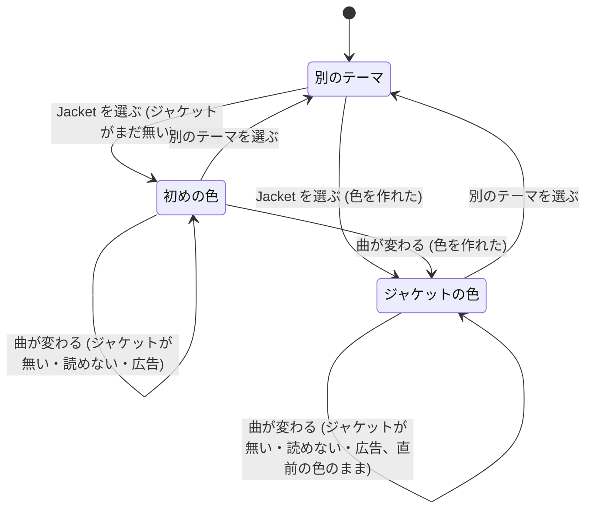

# Jacket テーマ

用語は [GLOSSARY.md](../../GLOSSARY.md) に従う (テーマ・色項目・同梱テーマ・面のぼかし・Jacket テーマ・マスク)。テーマの仕組みは [テーマ・背景動画・Discord の表示テンプレート](theme-bgvideo-discord.md) の上に足す。

## Problem Statement

今の同梱テーマ (Default・Midnight・Forest・Glass) は、どれも色が決まっている。背景に再生中の動画を流していても、アクセントや面の色は曲と関係が無く、MV やジャケットの色とテーマの色がぶつかることがある。曲ごとに雰囲気を合わせたくても、テーマファイルを曲ごとに書き換えるわけにはいかない。

## Solution

同梱テーマに **Jacket** を足す。Jacket を選んでいる間は、再生中の曲のジャケットから色項目 (アクセント・背景・面・枠線) を作り、曲が変わるたびに約 0.6 秒かけてなめらかに色が移る。文字と控えめな文字の色は白系に固定し、どのジャケットでも読めるようにする。面は Glass と同じすりガラス (面のぼかし 20px) にする。

ジャケットが無い・読めないときは直前の色のままにし、一度も色を作っていなければ Glass の色を使う。鮮やかな色が無いジャケット (白黒など) では、アクセントだけ Glass のアクセントを使う。

既定のテーマは今のまま Glass で、Jacket は利用者が選んだときだけ使う。

## User Stories

1. 利用者として、設定画面の Appearance → Theme で、同梱テーマの 1 つとして Jacket を選びたい。それは、曲に合わせて色が変わる見た目を、手間をかけずに使いたいからだ。
2. 利用者として、Jacket を選んだら、再起動せずにすぐ、再生中の曲のジャケットの色になってほしい。それは、見比べながら選びたいからだ。
3. 利用者として、曲が変わったら、テーマの色もその曲のジャケットの色に変わってほしい。それは、曲ごとに雰囲気をそろえたいからだ。
4. 利用者として、色はぱっと切り替わるのではなく、約 0.6 秒かけてなめらかに移ってほしい。それは、曲の変わり目に画面がちらつくと目が疲れるからだ。
5. 利用者として、OS の「アニメーションを減らす」がオンのときは、色が一瞬で切り替わってほしい。それは、動きを減らす設定を尊重してほしいからだ。
6. 利用者として、アクセント (シークバー・スイッチ・スライダー) には、ジャケットの中の目立つ鮮やかな色が使われてほしい。それは、その曲らしさが一番伝わる色だからだ。
7. 利用者として、背景・面・枠線は、ジャケットの主な色を暗く落とした色であってほしい。それは、曲の雰囲気を出しつつ、画面が明るくなりすぎないようにしたいからだ。
8. 利用者として、文字と控えめな文字の色は、どの曲でも白系のままであってほしい。それは、ジャケットによって文字が読めなくなると困るからだ。
9. 利用者として、Jacket の面は Glass と同じすりガラスであってほしい。それは、背景動画が面の後ろに透ける見た目のまま、色だけを曲に合わせたいからだ。
10. 利用者として、白黒や彩度の低いジャケットでも、アクセントははっきりした色であってほしい (Glass のアクセントを使う)。それは、シークバーやスイッチが灰色に埋もれると見づらいからだ。
11. 利用者として、起動直後で曲が無いとき、ジャケットが取れないとき、広告のときは、直前の色のままであってほしい。それは、曲の合間に色がちらつくと落ち着かないからだ。
12. 利用者として、Jacket を選んで一度も色を作っていないときは、Glass の色で描かれてほしい。それは、色の無い画面になると困るからだ。
13. 利用者として、Jacket の色は、アプリ画面 (タイトルバー・設定・ミニプレイヤーなど) と YTM 画面の両方に当たってほしい。それは、今のテーマと同じく、アプリ全体を 1 つの見た目にしたいからだ。
14. 利用者として、タイトルバーの色も、曲の色に合わせて変わってほしい。それは、ウィンドウの上端だけ色が浮かないようにしたいからだ。
15. 利用者として、背景動画のマスクの色も、曲の色に合わせて変わってほしい。それは、今のテーマと同じく、マスクの色はテーマの背景色に従ってほしいからだ。
16. 利用者として、カスタム CSS は、Jacket の後に当たってほしい。それは、Jacket の一部を自分で上書きしたいからだ。
17. 利用者として、Jacket から別のテーマに切り替えたら、曲が変わっても色が変わらなくなってほしい。それは、選んだテーマの色のままでいてほしいからだ。
18. 利用者として、新しく入れたときの既定のテーマは、今のまま Glass であってほしい。それは、曲ごとに色が変わるのは好みが分かれるからだ。
19. 利用者として、Jacket を選んでいても、アプリが重くならないでほしい。それは、音楽を聴くためのアプリで CPU を食われたくないからだ。

## Implementation Decisions

- **同梱テーマに Jacket を足す**: 同梱テーマの名前に `jacket` を足す。同梱テーマの定義としての Jacket の色項目と面のぼかしは、Glass と同じ値にする (一度も色を作っていないときの色)。テーマの読み込み (共有モジュール) はそのまま使える。
- **ジャケットの色の取り出し (共有モジュール、新規、純粋な関数)**: ジャケットの画素 (RGBA の並びと幅・高さ) を受け取り、Jacket の色項目 6 つ (`ThemeColors`) を返す。色の値は 16 進 (`#RRGGBB`、透明度があれば `#RRGGBBAA`) で返す。次のことはこの関数が受け持つ。
  - 画素を OKLCH で色の近いまとまりに分け、数の多いまとまりを **主な色**、鮮やかさと数を掛け合わせて一番大きいまとまり (数が全体の 3% 以上) を **目立つ色** とする。ほぼ透明な画素は数えない。
  - アクセント: 目立つ色の色相で、明るさを読みやすい高さ (OKLCH の L を 0.72 前後) にそろえ、鮮やかさを下限と上限の間に収めた色。目立つ色の鮮やかさが足りない (白黒・彩度が低い) ときは、Glass のアクセントを使う。
  - 背景: 主な色の色相で、とても暗く (L 0.16 前後)、鮮やかさを抑えた色。
  - 面・枠線: 主な色の色相を少しだけ帯びた、白の半透明 (Glass の面と枠線と同じ透明度の考え方)。
  - 文字と控えめな文字: Glass と同じ固定の値。
  - 具体的な数値は、実装後に画面を見ながら調整してよい。
- **ジャケットの取り込み (メインプロセス)**: テーマの適用役が、Jacket を選んでいる間だけ、再生中の曲が変わったこと (PlayerStateStore の曲の変化) を見張る。
  - その曲のジャケットの URL のうち、64px 以上で一番小さいものをメインで読み込み、Electron の画像として読んで 64×64 程度に縮め、画素を色の取り出しに渡す。
  - 同じ URL の結果は、直近 20 曲分を覚えて使い回す。
  - 読み込みは 5 秒で打ち切る。曲が無い・URL が無い・広告・読み込めない・読めないときは、色を変えない (直前の色のまま)。
  - 読み込んでいる間に次の曲に変わったら、前の曲の結果は捨てる (最後の曲の色だけを当てる)。
- **当て方**: 作った色項目を、今のテーマの適用 (アプリ画面への CSS 変数の注入・YTM 画面の CSS・タイトルバーの重ね表示・「色が変わった」の知らせを受けた背景動画のマスクの色) にそのまま流す。今は当て直しが設定から読み直す 1 つの処理に閉じているので、その後半 (色と面のぼかしを受けて当てる部分) を、外から色を渡せる口に切り出し、テーマの読み込みの道と Jacket の道の両方から使う。Jacket 用の当て方の道を別に作らない。
- **なめらかな移り方**: 6 つの色項目の CSS 変数を、各画面で `<color>` の型の登録済みの変数 (`@property`) にし、Jacket を選んでいる間だけ、`:root` に 0.6 秒の移り方 (transition) を付ける。OS の「アニメーションを減らす」がオンのとき (`prefers-reduced-motion: reduce`) は移り方を付けない。タイトルバーの重ね表示は、移り終わりの色を 1 回で当てる。
- **設定画面**: Appearance → Theme の同梱テーマの選択肢に Jacket を足す。設定の型は、同梱テーマの名前が増えるだけで、新しいキーは足さない。既定は Glass のまま。

## Testing Decisions

- よいテストは、純粋な関数に入力を与えて出力だけを確かめる。色のまとまりの分け方の中身には触れない。テストは Vitest で、`src/shared/theme/` の今のテストと同じ書き方にする。
- **合意済みの seam** (この 2 つでテストを先に書く):
  1. **ジャケットの色の取り出し**: 画素 → 6 つの色項目。次のことを確かめる。
     - 単色の赤・青・緑のジャケットで、アクセントがその色相になること
     - 半分が暗い色で、一部に鮮やかな色があるジャケットで、背景は暗い色の色相、アクセントは鮮やかな色の色相になること
     - 白黒・灰色だけのジャケットで、アクセントが Glass のアクセントになること
     - 文字と控えめな文字が、どの入力でも固定の値になること
     - 背景がどの入力でも暗いこと (明るさの上限)
     - 返す値がすべてテーマの色として読める (`isReadableColor`) こと
     - 透明な画素だけの入力で、Glass の色になること
  2. **テーマの読み込み**: 同梱テーマ Jacket を選んだとき、Glass と同じ色項目と面のぼかしが返ること (今のテストに 1 件足す)。
- テストしないものは、開発版で確かめる: 曲が変わったときに色が移ること、移り方の速さ、タイトルバーとマスクの色、広告や曲の無いときに色が変わらないこと、Jacket から別のテーマに戻したときに色が止まること。

## Out of Scope

- 文字の色をジャケットに合わせて変えること。
- 明るい (ライトの) Jacket。
- 再生中の MV の映像から色を作ること (ジャケットだけを使う)。
- Jacket の色の作り方を利用者が調整する設定 (鮮やかさ・明るさなど)。
- テーマファイルでジャケットの色を参照すること。

## Further Notes

- 色の取り出しをメインで行うのは、YTM 画面 (Google のページ) の中で画像を読むと、ジャケットの画像が別の origin で canvas が汚れて画素を読めず、またページのスクリプトに色の処理を足すことになるため。
- ジャケットの URL は YouTube の画像の配信元で、YTM 画面がすでに読み込んでいるものと同じ。メインから読むのは 1 曲に 1 回で、使い回しもする。

## 状態の図

pstack の `/statechart` の検査 (TLC と Java のダウンロードが要る) は、利用者の許可を取っていないため行っていない。図と利用者の合意で Ready とする。

「初めの色」は Glass の色項目と面のぼかしで描く。
