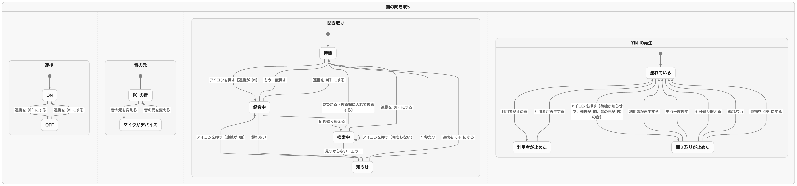
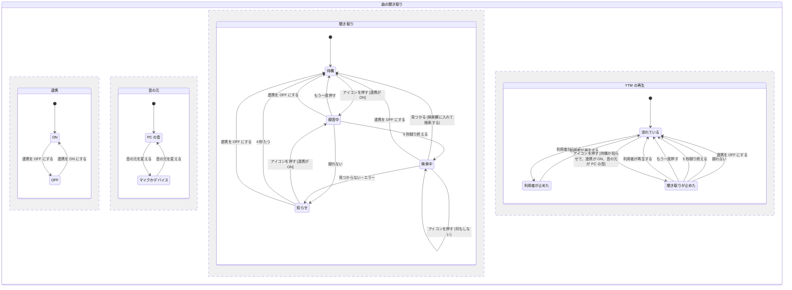

# 曲の聞き取り (Shazam 連携)

用語は [GLOSSARY.md](../../GLOSSARY.md) に従う (曲の聞き取り・音の元・PC の音)。録る場所と問い合わせる場所は [ADR 0003](../adr/0003-song-recognition-outside-ytm-view.md) に従う。

## Problem Statement

PC で流れている曲 (ほかのアプリの動画、配信、ゲームなど) が気になっても、YouTube Music で探すには曲名とアーティストを知っている必要がある。今は、スマートフォンの Shazam を PC のスピーカーに向けて聞き取らせ、出てきた曲名を手で打ち込んで検索するしかない。

## Solution

設定画面の Integrations タブに **Shazam** の欄を足す。利用者は有効にするトグルを入れ、RapidAPI で取った Shazam の API Key を入力し、**音の元** を選ぶ。音の元の既定は **PC の音** (PC から出ている音すべて)。

有効にすると、YTM 画面の検索欄のすぐ右にアイコンが出る。押すと、音の元を 5 秒録って Shazam に問い合わせる。曲が見つかると、`<曲名> <アーティスト>` が検索欄に入り、そのまま YouTube Music の検索結果が開く。見つからないときやエラーのときは、アイコンの下に短い文が数秒出る。

## User Stories

### 設定

1. 利用者として、設定画面の Integrations タブで、Shazam の連携を ON / OFF したい。それは、使わないときにアイコンを出したくないからだ。
2. 利用者として、API Key の入力欄の横に、キーを取るページ (RapidAPI の Shazam) へのリンクがほしい。それは、どこでキーを取るのか迷いたくないからだ。
3. 利用者として、API Key の入力欄は、入れた文字が隠れてほしい。それは、画面を人に見せることがあるからだ。
4. 利用者として、API Key は暗号化して保存されてほしい。それは、使った分だけ課金されるキーを、設定ファイルにそのまま残したくないからだ。
5. 利用者として、OS の暗号化 (safeStorage) が使えない環境では、Shazam を有効にできないこと、とその理由を設定画面で知りたい。それは、なぜ使えないのか分からないと困るからだ。
6. 利用者として、音の元を「PC の音」「システムの既定のマイク」、接続されている入力デバイス (マイク・仮想ケーブル・Monitor など) から選びたい。それは、聞き取りたい音がどこから来るかは場合によるからだ。
7. 利用者として、音の元は、何も選ばなければ「PC の音」になってほしい。それは、たいていは PC で流れている曲を探したいからだ。
8. 利用者として、Linux では「PC の音」の選択肢が出ず、Monitor のデバイスを選べばよいようにしてほしい。それは、選べても録れない選択肢があると迷うからだ。
9. 利用者として、選んでいたデバイスが今つながっていないとき、設定画面にそのデバイスの名前と「つながっていない」ことが出てほしい。それは、知らないうちに別のデバイスで録られていると気づけないからだ。
10. 利用者として、設定画面に「キーを試す」ボタンは要らない。キーの誤りは、使ったときに知らせてくれればよい。それは、試すだけで API の回数を使いたくないからだ。

### アイコン

11. 利用者として、Shazam が有効で API Key が入っているときだけ、YTM 画面の検索欄のすぐ右にアイコンが出てほしい。それは、使えない状態のアイコンを押したくないからだ。
12. 利用者として、アイコンにマウスを乗せたら「Shazam で曲を探す」と分かる説明が出てほしい。それは、汎用の形のアイコンだけでは何のボタンか分からないからだ。
13. 利用者として、アイコンは YTM 画面の戻る・進むの矢印と同じ系統の見た目 (Material Symbols) であってほしい。それは、ナビバーの中で浮かないでほしいからだ。
14. 利用者として、設定でトグルを OFF にしたら、アイコンがすぐ消えてほしい。また ON にしたら、YTM 画面を読み込み直さなくても出てほしい。それは、設定を変えるたびにページを読み込み直したくないからだ。

### 聞き取り

15. 利用者として、アイコンを押したら、音の元を 5 秒録って曲を探してほしい。それは、気になった曲をすぐ探したいからだ。
16. 利用者として、録音中はアイコンが点滅し、問い合わせ中はアイコンが回転してほしい。それは、今どの段階かを知りたいからだ。
17. 利用者として、録音中にもう一度押したら、録音を取り消して待機に戻ってほしい。それは、間違えて押したときに止めたいからだ。
18. 利用者として、問い合わせ中に押しても、何も起きないでほしい。それは、二重に問い合わせて API の回数を使いたくないからだ。
19. 利用者として、曲が見つかったら、`<曲名> <アーティスト>` が検索欄に入り、そのまま検索結果が開いてほしい。それは、打ち込む手間を省きたいからだ。
20. 利用者として、検索欄に入った文字が見えてほしい。それは、何で検索したかを確かめて、必要なら打ち直したいからだ。
21. 利用者として、見つからなかったときは、アイコンの下に `No match found` が数秒出てほしい。それは、失敗したのか、まだ動いているのかを見分けたいからだ。
22. 利用者として、API Key が違う・契約していないときは `Invalid API key`、回数の上限に達したときは `API limit reached` と出てほしい。それは、直し方が違うからだ。
23. 利用者として、通信できないときや、応答が 15 秒来ないときは `Network error` と出てほしい。それは、待ち続けたくないからだ。
24. 利用者として、音の元から録れないとき (マイクの権限が無い、OS が PC の音の取り込みを許していない など) は `Audio source unavailable` と出てほしい。それは、設定か OS の許可を見直すべきだと分かるからだ。
25. 利用者として、見つからなかったときやエラーのときは、自動ではやり直さないでほしい。もう一度押せばやり直せればよい。それは、API の回数を勝手に使ってほしくないからだ。
26. 利用者として、知らせの文が出ている間にアイコンを押したら、すぐ次の聞き取りを始めてほしい。それは、文が消えるのを待ちたくないからだ。

### PC の音とアプリ自身の再生

27. 利用者として、音の元が「PC の音」で YTM が再生中なら、録音の 5 秒だけ YTM が一時停止し、録り終えたら再生に戻ってほしい。それは、このアプリの曲ではなく、ほかで流れている曲を聞き取りたいからだ。
28. 利用者として、YTM が元から止まっていたら、録り終えたあとも止まったままであってほしい。それは、勝手に曲が流れ出すと驚くからだ。
29. 利用者として、音の元がマイクや入力デバイスのときは、YTM の再生に触れないでほしい。それは、録る音にアプリの音が入るかどうかは、利用者が分かって選んでいるからだ。
30. 利用者として、録音を取り消したときや、録音がエラーで終わったときも、一時停止していた再生は戻ってほしい。それは、聞き取りのせいで曲が止まったままになると困るからだ。
31. 利用者として、録音中・問い合わせ中に設定のトグルを OFF にしたら、聞き取りが取り消されて待機に戻り、一時停止していた再生も戻ってほしい。それは、OFF にした機能が動き続けてほしくないからだ。
32. 利用者として、聞き取りが止めている間に自分で再生・停止を操作したら、録り終えたあとは自分の操作のままにしてほしい。それは、自分で止めた曲を勝手に流されたくないからだ。

### 安全

33. 利用者として、YouTube Music のページ (YTM 画面) には、マイクの権限も PC の音の取り込みも API Key も渡らないでほしい。それは、Google のページのスクリプトにそれらを使われたくないからだ。
34. 利用者として、macOS で「PC の音」を使うとき、OS の許可を求められる理由の説明を読みたい。それは、何のために音の取り込みを許すのか分かりたいからだ。

## Implementation Decisions

### 設定 (integrations)
- `shazamEnabled: boolean` (既定 false)
- `shazamApiKey: string | null`。`safeStorage` で暗号化した値を hex にしたもの (companion のトークンと同じ形)。既定 null。
- `shazamAudioSource`: 音の元。`{ kind, deviceId, label }` の形。
  - `kind` は定数オブジェクト `SongRecognitionSourceKind` (PcAudio: "pc-audio" / DefaultMic: "default-mic" / Device: "device")。
  - `deviceId` と `label` は `kind` が Device のときだけ入る。`label` は、デバイスがつながっていないときに設定画面で名前を出すために持つ。
  - 既定は `{ kind: PcAudio, deviceId: null, label: null }`。
- 既存の利用者にも、版の移行で既定値を入れる。ただし移行のキーはアプリの版で、2.2.0 の移行を済ませた設定ファイルには新しいキーが入らない。そのため、読む側 (連携・設定画面・音の元の決定) は、値が無いときに既定値として扱う。
- 有効にできる条件は「`shazamEnabled` が true、API Key が入っている、`safeStorage` が使える」のすべて。満たさないときアイコンを出さない。

### 設定画面 (Integrations タブの Shazam の欄)
- 項目は英語: `Shazam` のトグル、`API key` (password の入力欄。横に `Get an API key` のリンクで https://rapidapi.com/apidojo/api/shazam を外部のブラウザで開く)、`Audio source` の選択。
- 入力された API Key は、保存のときに safeStorage で暗号化する。表示は伏せたまま。
- `Audio source` の選択肢は、`PC audio` (Linux では出さない)・`System default microphone`・入力デバイスの 1 台ずつ (`default` と `communications` の仮の ID は除く)。
  - デバイスの一覧は、設定画面では取らない。録音するアプリ画面が `enumerateDevices` の `audioinput` を取り (つながりが変わるたび、`devicechange` で取り直す)、メインの MemoryStore を通して設定画面に渡す。Chromium の deviceId は origin ごとに違う値になるので、録る画面と同じところで取った ID を保存するため。
- 選んでいるデバイスが一覧に無いときは、そのデバイスの `label` に `(not connected)` を付けて選択肢に残し、「録るときはシステムの既定のマイクを使う」と添える。
- safeStorage が使えないときは、トグルを押せなくし、理由を出す (companion サーバーの欄と同じ扱い)。

### 新しい連携 (メインプロセス)
- 既存の `Integration` の形で足す。`storeEnableProperty` は `integrations.shazamEnabled`。聞き取りの状態はここが持つ。
- 受け持ち:
  1. YTM 画面からの「アイコンが押された」の合図を受け、聞き取りの状態の決定 (下の共有モジュール) に通す。
  2. 録音を始めるとき、アプリ画面 (メインウィンドウの下のビュー、`ytmd-app://`) に「音の元をこの値で 5 秒録って」と頼む。返ってくるのは PCM の base64 か、録れなかったこと。
  3. 音の元が PC の音で YTM が再生中なら、録音の前に既存のリモート操作 (`RemoteControl` の `pause`) で止め、録音が終わったら (成功・取り消し・失敗・OFF のどれでも) `play` で戻す。再生中かどうかは `PlayerStateStore` の状態で決める。
     - 「聞き取りが止めた」という印を持ち、録音が終わったときに印があるときだけ `play` で戻す。録音中に YTM が再生に変わったら (利用者が再生した)、印を消す。
  4. API Key を safeStorage で復号し、Shazam に問い合わせる (下の契約)。15 秒で打ち切る。
  5. 応答を応答の解釈 (共有モジュール) に通し、見つかれば YTM 画面に「検索の文字列で検索して」と送る。
  6. 状態が変わるたびに、YTM 画面に今の状態 (待機 / 録音中 / 検索中 / 知らせの文) を送る。アイコンを出すかどうかも一緒に送る。
- 知らせの文は 4 秒で消して待機に戻す。

### Shazam API の契約
- `POST https://shazam.p.rapidapi.com/songs/v2/detect`
- ヘッダー: `X-RapidAPI-Key: <API Key>`、`X-RapidAPI-Host: shazam.p.rapidapi.com`、`Content-Type: text/plain`
- 本文: 44.1kHz・モノラル・符号付き 16bit リトルエンディアンの PCM を base64 にした文字列。5 秒で約 441KB。
- 応答: `track` があれば一致。`track.title` が曲名、`track.subtitle` がアーティスト。`track` が無ければ見つからない。
- HTTP の状態の扱い: 401・403 → キーが違う、429 → 回数の上限、そのほかの 4xx・5xx・通信の失敗・15 秒の打ち切り → 通信エラー。

### 録音 (アプリ画面)
- アプリ画面の preload に、録音を受ける口を足す。録音の処理はこの画面の中だけで動く。
- 音の元の決定 (共有モジュール) が返した元で録る:
  - PC の音: `getDisplayMedia` を呼び、メインの `setDisplayMediaRequestHandler` が、このアプリ画面からの要求にだけ、画面の 1 つと `audio: 'loopback'` を返す。映像のトラックはすぐ止める。
  - マイク・デバイス: `getUserMedia({ audio: { deviceId, echoCancellation: false, noiseSuppression: false, autoGainControl: false } })`。音楽の聞き取りの精度を落とさないため、3 つの補正を切る。
- 5 秒分の音を集め、音の変換 (共有モジュール) で base64 にして返す。取り消しの合図が来たら、集めるのをやめてトラックを止める。
- 既定のセッションの権限: 今は既定のセッションに権限の扱いが無く、すべて許されている。音声 (`media` の audio) と画面の取り込みは、アプリ画面 (メインウィンドウの下のビュー) からの要求だけを許すようにする。見分けは origin ではなく webContents で行う (開発版では origin が `http://localhost` になり、ほかの `ytmd-app://` の画面も同じセッションにあるため)。それ以外の権限の扱いは今のまま変えない。
- 隠れた画面からの録音: アプリ画面は YTM 画面の準備ができると `setVisible(false)` で隠れ、タイマーが絞られうる。録音の 5 秒はタイマーではなく、集めたサンプルの数で数える。`getDisplayMedia` が利用者の操作を求める場合に備え、メインは録音を `executeJavaScript` の userGesture で始める。
- macOS: パッケージの `Info.plist` に `NSAudioCaptureUsageDescription` (PC の音を取り込む理由) と `NSMicrophoneUsageDescription` (マイクで録る理由) を足す。
- 設定画面の外部リンク: 設定画面は決まった URL しか外部のブラウザで開かないので、RapidAPI の Shazam のページをその許可に足す。

### YTM 画面
- 検索欄 (`ytmusic-search-box`) のすぐ右に、Material Symbols のアイコン (`graphic_eq`) を足す。`title` は `Search with Shazam`。新しい YTM の UI (ナビバーに検索欄がある) だけに足し、検索欄が見つからなければ何もしない。
- 見た目: 待機 / 録音中 (点滅) / 検索中 (回転) / 知らせの文 (アイコンの下に小さく)。色はテーマの色項目から取る。
- アイコンを出す・隠す・状態の変化は、メインから送られた状態に従う。押されたら合図を送るだけで、YTM 画面の中では判断しない。
- 検索: 検索欄の入力に文字を入れたうえで、YouTube Music 自身の遷移 (`searchEndpoint` の `query`) で検索結果を開く。Enter キーを真似るより壊れにくいため。
- preload とページのスクリプトのやりとりの名前 (IPC と `postMessage` の op) は、共有モジュールに定数として置き、preload・ページ・メインで同じものを使う (背景動画の G2 と同じ置き方)。

### 共有モジュール (曲の聞き取り)
純粋な関数だけを置く。テストの境界はここ (Testing Decisions を参照)。
- **音の変換**: 録った音 (Float32 のサンプル列と、その標本化周波数・チャンネル数) を受け、44.1kHz・モノラル・16bit の PCM の base64 を返す。複数チャンネルは平均してモノラルにし、周波数は 44.1kHz に変える。範囲を超える値は丸める。
- **応答の解釈**: HTTP の状態と JSON (または通信の失敗・打ち切り) を受け、「検索の文字列」か「結果の種類」(見つからない / キーが違う / 回数の上限 / 通信エラー) を返す。曲名かアーティストの片方しか無いときは、ある方だけで検索の文字列を作る。
- **音の元の決定**: 設定の音の元・今つながっている入力デバイスの一覧・OS を受け、実際に録る元 (PC の音 / 既定のマイク / ある 1 台) を返す。Device がつながっていなければ既定のマイク。Linux で PC の音が設定されていたら既定のマイク。
- **聞き取りの状態の決定**: 今の状態と出来事 (押された・録り終えた・録れなかった・応答が来た・知らせの時間が過ぎた・OFF になった) を受け、次の状態と、メインがすること (録音を頼む・取り消す・問い合わせる・一時停止する・再生に戻す・検索する) を返す。

## Testing Decisions

- よいテストは、共有モジュールの関数に入力を与え、出力だけを確かめる。中の作り (補間のやり方など) には触れない。
- テストは Vitest で、`src/shared/background-video/index.test.ts`・`src/shared/theme/index.test.ts`・`src/shared/discord-presence/activity.test.ts` と同じ書き方にする。
- **合意済みの seam** (この 4 つでテストを先に書く):
  1. 音の変換: 48kHz・ステレオの入力が 44.1kHz・モノラルの長さとバイト数になる、±1 を超える値が丸められる、無音が 0 の列になる、base64 として読み戻せる。
  2. 応答の解釈: 一致 → `<曲名> <アーティスト>`、`track` 無し → 見つからない、401・403 → キーが違う、429 → 回数の上限、500・通信の失敗・打ち切り → 通信エラー、片方だけの曲名・アーティスト。
  3. 音の元の決定: PC の音 (Windows・macOS / Linux)、既定のマイク、つながっているデバイス、つながっていないデバイス。
  4. 聞き取りの状態の決定: 状態の図 (下) のすべての遷移と、`%% never` の規則 (検索中に押しても問い合わせが増えない、録音が終わる道のすべてで一時停止が戻る など)。
- 録音そのもの (`getDisplayMedia` / `getUserMedia`)、Shazam への実際の問い合わせ、YTM 画面の DOM の操作は、自動のテストを書かず、開発版で実際に確かめる。実際の API を呼ぶテストは置かない。

## 状態の図

4 つの部分 (連携・音の元・聞き取り・YTM の再生) が並んで動く。同じ出来事 (例えば「アイコンを押す」) は、その出来事で動ける部分をまとめて動かす。`[ ]` の中は、その遷移が起きる条件。

図から読める決まり:
- 利用者が自分で止めていた再生 (「利用者が止めた」) に、聞き取りは触れない。録り終えても再生に戻さない。
- 聞き取りが止めている間に利用者が再生したら、その時点で「流れている」になり、聞き取りはもう再生を止めたものとして扱わない。そのあと利用者がまた止めたら、「利用者が止めた」になり、録り終えても戻さない。
- 検索中にアイコンを押しても状態は変わらず、問い合わせは 1 つのまま。

検査: pstack の `/statechart from-chart` で、上の図と同じ形 (状態と遷移の名前を英語にしたもの) を TLC にかけた (2026-11-02)。5 つの `%% never` の規則はすべて守られた (22 の状態、規則を破る状態は 0)。TLC は日本語の文字列を読めないため、検査用の図は英語の名前にした。検査用の図は [song-recognition/statechart-check.mmd](song-recognition/statechart-check.mmd)。画像 (`statechart.png`) は上の Mermaid を pstack の `render` で描いたもの。

## Out of Scope

- 全体のショートカットキーで聞き取りを始めること
- 聞き取った曲の履歴
- Chromium の `restrictOwnAudio` でアプリ自身の音を除いて録ること (ADR 0003 の「考えた別の案」)
- 古い YTM の UI (ピボットバー) へのアイコン
- 「キーを試す」ボタン
- RapidAPI の apidojo 版以外の Shazam 系 API
- Shazam のロゴを使うこと (使うなら README の商標の欄に Shazam を書き足す)

## Further Notes

- Shazam の本文の上限は 500KB とよく書かれるが、公式の文書では確かめられていない。5 秒 (約 441KB) はその内に収まる。
- アプリ画面 (ローディング画面) は、YTM 画面が読み込まれたあと隠される (`appView:hide`)。隠れたビューでも `getUserMedia` と `getDisplayMedia` で録れるかは、最初の PBI で開発版で確かめる。録れなければ、録音のときだけ見えない形で動かす手を考える。
- Windows のループバックは、既定の出力デバイスの音を録る。出力が複数あるときに別のデバイスの音は録れない。
- macOS の PC の音は、Electron 39 以降の CoreAudio Tap による。初回に OS の許可が出る。
- Shazam は Apple の商標。README の改変・ライセンス・商標の欄に、この連携のことを足すかは実装のときに決める。
- 状態の図の検査に使った図 (英語の名前) は [song-recognition/statechart-check.mmd](song-recognition/statechart-check.mmd)。pstack を入れた環境で、その置き場所で `node <pstack>/skills/statechart/scripts/statechart.mjs from-chart statechart-check.mmd` を走らせれば、もう一度検査できる (生成物はリポジトリに入れない)。
