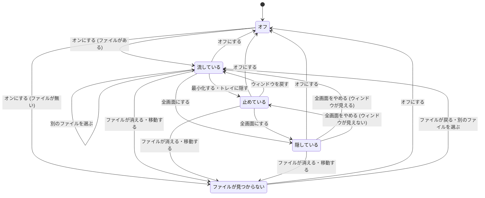

# テーマ・背景動画・Discord の表示テンプレート

用語は [GLOSSARY.md](../../GLOSSARY.md) に従う。背景動画の置き方は [ADR 0001](../adr/0001-background-video-below-ytm-view.md) に従う。

## Problem Statement

今の YouTube Music Desktop App は、見た目を変える手段がカスタム CSS しかない。カスタム CSS は YTM 画面にしか効かず、アプリ画面 (タイトルバー・設定・ミニプレイヤーなど) は黒の配色に固定されている。色を変えたいだけでも、YTM のクラス名を調べて CSS を書く必要があり、YTM 画面とアプリ画面の色もそろわない。

背景に好きな動画を流して雰囲気を変える手段も無い。

Discord に出る内容も固定で、1 行目に曲名、2 行目にアーティスト、ジャケットの説明文にアルバム名が出るだけである。「曲名 / アーティスト」を 1 行にまとめるなど、見せ方を変えられない。

## Solution

**テーマ**: 利用者はテーマを 1 つ選ぶ。テーマは 6 つの色項目 (背景・面・文字・控えめな文字・アクセント・枠線) を持ち、アプリ画面と YTM 画面の両方がその色で描かれる。
- 同梱テーマは Default (今の見た目と同じ)・Midnight・Forest の 3 つ。
- 利用者は、色項目の値を書いたテーマファイルを作って選ぶこともできる。
- 切り替えもテーマファイルの書き換えも、再起動せずにすぐ反映される。
- 既存のカスタム CSS は残り、テーマの後に当たる。

**背景動画**: 利用者はローカルの動画ファイルを 1 本選び、メインウィンドウの背景全体に無音でループ再生できる。
- 背景動画の上には、YTM 画面を読みやすくするマスクが重なる。マスクの色はテーマの背景色で、濃さとぼかしを選べる。
- ウィンドウが見えない間と全画面表示の間は、動画が止まる。

**Discord**: 利用者は、Discord の 1 行目・2 行目・ジャケットの説明文の 3 欄に、表示テンプレートを書ける。
- テンプレートには `{title}`・`{artist}`・`{album}` を差し込める。
- 「Play on YTMDesktop」ボタンを出すかどうかと、フレンド一覧に出す内容も選べる。
- 設定画面で、再生中の曲を使ったプレビューを見ながら書ける。

## User Stories

### テーマ

1. 利用者として、設定画面の Appearance タブで同梱テーマを選びたい。それは、手間をかけずに好みの色にしたいからだ。
2. 利用者として、テーマを選んだらすぐ (再起動せずに) 全画面の色が変わってほしい。それは、見比べながら選びたいからだ。
3. 利用者として、テーマを変えたときに、アプリ画面と YTM 画面の色がそろってほしい。それは、アプリ全体が一つの見た目に見えるようにしたいからだ。
4. 利用者として、タイトルバーの色もテーマに合わせて変わってほしい。それは、ウィンドウの上端だけ黒く浮かないようにしたいからだ。
5. 利用者として、ミニプレイヤーにもテーマが当たってほしい。それは、どの画面でも同じ雰囲気でいたいからだ。
6. 利用者として、設定画面そのものもテーマの色で描かれてほしい。それは、設定を変えた結果をその場で感じたいからだ。
7. 利用者として、アップデートした直後は今までと同じ見た目のままでいてほしい (Default)。それは、知らないうちに見た目が変わると戸惑うからだ。
8. 利用者として、Midnight (紺) と Forest (深緑) を選びたい。それは、黒以外の暗い配色も試したいからだ。
9. 利用者として、色項目の値を書いたテーマファイルを作って選びたい。それは、同梱テーマに無い好みの色にしたいからだ。
10. 利用者として、テーマファイルを保存し直したら、すぐ反映されてほしい。それは、色を少しずつ調整したいからだ。
11. 利用者として、テーマファイルに書き忘れた色項目や、色として読めない値があっても、テーマが使えてほしい。足りない項目は Default の色でよい。それは、1 か所の書き間違いでテーマ全体が使えなくなると困るからだ。
12. 利用者として、テーマファイルのどの色項目が読めなかったかを、設定画面で知りたい。それは、どこを直せばよいか分かるようにしたいからだ。
13. 利用者として、テーマファイルが見つからなくなっても、アプリが Default の色で動き続けてほしい。そのうえで、設定画面で「見つからない」と知りたい。それは、ファイルを移動しただけでアプリが崩れると困るからだ。
14. 利用者として、カスタム CSS をテーマの後に当てて、テーマの一部を上書きしたい。それは、テーマでは変えられない細部を自分で直したいからだ。
15. 利用者として、YTM 画面のアクセント (シークバーなど) もテーマのアクセント色になってほしい。それは、配色の印象を統一したいからだ。
16. 利用者として、アプリ画面のスイッチやスライダーのアクセントもテーマのアクセント色になってほしい。それは、設定画面でも同じ配色でいたいからだ。

### 背景動画

17. 利用者として、Appearance タブで背景動画をオンにし、PC 上の動画ファイル (mp4 / webm) を 1 本選びたい。それは、好きな映像を背景に流したいからだ。
18. 利用者として、背景動画がメインウィンドウの背景全体 (タイトルバーを除く) に、無音でループ再生されてほしい。それは、音楽の邪魔をせずに雰囲気だけ変えたいからだ。
19. 利用者として、背景動画の上でも YTM 画面の文字が読めてほしい。それは、操作できなくなると困るからだ。
20. 利用者として、マスクの濃さを 0〜100% で調整したい。それは、動画をどれくらい見せるかを自分で決めたいからだ。
21. 利用者として、マスクのぼかしを 0〜20px くらいで調整したい。それは、動画がうるさいときに柔らかくしたいからだ。
22. 利用者として、マスクの色がテーマの背景色に合ってほしい。それは、テーマと背景動画の雰囲気をそろえたいからだ。
23. 利用者として、濃さやぼかしを動かしたらすぐ反映されてほしい。それは、見ながら調整したいからだ。
24. 利用者として、背景動画をオンにした直後のマスクは、濃さ 60%・ぼかし 0px から始まってほしい。それは、最初から文字が読める状態にしたいからだ。
25. 利用者として、曲を一時停止しても、背景動画は流れ続けてほしい。それは、背景は音楽と切り離した飾りだからだ。
26. 利用者として、ウィンドウを最小化したりトレイに隠したりしている間は、背景動画が止まってほしい。それは、見えない動画に CPU や GPU を使ってほしくないからだ。
27. 利用者として、ウィンドウを戻したら、背景動画が再び流れてほしい。それは、手で再生し直したくないからだ。
28. 利用者として、YTM 画面を全画面表示している間は、背景動画が止まって見えなくなってほしい。それは、全画面の MV の邪魔をされたくないからだ。
29. 利用者として、選んだ動画ファイルが見つからなくなったら、背景動画なしの普段の見た目で使い続けたい。それは、ファイルの移動でアプリが崩れると困るからだ。
30. 利用者として、動画ファイルが見つからないことを設定画面で知りたい。パスは消えずに残っていてほしい。それは、ファイルを戻せばまた使えるようにしたいからだ。
31. 利用者として、背景動画をオフにしたら、YTM 画面がテーマの背景色に戻ってほしい。それは、いつでも普段の見た目に戻せるようにしたいからだ。
32. 利用者として、初めて使うときは背景動画がオフであってほしい。それは、頼んでいない動画が流れると困るからだ。

### Discord

33. 利用者として、Integrations タブで、Discord の 1 行目の表示テンプレートを書きたい。例えば `{title} / {artist}` とすれば、曲名とアーティストを 1 行で見せられる。
34. 利用者として、Discord の 2 行目の表示テンプレートを書きたい。それは、1 行目に入れなかった情報を出したいからだ。
35. 利用者として、ジャケット画像にカーソルを当てたときの説明文の表示テンプレートを書きたい。それは、アルバム名以外も出せるようにしたいからだ。
36. 利用者として、表示テンプレートに `{title}`・`{artist}`・`{album}` を差し込めることを、設定画面で知りたい。それは、書き方を覚えていなくても使いたいからだ。
37. 利用者として、書いている表示テンプレートが再生中の曲でどう見えるかを、設定画面でプレビューしたい。それは、Discord を開かずに確かめたいからだ。
38. 利用者として、アルバムの無い曲で説明文が空になったら、その欄は出ないでほしい。それは、空の欄や意味の無い記号だけが出ると格好悪いからだ。
39. 利用者として、1 行目が空になってしまったときは、曲名が出てほしい。それは、何を聴いているかが必ず伝わるようにしたいからだ。
40. 利用者として、長すぎる表示は今までどおり 128 文字で切られてほしい。それは、Discord の制限で表示が消えると困るからだ。
41. 利用者として、「Play on YTMDesktop」ボタンを出すかどうかを選びたい。それは、ボタンを見せたくない場面もあるからだ。
42. 利用者として、Discord のフレンド一覧に何を出すか (アプリ名・1 行目・2 行目) を選びたい。それは、一覧でも曲名を見せたいことがあるからだ。
43. 利用者として、何も設定していない間は、今までと同じ表示であってほしい。それは、アップデートで勝手に変わると困るからだ。
44. 利用者として、表示テンプレートを変えたら、次の更新から Discord の表示に反映されてほしい。それは、Discord の再接続や再起動をしたくないからだ。

## Implementation Decisions

### 全体
- 自分用のフォークに留め、本家に合わせた差分の小ささは求めない。
- 設定を足すのは設定の型 (StoreSchema)。既定値と版ごとの移行は、今の configstore の書き方 (無ければ既定値を入れる) に合わせる。
- 一時的な状態 (読めなかった色項目、動画ファイルが見つからないことなど) は、MemoryStore に足して設定画面へ知らせる。

### テーマ
- **テーマ (共有モジュール、新規)**: 次の 3 つを、Electron に依存しない純粋な関数として持つ。
  - 同梱テーマの定義
  - **テーマの読み込み**: 選択中のテーマ (同梱テーマの名前、またはテーマファイルの中身) を受け取り、6 つの色項目の値と、読めなかった色項目の一覧を返す。欠けた項目と読めない項目には Default の値を使う。
  - 色項目から、CSS 変数の宣言を作る関数
- **テーマファイルの形**: CSS ファイル。`:root` に、6 つの色項目の CSS 変数の値を書く。項目の名前は、背景・面・文字・控えめな文字・アクセント・枠線にあたる英語名に、アプリ固有の接頭辞を付けたものにする。色として読めるかどうかは、CSS の色として解釈できるかで判断する。
- **テーマの適用役 (main、新規)**: 次の 4 つを受け持つ。
  - 選択中のテーマを読み込み、テーマファイルであれば変更を監視する。
  - 読み込んだ色項目の CSS 変数を、すべてのアプリ画面に注入する。読めなかった色項目と「見つからない」ことは、MemoryStore に置いて設定画面に知らせる。
  - YTM 画面には、色項目を YTM の色の変数 (`--ytmusic-*` 系) に対応付けた CSS と、背景色を直接書いている箇所 (ナビバー・サイドバー・プレイヤーバーなど) の上書きを注入する。
  - YTM 画面が作り直されたときは、注入し直す。

  テーマには「オフ」が無いので、今の Integration (オン/オフで有効になるもの) にはしない。
- **当てる順番**: YTM 画面に当てる順は、アプリが元々足している YTM 画面用の CSS → テーマ → カスタム CSS。カスタム CSS が最後に勝つ。
- **アプリ画面**: 次のように Tailwind を入れる。
  - Tailwind v4 を、レンダラーのビルドに Vite のプラグインとして入れる。
  - `@theme` で色のユーティリティを 6 つの色項目に結び付け、その値は実行時に CSS 変数で差し替える。
  - Tailwind の preflight (要素の既定スタイルのリセット) は入れない。今の見た目を崩さないため。
  - 色項目の値 (CSS 変数) は、テーマの適用役が main から各アプリ画面に注入する。注入し直すのは、テーマが変わったときと、画面を読み込んだときの 2 つ。各画面の preload や renderer には手を入れない。
  - アプリ画面の SFC のうち、色・背景・枠線の直書きを、テーマの色のユーティリティに置き換える。レイアウトの scoped CSS は残す。
- **タイトルバー**: ウィンドウのタイトルバーの重ね表示 (titleBarOverlay) の色も、テーマの背景色と文字色に合わせて更新する。
- **Default の見た目**: Default の値は、今のアプリと YTM 画面の色に合わせる。Default を選んでいる間は、今と同じ見た目を保つ。
- **設定 (appearance)**: 選択中のテーマ (同梱テーマの名前か、テーマファイル) と、テーマファイルのパスを足す。既定は Default。(2026-11-03 追記: 既定を Glass に変えた。利用者が決めた)

### 背景動画
- **置き方**: ADR 0001 のとおり、背景動画とマスクは、背景動画専用の新しいビューに置く。ビューは YTM 画面のさらに下に付け、ローディング画面のビューは使わない。背景動画が有効な間は、YTM 画面の背景を透明にする。ビューの背景色と、注入する CSS の両方で透明にする。
- **動画の配り方**: アプリ内のプロトコルで、設定で選ばれた 1 つのファイルだけを配る。任意のパスを読める入口にはしない。
- **背景動画の状態の決定 (共有モジュール、新規、純粋な関数)**: 次の入力を受け取り、「流す / 止める / 隠す」を返す。全画面は、見えないことより優先する。
  - 背景動画がオンか
  - 動画ファイルが見つかるか
  - ウィンドウが見えるか (最小化・トレイに隠しているかどうか)
  - 全画面表示か
- **背景動画の制御役 (main、新規)**: ウィンドウの最小化・復帰・トレイへの格納・全画面の出入りと、ファイルの有無を見張る。上の状態の決定の結果を、ビューに送る。ファイルが見つからないことは MemoryStore で設定画面に知らせ、パスは消さない。
- **マスク**: 動画の上に重ねる層。色はテーマの背景色で、不透明度が濃さ (0〜100%) にあたる。ぼかしは動画にかけ、0〜20px の範囲とする。
- **設定 (appearance)**: 背景動画のオン/オフ (既定はオフ)、動画ファイルのパス、マスクの濃さ (既定 60)、ぼかし (既定 0) を足す。(2026-11-03 追記: 既定をオン・元は再生中の動画・濃さ 60・ぼかし 8 に変えた。利用者が決めた)
- **設定画面**: Appearance タブに、テーマ → 背景動画 → カスタム CSS の順で並べる。濃さとぼかしには、今あるスライダーの部品を使う。

### Discord
- **アクティビティの組み立て (共有モジュール、新規、純粋な関数)**: 表示テンプレートの設定・曲の情報・再生状態・再生位置・今の時刻を受け取り、Discord に送るアクティビティを返す。次のことはこの関数が受け持つ。
  - 差し込み項目の置き換え
  - 置き換えた結果の前後の空白を除いたうえで、空になった欄を出さないこと
  - 1 行目が空のときに曲名で埋めること
  - 2〜128 文字に合わせること (今の文字数の扱いと同じ)
  - ボタンを出すかどうか
  - フレンド一覧に出す内容

  今のアクティビティの組み立ては、この関数に置き換える。接続・再試行・送る間隔・一時停止後に表示を消す処理は、今の Integration に残す。
- **差し込み項目**: `{title}`・`{artist}`・`{album}` の 3 つ。知らない `{...}` はそのまま残す。アルバムが無い曲では `{album}` は空になる。
- **設定 (integrations)**: 3 欄の表示テンプレート (既定は `{title}`・`{artist}`・`{album}`)、ボタンを出すかどうか (既定は出す)、フレンド一覧に出す内容 (既定は 2 行目) を足す。テンプレートの変更は、次のアクティビティの更新から反映する。
- **設定画面のプレビュー**: 設定画面にも、ミニプレイヤーと同じ再生状態の IPC (状態の取得と変更の通知) を渡す。共有モジュールのアクティビティの組み立てを、そのまま使ってプレビューを表示する。曲が再生されていないときは、見本の曲でプレビューする。

## Testing Decisions

- テストの道具として Vitest を入れる。このリポジトリには今までテストが無く、前例は無い。Vite と同じ設定の流儀で、Node 環境で動かす。
- よいテストとは、境界の外から見える振る舞い (入力に対して何を返すか) だけを確かめるもの。中の関数の分け方や変数名には依存させない。
- **合意済みの seam** (この 3 つ以外の境界でテストを書かない):
  1. **テーマの読み込み**: 選んだテーマ (同梱テーマの名前、またはテーマファイルの中身) → 6 つの色項目の値 + 読めなかった色項目の一覧。同梱テーマ 3 つ、すべて書かれたテーマファイル、一部が欠けたファイル、読めない値を含むファイル、空のファイルを確かめる。
  2. **背景動画の状態の決定**: オン/オフ・ファイルがあるか・ウィンドウが見えるか・全画面か → 流す / 止める / 隠す。入力の組み合わせをすべて確かめ、状態の図の `%% never` の規則が破れないことも確かめる。
  3. **アクティビティの組み立て**: 表示テンプレートの設定 + 曲の情報 + 再生状態 → Discord に送るアクティビティ。次のことを確かめる。
     - 既定のテンプレートで今と同じアクティビティになること
     - `{title} / {artist}` のように 1 行にまとめたとき
     - アルバムが無いとき
     - 1 行目が空になるとき
     - 128 文字を超えるとき
     - ボタンを消したとき
     - フレンド一覧に出す内容を変えたとき
     - 一時停止中
- テストしないものは、アプリを起動して確かめる。
  - YTM 画面への CSS の注入
  - ビューの重なりと透明化
  - 動画の再生
  - Discord への送信
  - Default が今と同じ見た目かどうか: 実装前と実装後で、メインウィンドウ・設定画面・ミニプレイヤーのスクリーンショットを撮って比べる。

## Out of Scope

- 明るい (ライトの) テーマ。YTM 画面は暗い配色しか無い作りで、白い文字を直接書いている箇所が多いため。
- 背景に再生中の曲の MV を映すこと。
- 動画の URL を指定すること。
- 複数の動画を順番やランダムで切り替えること。
- ミニプレイヤーや設定画面に背景動画を出すこと。
- アプリ画面のレイアウト (余白・並び) を Tailwind に移すこと。
- 色項目を 6 つより増やすこと (フォント・角丸・影など)。
- `{title}`・`{artist}`・`{album}` 以外の差し込み項目と、ボタンの文言の変更。
- 本家 (ytmdesktop/ytmdesktop) への PR。

## Further Notes

- YTM 画面の色の変数は、2026-11-02 に music.youtube.com で確かめた。`--ytmusic-background: #030303`、`--ytmusic-color-black1: #212121`、`--ytmusic-color-white1: #fff` などがある。`--yt-spec-*` 系の変数は使われておらず、`<html dark>` の暗い配色しか無い。ナビバーの背景 (`#nav-bar-background`) やサイドバー (`#guide-wrapper`) は `rgb(3, 3, 3)` で、背景色を直接持っている。YTM 側の変更でこれらが変わることがあるため、注入する CSS は YTM の変更に合わせて直すことがある。
- テーマファイルが見つからないときの扱い (Default の色で動き、設定画面で知らせ、パスは残す) は、背景動画のファイルが見つからないときの扱い (User Stories の 29・30) に合わせた。2026-11-02 に、状態の図の合意の中で利用者が認めた。
- 同梱テーマの色の値は仮のもので、実装後に画面を見ながら調整してよい。

## 状態の図

2026-11-02 に、pstack の `/statechart` (from-chart) で、下の 2 つの図の `%% never` の規則を TLC で検査した。検査では、図を部分 (region) ごとの組み合わせに分けて描いた。

- **背景動画**: 設定・動画ファイル・ウィンドウ・背景動画・YTM 画面の背景の 5 つの部分に分けた。9 つの規則はすべて守られた (到達できる状態は 12)。
- **テーマ**: 選択・ファイル・アプリ画面・YTM 画面・設定画面の知らせの 5 つの部分に分けた。14 の規則はすべて守られた (到達できる状態は 6)。

TLA+ が日本語の文字列を読めないため、検査用の図では状態名を英語にしている。次の規則は状態の組み合わせとして書けないので、検査に含めていない。これらは実装のテストと、アプリを起動しての確認で見る。

- 「パスの設定が消える」
- 「カスタム CSS がテーマより先に当たっている」
- 「色の無い画面になる」

### 背景動画



「ファイルが見つからない」と「オフ」の間は、YTM 画面はテーマの背景色で描かれる (透明にしない)。ファイルが戻ったときに見えていないか全画面であれば、そのまま「止めている」か「隠している」に入る。

### テーマ

```mermaid
stateDiagram-v2
    [*] --> 同梱テーマを使っている: 初回は Default
    同梱テーマを使っている --> 同梱テーマを使っている: 別の同梱テーマを選ぶ
    同梱テーマを使っている --> テーマファイルを使っている: テーマファイルを選ぶ (すべて読める)
    同梱テーマを使っている --> 一部を Default で補っている: テーマファイルを選ぶ (一部が読めない)
    同梱テーマを使っている --> テーマファイルが見つからない: テーマファイルを選ぶ (ファイルが無い)

    テーマファイルを使っている --> 一部を Default で補っている: 保存し直す (一部が読めない)
    一部を Default で補っている --> テーマファイルを使っている: 保存し直す (すべて読める)
    テーマファイルを使っている --> テーマファイルが見つからない: ファイルが消える・移動する
    一部を Default で補っている --> テーマファイルが見つからない: ファイルが消える・移動する
    テーマファイルが見つからない --> テーマファイルを使っている: ファイルが戻る

    テーマファイルを使っている --> 同梱テーマを使っている: 同梱テーマを選ぶ
    一部を Default で補っている --> 同梱テーマを使っている: 同梱テーマを選ぶ
    テーマファイルが見つからない --> 同梱テーマを使っている: 同梱テーマを選ぶ

    %% never アプリ画面と YTM 画面が、違うテーマの色で描かれている
    %% never テーマファイルが読めないことで、色の無い (透明や既定の黒以外の) 画面になる
    %% never 読めなかった色項目があるのに、設定画面に何も出ていない
    %% never カスタム CSS がテーマより先に当たっている
```

「一部を Default で補っている」と「テーマファイルが見つからない」の間は、設定画面に、読めなかった色項目または「見つからない」ことを出す。「テーマファイルが見つからない」の間は、すべての色項目に Default を使う。
